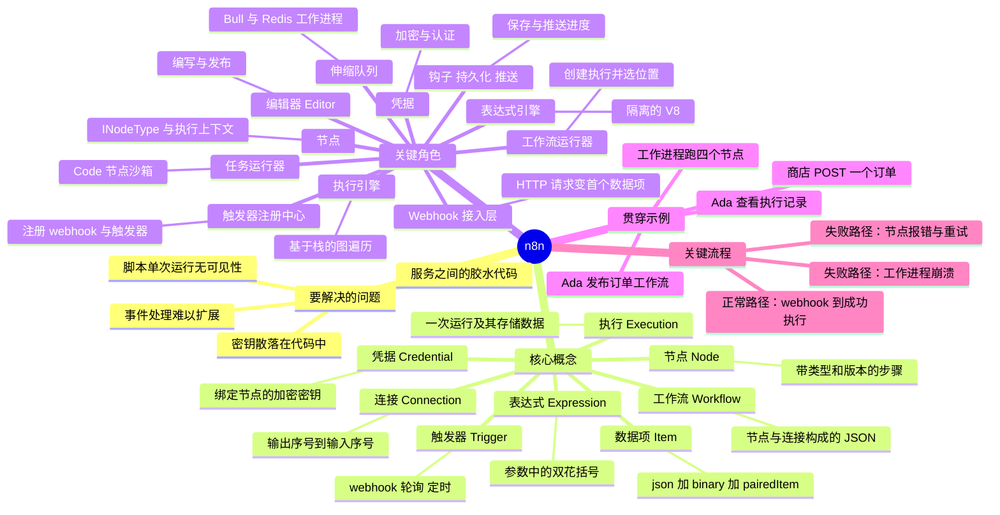

# n8n —— 认知心智模型指南

> **你在这里：** 整个指南包的入口。**读完本文件后**，你会在脑中形成 n8n 全貌的一张图（思维导图），并知道接下来该按什么顺序阅读。

**研究快照：** n8n `2.41.0`，提交 `c1463d0e`（2026-09-26），克隆自 `github.com/n8n-io/n8n` 的浅克隆仓库。
下文出现的所有源码路径均相对于该仓库中的 `packages/` 目录。

---

## 1. 本指南遵循的路径

```
为什么 → 是什么 → 概念地图 → 贯穿示例 → 深度剖析 → 完整走查
```

一个场景——**Ada 的订单接入工作流（Order-Intake Workflow）**——贯穿全文。每一篇深度剖析都会回扣到它（⚓标记），而最后的走查会以完整深度把它重新跑一遍。

| 阶段 | 文件 | 你将学到 |
|---|---|---|
| 为什么 | [01-why.md](01-why.md) | 让 n8n 的出现成为必然的那些痛点 |
| 是什么 | [02-what.md](02-what.md) | 定义、边界、生态位置 |
| 概念地图 | [03-concept-map.md](03-concept-map.md) | 8 个核心概念、11 个关键角色、一张协作总览图 |
| 贯穿示例 | [04-running-example.md](04-running-example.md) | Ada 的工作流，用 12 个步骤浅层走一遍 |
| 深度剖析 | [05-deep-dives/](05-deep-dives/) | 每个关键角色一篇（见下） |
| 完整走查 | [06-walkthrough.md](06-walkthrough.md) | 再跑一遍同一个示例，全程深入，带真实数据和一个可运行的玩具实现 |
| 后续步骤 | [07-next-steps.md](07-next-steps.md) | 练习题、源码入口、本指南*没有*覆盖的内容 |

深度剖析，按它们在贯穿示例中出场的顺序排列：

1. [编辑器 Editor](05-deep-dives/01-editor.md) —— 工作流在哪里被编写和发布
2. [触发器注册中心 Trigger Registry](05-deep-dives/02-trigger-registry.md) —— `ActiveWorkflowManager` + `WebhookService`
3. [Webhook 接入层 Webhook Ingress](05-deep-dives/03-webhook-ingress.md) —— 一个 HTTP（超文本传输协议，Hypertext Transfer Protocol）请求如何变成第一个数据项
4. [工作流运行器 Workflow Runner](05-deep-dives/04-workflow-runner.md) —— 创建执行记录，决定它*在哪里*运行
5. [伸缩队列 Scaling Queue](05-deep-dives/05-scaling-queue.md) —— Bull/Redis 的主进程 ↔ 工作进程拆分
6. [执行引擎 Execution Engine](05-deep-dives/06-execution-engine.md) —— `WorkflowExecute`，图遍历循环
7. [节点 Nodes](05-deep-dives/07-nodes.md) —— 节点类型、执行上下文、加载机制
8. [表达式引擎 Expression Engine](05-deep-dives/08-expression-engine.md) —— 沙箱中的 `{{ … }}`
9. [凭据 Credentials](05-deep-dives/09-credentials.md) —— 加密的密钥与请求认证
10. [任务运行器 Task Runner](05-deep-dives/10-task-runner.md) —— Code 节点真正在哪里执行
11. [生命周期、持久化与推送 Lifecycle, Persistence & Push](05-deep-dives/11-lifecycle-persistence-push.md) —— 钩子、执行记录、界面实时更新

---

## 2. 缩写对照表

| 缩写 | 英文全称 | 这里的含义 |
|---|---|---|
| API | Application Programming Interface（应用程序编程接口） | 一个可调用的接口，通常是 HTTP |
| HTTP | Hypertext Transfer Protocol（超文本传输协议） | webhook 与 HTTP Request 节点通信所用的协议 |
| JSON | JavaScript Object Notation（JavaScript 对象表示法） | 每个数据项、每个工作流的数据格式 |
| UI | User Interface（用户界面） | 浏览器中的编辑器 |
| ID | Identifier（标识符） | 例如执行 ID、工作流 ID |
| REST | Representational State Transfer（表征状态转移） | 编辑器 ↔ 服务端接口的风格 |
| SSE | Server-Sent Events（服务器发送事件） | 推送到编辑器的两种传输方式之一 |
| WS | WebSocket（WebSocket 协议） | 另一种推送传输方式；也用于运行器 ↔ 代理之间 |
| DB | Database（数据库） | SQLite 或 Postgres |
| AST | Abstract Syntax Tree（抽象语法树） | 表达式被解析后的形式，执行前会先被净化 |
| VM | Virtual Machine（虚拟机，这里指沙箱化的 JavaScript 上下文） | 表达式与 Code 节点的沙箱 |
| V8 | Google's JavaScript engine（谷歌的 JavaScript 引擎） | `isolated-vm` 在 V8 隔离实例中运行表达式 |
| AES | Advanced Encryption Standard（高级加密标准） | 凭据所用的加密算法 |
| CBC / GCM | Cipher Block Chaining / Galois-Counter Mode（密码分组链接模式 / 伽罗瓦计数器模式） | 加密组件支持的两种 AES 工作模式 |
| OAuth | Open Authorization（开放授权） | 许多凭据类型使用的基于令牌的委托登录机制 |
| DAG | Directed Acyclic Graph（有向无环图） | 工作流的直观心智图像（n8n 也允许回路，见[引擎深度剖析](05-deep-dives/06-execution-engine.md)） |
| CORS | Cross-Origin Resource Sharing（跨域资源共享） | 由 webhook 请求处理器处理 |
| IPC | Inter-Process Communication（进程间通信） | 运行器 ↔ 代理之间 |
| MCP | Model Context Protocol（模型上下文协议） | n8n 可以提供的一种 AI（人工智能，Artificial Intelligence）工具协议；本指南不涉及 |

---

## 3. 一张图看完整个疆域



*图注：n8n 中存在哪些概念和组件、它们如何分组——在进入其他任何文件之前先读这张图。*

---

## 4. 阅读路径建议

- **第一次接触 n8n：** `01 → 02 → 03 → 04`，然后按顺序读完深度剖析，最后读 `06`。
- **有经验的工程师：** 略读 `01–02`，精读 `03`（关键角色表中的"不做"一列），直接跳到深度剖析 `04`、`05`、`06`、`09`、`11`。
- **只想了解运行时：** `04-running-example` → 深度剖析 03（接入层）、04（运行器）、05（队列）、06（引擎）→ `06-walkthrough`。
- **只想跑点代码试试：** [`examples/mini-engine.mjs`](examples/mini-engine.mjs)——一个约 90 行、模拟引擎循环的玩具实现（`node mini-engine.mjs`）。

**下一步：** [01-why.md](01-why.md)
