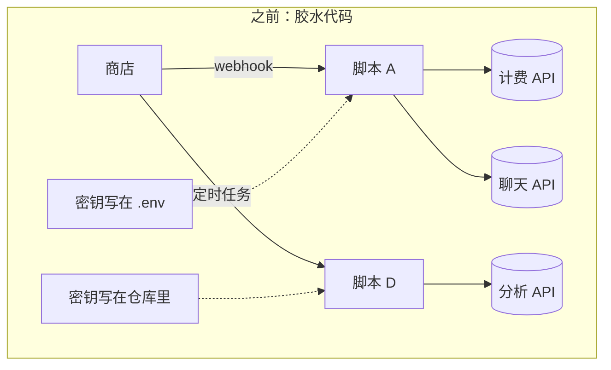
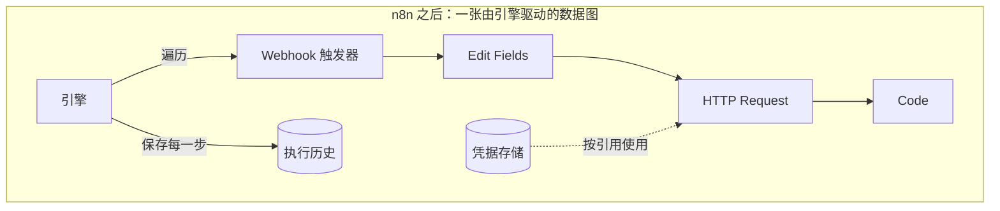

# 01 —— n8n 为何存在

> **你在这里：** 第 1 阶段（共 6 阶段）——问题本身。
>
> **读完本文件后**，你应该能说出"如果 n8n 不存在，总会有人把它发明出来"，并且能大致预测出它必须具备哪些能力。

缩写对照表：**API**（Application Programming Interface，应用程序编程接口）、**HTTP**（Hypertext Transfer Protocol，超文本传输协议）、**SaaS**（Software as a Service，软件即服务）、**SQL**（Structured Query Language，结构化查询语言）。

---

## 1. 在它出现之前的世界

一家公司经营一家商店。新订单到来时，需要有人（a）在计费系统中创建发票，（b）通知团队，（c）记录下来用于分析。每个系统都有自己的 HTTP 接口（API）、认证方式、速率限制和失败模式。

通常的做法是**胶水代码**：一段脚本、一个定时任务（cron job）、一个小服务。这在一开始能用——直到：

| 痛点 | 实际表现 |
|---|---|
| **每个集成都要重新造轮子** | 每接入一个新服务，就要重新写一遍认证、分页、重试、错误映射 |
| **毫无可见性** | 脚本在凌晨三点挂了；是哪一步出的问题？输入是什么？只有日志——前提是你记得写日志 |
| **密钥到处散落** | API 密钥散落在环境变量文件、代码仓库和聊天消息里 |
| **只有开发者能改** | 真正理解业务流程的人，读不懂也改不了这段脚本 |
| **扩容全靠自己搭** | 事件量暴增时需要队列、工作进程、背压控制——每段脚本都要重新发明一遍 |
| **接入事件很繁琐** | 要向第三方注册 webhook、保持它存活、把请求路由到正确的脚本 |

*图注：痛点长什么样——每一条箭头都是手写代码，各自带着自己的密钥、重试逻辑和日志。*

## 2. 为什么现有方案都不够

| 替代方案 | 擅长之处 | 在这个问题上的不足 |
|---|---|---|
| **手写脚本 / 微服务** | 完全可控 | 上面痛点表里的全部内容 |
| **托管式无代码自动化 SaaS**（Zapier 类产品） | 零搭建成本，集成目录庞大 | 数据和密钥存在别人的云上；按用量计费；自定义代码的空间有限 |
| **基于流程的可视化工具**（Node-RED 类产品） | 可视化连线，可自托管 | 面向设备/消息流场景；在"每次运行的历史记录""凭据管理""多用户项目"方面较弱 |
| **批处理编排器**（Airflow 类产品） | 以代码方式编写有依赖关系的定时流水线 | 代码优先、批处理优先；不适合"一个 HTTP 事件到来、立刻响应"这种业务自动化，也不适合非开发者 |
| **持久化执行引擎**（Temporal 类产品） | 保证长时间代码工作流最终完成 | 工作流本身要*用代码编写*；没有现成的集成目录 |

> 以上是对这几类方案的概括性描述，而非对具体产品的评测。

## 3. 塑造这个方案的约束条件

1. **可自托管、可审查。** 数据和密钥必须能够留在公司自己的基础设施上。（该仓库的 `LICENSE.md` 把自己的许可称为 "Sustainable Use License"（可持续使用许可），文件名或目录名中带 `.ee.` 的部分则属于另一份企业许可。）
2. **既可视化又可编程。** 非开发者需要一块画布；开发者需要一个逃生舱口（Code 节点、自定义节点）。
3. **把集成做成目录。** 认证、分页和各种怪癖应该针对每个服务解决一次，而不是每个工作流解决一次。（仅 `nodes-base` 这一个包，在本次研究的提交版本中就有 308 个节点目录和 412 个凭据文件。）
4. **每次运行都可审查。** 事后你应该能看到每一步、每一次运行时的数据。
5. **密钥是一等公民。** 加密存储，按名称引用，绝不粘贴进工作流的 JSON 里。
6. **能横向扩容。** 在笔记本电脑上用 SQLite 跑起来；在生产环境用 Postgres + Redis + 多个工作进程跑起来。

## 4. 由此推导出的设计

把这些约束条件放在一起，形状几乎是被逼出来的：

- 把业务流程表示为**数据**（一张由类型化步骤组成的图）——这样画布就能编辑它，数据库就能存储它，工作进程就能加载它。
- 让每一步都是目录中的一个**节点**，遵循统一契约：*输入数据项 → 输出数据项*。
- 把密钥放进独立的**凭据**存储，让节点通过引用来使用它们。
- 给每一步一种方式，让它能基于前面步骤的结果计算值：**表达式**。
- 用**触发器**把外部事件转化为最初的数据项。
- 把每一次**执行**连同每一步的数据一起存下来。
- 让执行可以**在进程内运行，或在队列后面交给工作进程运行**。

*图注：有了 n8n 之后的同一个流程——图本身就是数据；一个引擎，一个凭据存储，一份历史记录。*

**质量检查：** 你现在能否预测出，n8n 需要一个*节点契约*、一个*凭据存储*、一门*表达式语言*、一套*触发器机制*和一份*执行记录*？这些正好对应 [03-concept-map.md](03-concept-map.md) 里的概念。

**下一步：** [02-what.md](02-what.md) · **返回：** [00-overview.md](00-overview.md)
