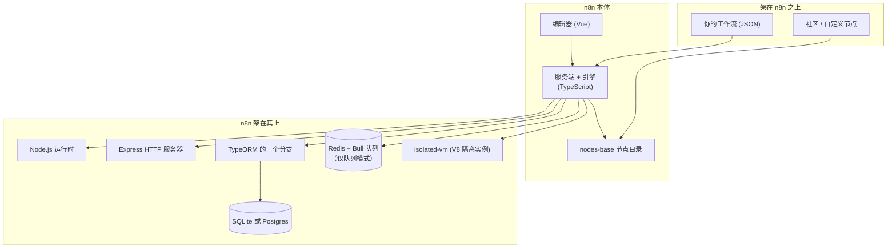

# 02 —— n8n 是什么

> **你在这里：** 第 2 阶段（共 6 阶段）——定义、边界、生态位置。
>
> **读完本文件后**，在还不知道 n8n 内部如何工作的情况下，你就能正确地对它归类，并判断它是否适合解决某个具体问题。

缩写对照表：**ETL**（Extract-Transform-Load，抽取-转换-加载）、**HTTP**（Hypertext Transfer Protocol，超文本传输协议）、**JSON**（JavaScript Object Notation，JavaScript 对象表示法）、**SQL**（Structured Query Language，结构化查询语言）、**ORM**（Object-Relational Mapper，对象关系映射器）、**DB**（Database，数据库）、**V8**（Google's JavaScript engine，谷歌的 JavaScript 引擎）、**GB**（Gigabyte，吉字节）、**CSV**（Comma-Separated Values，逗号分隔值）、**EE**（Enterprise Edition，企业版）。

---

## 1. 一句话定义

> **n8n 是一个可自托管的工作流自动化平台，它把业务流程存储为一张由节点组成的图——节点可以是预置集成，也可以是代码步骤——数据项以 JSON 格式沿连接流动，由一个 Node.js 引擎执行；该引擎同时负责触发器、凭据和每次运行的历史记录，从而消除集成所需的胶水代码。**

对应到第 1 阶段：*胶水代码* → 节点；*毫无可见性* → 按次运行的历史记录；*密钥散落* → 凭据；*事件接入* → 触发器；*扩容* → 队列模式。

## 2. 边界——它**不是**什么

| 它不是…… | 因为…… |
|---|---|
| 消息代理（如 Kafka、RabbitMQ） | 它只是*消费*事件并*调用*服务，不提供持久化的发布/订阅主题。（Redis 在这里只是它内部的任务队列。） |
| 批处理/ETL 编排器 | 数据以每次执行中的内存数据项形式流动，而不是以数据仓库中的分区数据集形式流动 |
| 确定性重放式的持久化执行引擎 | 它会持久化运行数据（总在结束时持久化；可选地在每个节点之后持久化；在 `Wait` 节点处持久化以便恢复执行），但它不会通过重放代码来重建状态。被崩溃中断的执行会被恢复逻辑标记为 `crashed`，而不会被透明地续跑 |
| 通用型应用框架 | 它承载的是*工作流*；除了 webhook 之外，你无法在它的 HTTP 层之上搭建任意服务 |
| 已经完成的"引擎 v2" | `packages/@n8n/engine` 在自述中说自己"目前只是一个脚手架，尚未接入 n8n"——它还不是可用的引擎。本指南记录的是真正在运行的引擎（`WorkflowExecute`） |

## 3. 在生态系统中的位置

*图注：谁依赖谁——n8n 本质上是一个 Node.js 服务端加一个 Vue 编辑器，背后是一个 SQL 数据库，以及可选的 Redis。*

仓库中的证据：数据库类型为 `sqlite`（默认）或 `postgresdb`（`@n8n/config/src/configs/database.config.ts`）；队列实现是 `bull`（`cli/src/scaling/scaling.service.ts`）；表达式默认使用基于 `isolated-vm` 的 `vm` 引擎（`@n8n/config/src/configs/expression-engine.config.ts`）；编辑器位于 `frontend/editor-ui`。

### 最接近的邻居（各一句话）

| 邻居 | n8n 与它的不同之处 |
|---|---|
| Zapier / Make | 面向相同的用户群；n8n 可自托管，并且暴露了代码逃生舱口和完整的执行数据 |
| Node-RED | 同样是节点连线式，但 n8n 更聚焦于业务集成：凭据、多用户项目、按次执行的历史记录 |
| Apache Airflow | Airflow = 用 Python 编写的定时批处理 DAG（有向无环图）；n8n = 以可视化方式编写的事件驱动图 |
| Temporal | Temporal = 以代码定义、支持重放的持久化工作流；n8n = 以数据定义、带集成目录的图 |

## 4. 包的分布图（本指南全文都会用到）

| 包（位于 `packages/` 下） | 角色 |
|---|---|
| `workflow`（`n8n-workflow`） | **词汇表**：`Workflow`、`INode`、`IConnections`、`INodeExecutionData`、`INodeType`、表达式——由后端和编辑器共用 |
| `core`（`n8n-core`） | **引擎**：`WorkflowExecute`、节点执行上下文、请求辅助函数、`Credentials`/加密组件 |
| `cli`（`n8n`） | **服务端**：HTTP 路由、webhook、`WorkflowRunner`、伸缩逻辑、数据库接线、`start`/`worker`/`webhook` 命令 |
| `nodes-base` | **节点目录**：约 300 种集成、约 400 种凭据类型 |
| `@n8n/nodes-langchain` | AI 节点（本指南不涉及） |
| `@n8n/task-runner` | 执行 Code 节点的沙箱进程 |
| `@n8n/expression-runtime`、`@n8n/tournament` | 表达式解析与隔离求值 |
| `@n8n/db` | 实体与仓储（`WorkflowEntity`、`ExecutionEntity`、`WebhookEntity`、`CredentialsEntity`） |
| `frontend/editor-ui` | Vue 编辑器 |

**质量检查：** 现在你能否回答同事"当 Shopify 订单到来时，创建发票并在 Slack 通知团队"这个场景是否适合用 n8n？（能。）那"每晚把 10 GB 的 CSV（逗号分隔值）文件流式导入数据仓库"呢？（大概率不适合——那是批处理 ETL。）

**下一步：** [03-concept-map.md](03-concept-map.md) · **返回：** [01-why.md](01-why.md) · [总览](00-overview.md)
