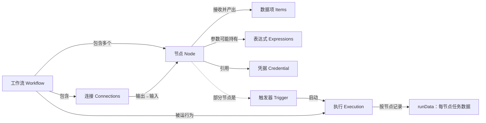
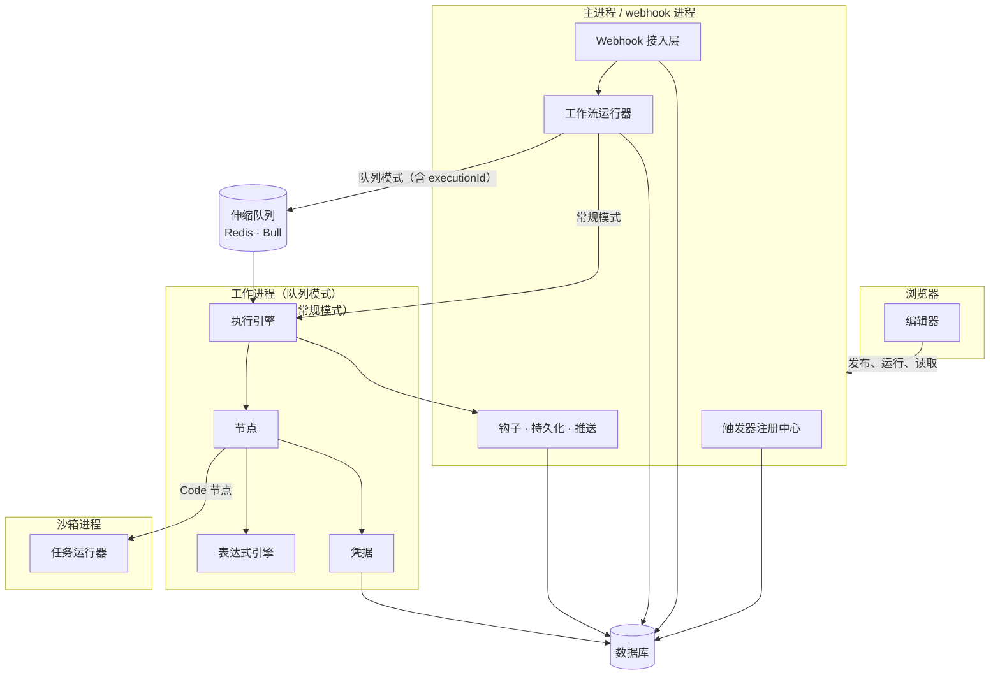
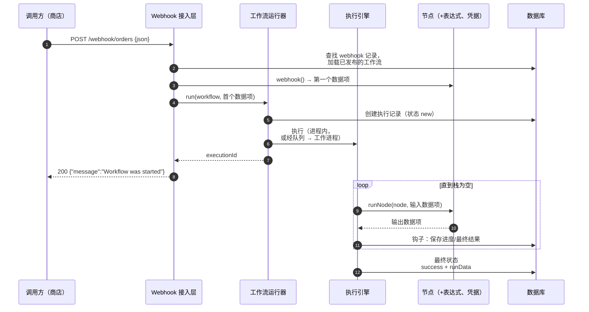

# 03 —— 概念地图（先铺开广度）

> **你在这里：** 第 3 阶段（共 6 阶段）——把每一个核心概念、每一个关键角色都浅浅地过一遍。
> **读完本文件后**，你就能在白板上画出 n8n 的架构图，并为每个组件的存在找到理由——尽管此时你还不知道任何一个组件内部是如何工作的。

本文用到的缩写：**HTTP**（Hypertext Transfer Protocol，超文本传输协议）、**JSON**（JavaScript Object Notation，JavaScript 对象表示法）、**API**（Application Programming Interface，应用程序编程接口）、**ID**（Identifier，标识符）、**UI**（User Interface，用户界面）、**DB**（Database，数据库）、**REST**（Representational State Transfer，表征状态转移）、**V8**（Google's JavaScript engine，谷歌的 JavaScript 引擎）。完整表格见 [00-overview](00-overview.md#2-缩写对照表)。

---

## 3.1 领域映射——从问题到概念

按**依赖顺序**引入（每一行只依赖在它之前出现过的行）。

| # | 现实世界中的问题要素 | n8n 概念 | 一句话定义 | 为什么要用这个抽象 | 权威来源 |
|---|---|---|---|---|---|
| 1 | "业务流程中的一个步骤" | **节点 Node** | 一个带类型、带版本的单元（`INode` = 配置，`INodeType` = 行为），把输入数据项变成输出数据项 | 统一的契约让 300 多种集成和引擎能够互通 | `workflow/src/interfaces.ts` —— `INode`（第 1730 行）、`INodeType`（第 2559 行） |
| 2 | "在流程中流动的一条记录" | **数据项 Item** | `INodeExecutionData`：`{ json, binary?, pairedItem?, error? }` | 按记录处理、溯源链（`pairedItem`）、二进制附件——都无需改动节点代码 | `interfaces.ts` 第 1844 行 |
| 3 | "哪一步给哪一步供数据" | **连接 Connection** | `IConnections`：源节点 → 输出序号 → `{ node, type, index }` 列表 | 让流程成为一张图，支持分支（IF）、合并（多输入）、子节点连线 | `interfaces.ts` 第 509 行 |
| 4 | "整个流程" | **工作流 Workflow** | `IWorkflowBase`：`nodes[]` + `connections` + 设置；运行时被 `Workflow` 类包装，该类会预先计算出 `connectionsBySourceNode` / `connectionsByDestinationNode` | 是数据而非代码 → 可在画布上编辑、可存储、可版本化、可被任意工作进程加载 | `interfaces.ts` 第 3667 行，`workflow/src/workflow.ts` |
| 5 | "外部发生了某件事" | **触发器 Trigger** | 一种*启动*执行的节点：webhook（接收 HTTP 请求）、poll（周期性询问）或 trigger（长驻监听器/定时器） | 把*事件接入*和*数据处理*分离开；让平台能在发布时注册/注销接入点 | `INodeType.webhook / poll / trigger` |
| 6 | "使用前面某一步产生的数据" | **表达式 Expression** | 一个以 `=` 开头、内含 `{{ … }}` JavaScript 代码的参数字符串，针对 `$json`、`$node[...]` 等求值 | 无需编写 Code 节点即可动态接线；在沙箱中求值 | `workflow/src/expression.ts` |
| 7 | "那个服务的 API 密钥" | **凭据 Credential** | 一条加密的、带类型的记录（`ICredentialType` 定义它的字段以及如何认证），节点通过 `{ id, name }` 引用它 | 密钥存在工作流 JSON 之外，可按项目共享，只在调用时才解密 | `interfaces.ts` 第 417 行，`core/src/credentials.ts` |
| 8 | "流程的一次运行" | **执行 Execution** | 一台 `IRunExecutionData` 状态机（`nodeExecutionStack`、`waitingExecution`、`resultData.runData`），加上一条带状态的数据库记录 | 让运行可恢复、可审查、可在进程之间转移 | `workflow/src/run-execution-data/run-execution-data.v1.ts` |

**派生而非核心的概念：** *pin data*（固定的测试输出）、*static data*（按工作流持久化的键值对，例如 webhook id）、*执行模式*（`manual`、`webhook`、`trigger` 等）、*已发布/活动版本*、*子工作流*、*错误工作流*、*子节点*（AI，人工智能，Artificial Intelligence）。

*图注：八个概念之间的关系——工作流由节点和连接组成；触发器启动执行；每次执行都记录下每个节点产出了什么。*

## 3.2 关键角色——从概念到组件

每个关键角色都在 `05-deep-dives/` 中有专门的深度剖析，顺序与它们在贯穿示例中出场的顺序一致。

| # | 关键角色 | **负责**（唯一职责） | **掌握** | **不做** | 位置（均位于 `packages/` 下） |
|---|---|---|---|---|---|
| 1 | **编辑器 Editor** | 编写、测试、发布工作流；展示执行记录 | 正在编辑的工作流（Vue 状态仓库）、通过推送得到的节点实时状态 | 从不执行生产环境的工作流；从不看到解密后的密钥 | `frontend/editor-ui`；服务端部分见 `cli/src/workflows/workflows.controller.ts`、`cli/src/push` |
| 2 | **触发器注册中心 Trigger Registry** | 把"已发布"变成真正的事件接入：webhook 数据行 + 内存中的触发器/轮询器 | 哪些工作流处于活动状态；`webhook_entity` 数据行；激活错误 | 不处理请求，不运行工作流 | `cli/src/active-workflow-manager.ts`、`cli/src/webhooks/webhook.service.ts` |
| 3 | **Webhook 接入层 Webhook Ingress** | 把一个 HTTP 请求变成最初的数据项和一个 HTTP 响应 | 路由 → webhook 数据行 → 工作流 的映射；响应模式 | 不遍历图；不决定运行发生在哪里 | `cli/src/webhooks/live-webhooks.ts`、`webhook-helpers.ts`、`webhook-request-handler.ts` |
| 4 | **工作流运行器 Workflow Runner** | 创建一次执行，并决定它*在哪里*运行（进程内 vs. 队列） | 执行 ID、超时设置、响应 Promise（通过 `ActiveExecutions`） | 不知道节点内部如何运行 | `cli/src/workflow-runner.ts`、`cli/src/active-executions.ts` |
| 5 | **伸缩队列 Scaling Queue** | 把执行 ID 从主进程搬到工作进程（基于 Redis 的 Bull），再把结果转发回去 | 任务（job）、工作进程并发数、Leader 选举 | 不在任务里携带运行数据——数据走数据库 | `cli/src/scaling/*` |
| 6 | **执行引擎 Execution Engine** | 遍历图：下一个该跑哪个节点，用什么数据 | `IRunExecutionData`（栈、等待中的节点、`runData`） | 不知道节点具体*做什么*，也不管持久化/HTTP | `core/src/execution-engine/workflow-execute.ts` |
| 7 | **节点 Nodes** | 每一步真正的工作，通过统一的上下文接口完成 | 自己的参数和输入数据项 | 不选择下一个节点；不保存自己的输出 | `nodes-base/nodes/*`、`core/.../node-execution-context/*`、`cli/src/node-types.ts`、`cli/src/load-nodes-and-credentials.ts` |
| 8 | **表达式引擎 Expression Engine** | 针对本次运行的数据，安全地求值 `{{ … }}` | 一个覆盖在 `runData` 之上的数据代理；隔离实例池 | 不从网络取数据；无法触达宿主进程 | `workflow/src/expression.ts`、`@n8n/expression-runtime`、`@n8n/tournament` |
| 9 | **凭据 Credentials** | 加密、存储、解密密钥，并把密钥应用到请求上 | 加密密钥、凭据类型、访问策略 | 绝不把密钥放进工作流 JSON 或执行数据里 | `core/src/credentials.ts`、`core/src/encryption`、`cli/src/credentials-helper.ts` |
| 10 | **任务运行器 Task Runner** | 在隔离进程中运行 Code 节点里用户写的 JavaScript/Python | 任务报价（offer）、脚本、被请求的输入数据 | 不持有工作流状态；需要数据时向主进程索要 | `@n8n/task-runner`、`cli/src/task-runners/*` |
| 11 | **生命周期钩子、持久化与推送** | 响应执行事件：保存、推送到界面、统计、触发错误工作流 | 保存设置、`pushRef`、执行记录 | 不影响哪些节点会运行 | `cli/src/execution-lifecycle/*`、`@n8n/db` 仓储、`cli/src/push` |

*图注：十一个关键角色分别运行在哪些进程里——数据库是共享内存，Redis 只携带任务 ID。*

## 3.3 协作总览

正常路径：**一个 webhook 订单到来，变成一条已保存的执行记录。**

*图注：谁调用谁、顺序如何、正常路径上每一跳传递了什么数据。*

需要记住名字的两条失败/边缘流程（具体机制留到深度剖析里再讲）：

1. **节点报错**——重试 → `onError` 路由（`continueRegularOutput` / `continueErrorOutput` / `stopWorkflow`）→ 执行状态变为 `error` → 触发错误工作流。见[执行引擎](05-deep-dives/06-execution-engine.md)。
2. **工作进程或进程崩溃**——执行记录会停留在 `running` 状态；恢复逻辑会把它标记为 `crashed`。见[伸缩队列](05-deep-dives/05-scaling-queue.md)和[生命周期](05-deep-dives/11-lifecycle-persistence-push.md)。

**质量检查：** 指着这张图解释一下，为什么队列里只携带一个执行 ID，以及为什么数据库被画成共享枢纽。（答案在[05-scaling-queue](05-deep-dives/05-scaling-queue.md)里。）

**下一步：** [04-running-example.md](04-running-example.md) · **返回：** [02-what.md](02-what.md) · [总览](00-overview.md)
