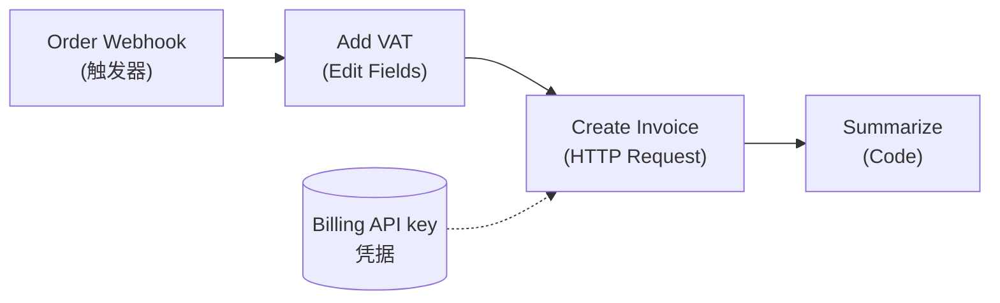
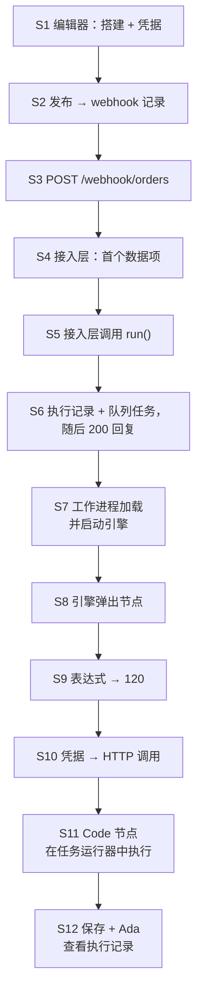

# 04 —— 贯穿示例：Ada 的订单接入工作流

> **你在这里：** 第 4 阶段（共 6 阶段）——这条贯穿全文的主线场景，沿着概念地图*浅浅地*走一遍。
> **读完本文件后**，你应该能凭记忆复述这个场景，并说出每一步舞台上站着哪个组件——尽管你还不了解任何一个组件的内部细节。

缩写：**HTTP**（Hypertext Transfer Protocol，超文本传输协议）、**JSON**（JavaScript Object Notation，JavaScript 对象表示法）、**API**（Application Programming Interface，应用程序编程接口）、**UI**（User Interface，用户界面）、**ID**（Identifier，标识符）、**DB**（Database，数据库）。

---

## 三句话讲完这个场景

*Ada* 在**编辑器**里搭建了一个工作流：一笔订单到达一个 **webhook**，一个 **Edit Fields** 节点用一条**表达式**加上增值税（VAT），一个 **HTTP Request** 节点用一份存好的**凭据**创建发票，一个 **Code** 节点写一段摘要。她把它**发布**出去。随后，商店后端向 `/webhook/orders` 发送一个 POST 请求；运行在**队列模式**下的 n8n 在一个**工作进程**上执行这四个节点，Ada 读取已保存的**执行**记录。

这个场景覆盖了**每一个概念**（工作流、节点、数据项、连接、触发器、表达式、凭据、执行）和**每一个关键角色**（全部 11 个）。

## 这个工作流（作为数据）

```json
{
  "name": "Order intake",
  "nodes": [
    { "id": "n1", "name": "Order Webhook", "type": "n8n-nodes-base.webhook",  "typeVersion": 2,
      "webhookId": "6f1c2b7e-0000-4000-8000-000000000001",
      "parameters": { "httpMethod": "POST", "path": "orders" } },
    { "id": "n2", "name": "Add VAT",       "type": "n8n-nodes-base.set",      "typeVersion": 3.4,
      "parameters": { "assignments": { "assignments": [
        { "name": "total", "type": "number", "value": "={{ $json.body.amount * 1.2 }}" } ] } } },
    { "id": "n3", "name": "Create Invoice","type": "n8n-nodes-base.httpRequest","typeVersion": 4.2,
      "parameters": { "method": "POST", "url": "https://billing.example.com/invoices",
                      "authentication": "genericCredentialType", "genericAuthType": "httpHeaderAuth",
                      "sendBody": true, "bodyParameters": { "parameters": [
                        { "name": "total", "value": "={{ $json.total }}" } ] } },
      "credentials": { "httpHeaderAuth": { "id": "cred42", "name": "Billing API key" } } },
    { "id": "n4", "name": "Summarize",     "type": "n8n-nodes-base.code",     "typeVersion": 2,
      "parameters": { "jsCode": "return [{ json: { summary: `Invoice ${$input.first().json.invoiceId}` } }];" } }
  ],
  "connections": {
    "Order Webhook":  { "main": [[ { "node": "Add VAT",        "type": "main", "index": 0 } ]] },
    "Add VAT":        { "main": [[ { "node": "Create Invoice", "type": "main", "index": 0 } ]] },
    "Create Invoice": { "main": [[ { "node": "Summarize",      "type": "main", "index": 0 } ]] }
  }
}
```

> 示意性数据：这里的结构（`nodes`、`connections`、`parameters`、`credentials: {type: {id, name}}`）与 `workflow/src/interfaces.ts` 中的接口一致；真实 Set / HTTP Request 节点的具体参数名和 `typeVersion` 编号会因版本而异，这里做了简化。节点名称（`Order Webhook`、`Add VAT`、`Create Invoice`、`Summarize`）是 Ada 自己起的，在全文中保持原样不译，方便与源码引用对照。



*图注：Ada 的四节点工作流——本指南之后每一篇文件都会复用这同一张图。*

## 12 个步骤，浅浅地过一遍

步骤编号为 **S1–S12**；每篇深度剖析都会说明自己负责哪几步。

| 步骤 | 发生了什么 | 舞台上的角色 | 出现的概念 |
|---|---|---|---|
| **S1** | Ada 把四个节点拖到画布上，把它们连起来，并创建了名为 "Billing API key" 的**凭据**。测试运行会使用一个*测试*用的 webhook 地址。 | **编辑器** | 工作流、节点、连接、凭据 |
| **S2** | Ada 点击**发布**。服务端加载已发布版本，构建一个 `Workflow` 对象，向每个节点询问它需要哪些 webhook；一行 `(POST, "orders") → 工作流, 节点` 的记录被插入 `webhook_entity` 表。 | **触发器注册中心** | 触发器 |
| **S3** | 商店后端发送 `POST /webhook/orders`，内容为 `{"customer":"ACME","amount":100}`。 | （外部） | —— |
| **S4** | Express 把请求路由给 **LiveWebhooks**，它查到这行记录，加载已发布的工作流，并调用 Webhook 节点的 `webhook()` 方法 → 这个请求就变成了**第一个数据项**（`json.body`、`json.headers`、`json.query`）。 | **Webhook 接入层** + **节点** | 数据项 |
| **S5** | 接入层调用 `WorkflowRunner.run(...)`，并传入这个第一个数据项。（默认的响应模式 `onReceived` 会*一旦 `run` 返回新的执行 ID 就立刻*回复调用方——它不会等工作流跑完。） | **Webhook 接入层** → **工作流运行器** | 执行 |
| **S6** | 运行器检查凭据访问权限，插入一条**执行记录**（状态 `new`）；由于 n8n 跑在队列模式下，它还会往 Redis 里的 Bull 队列中添加一个**任务** `{ executionId, workflowId, … }`。运行器返回执行 ID；此时接入层才把此前延迟的回复 `{"message":"Workflow was started"}` 发给商店。 | **工作流运行器** + **伸缩队列** | 执行 |
| **S7** | 一个**工作进程**取到这个任务，从数据库加载执行记录和工作流，把状态标记为 `running`，构建出一个 `Workflow` 对象，接好生命周期钩子，然后把它交给 `WorkflowExecute`。 | **伸缩队列** → **执行引擎** | —— |
| **S8** | **引擎**循环弹出 `Order Webhook`（它的数据已经在那了），记录它的输出，并把 `Add VAT` 压入执行栈。 | **执行引擎** | 连接 |
| **S9** | `Add VAT` 请求参数 `total`；值 `={{ $json.body.amount * 1.2 }}` 被交给**表达式引擎**，在一个 V8 隔离实例里求值 → 得到 `120`。 | **节点** + **表达式引擎** | 表达式 |
| **S10** | `Create Invoice` 请求它的凭据；**凭据**层解密出 "Billing API key"，把它加到请求头里，HTTP 调用返回 `{ invoiceId: "INV-1001" }`。 | **节点** + **凭据** | 凭据 |
| **S11** | `Summarize`（Code 节点）把脚本和一份数据请求发给**任务运行器**，后者在一个沙箱进程里执行它，再把数据项返回。 | **节点** + **任务运行器** | —— |
| **S12** | 每个节点跑完后都会触发**钩子**（如果开启了"保存进度"就保存一次；如果存在 `pushRef` 就推送到界面——生产环境的运行没有这个）。最后，工作进程写入最终的 `runData` 和状态 `success`；Ada 打开**执行记录**页面，看到每个节点的输入和输出。 | **生命周期、持久化与推送** | 执行 |



*图注：本指南的主线——从画一个工作流，到读出它的执行记录，一共十二步。*

## 两个需要记住的变体

- **常规模式**（没有 Redis）：S6–S7 会合并为一步——同一个进程直接运行 `WorkflowExecute`（`runMainProcess`）。
- **手动测试运行**（Ada 在编辑器里按下*执行工作流*）：入口不同（`POST /workflows/:id/run`），用的是*测试*webhook，但从 S8 开始走的是**同一个引擎**。这就是为什么"你在编辑器里看到的，就是生产环境会执行的"这句话（几乎）成立。

**质量检查：** 不看上文，列出 S4、S6、S9、S11 这几步舞台上分别是谁。（接入层、运行器+队列、表达式引擎、任务运行器。）

**下一步：** [深度剖析 1 —— 编辑器](05-deep-dives/01-editor.md) · **返回：** [03-concept-map.md](03-concept-map.md) · [总览](00-overview.md)
