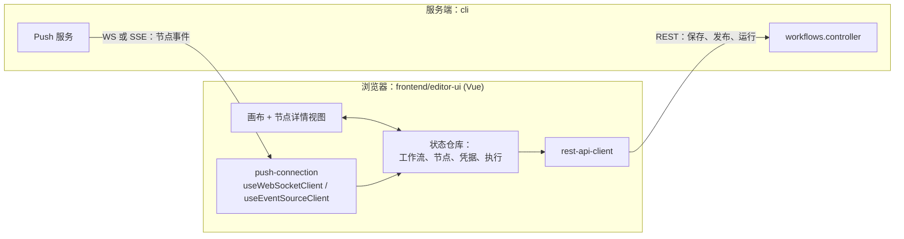

# 深度剖析 1 —— 编辑器 Editor

> **你在这里：** 第 5 阶段，第 1/11 篇深度剖析——这是一个*配角*，所以本篇比较短。
> **读完本文件后**，你会知道编辑器做什么、不做什么，它与服务端的哪些接口对话，以及节点的实时进度是怎么传到浏览器的。

缩写：**UI**（User Interface，用户界面）、**REST**（Representational State Transfer，表征状态转移）、**API**（Application Programming Interface，应用程序编程接口）、**WS**（WebSocket，WebSocket 协议）、**SSE**（Server-Sent Events，服务器发送事件）、**ID**（Identifier，标识符）、**JSON**（JavaScript Object Notation，JavaScript 对象表示法）、**HTTP**（Hypertext Transfer Protocol，超文本传输协议）、**DTO**（Data Transfer Object，数据传输对象）。

---

## 角色回顾

**负责：** 编写工作流（节点、连接、参数、表达式）、创建凭据、触发*手动*运行、发布、展示执行记录。
**出现于：** **S1**（搭建 + 凭据）、**S2**（发布）、**S12**（读取执行记录）。

## 内部设计



*图注：编辑器在本地编辑状态，通过 REST 来持久化或运行，再通过一条推送通道监听实时进度。*

1. **编辑器编辑的是一份 JSON 文档。** 它保存的内容正是 `IWorkflowBase`：`nodes` 和 `connections`（见 [03-concept-map](../03-concept-map.md)）。不存在另一套"编辑器专属格式"。
2. **与服务端之间有两条通道。**
   - *REST* 用于发送命令：`POST /workflows/:id/run`（手动执行）、`POST /workflows/:id/activate`（也就是"发布"按钮——代码里仍然叫 *activate*，界面上写的是"发布"）、`PATCH /workflows/:id`（保存）。
   - *推送*（WebSocket 或 Server-Sent Events）用于服务端主动发起的事件：`executionStarted`、`nodeExecuteBefore`、`nodeExecuteAfter`、`executionFinished`……（`frontend/editor-ui/src/app/push-connection/`、`cli/src/push/websocket.push.ts`、`sse.push.ts`）。
3. **`pushRef` 把一个浏览器标签页和它发起的运行绑在一起。** 编辑器在 REST 调用上带一个 `push-ref` 请求头；服务端把它一路带入执行过程，[钩子层](11-lifecycle-persistence-push.md)只会把节点事件推送给这一个标签页。
4. **手动运行受到限制，且以数据库为准。** `WorkflowsController.runManually`（`cli/src/workflows/workflows.controller.ts` 第 506 行）总是从数据库加载已存储的工作流——注释里写明这是为了"防止执行任意的工作流定义"——然后调用 `WorkflowExecutionService.executeManually`（`workflow-execution.service.ts` 第 344 行），它会把工作流标记为测试用的非活动状态，决定是部分执行还是完整执行，并且如果起始触发器是 webhook，还会注册一个*测试 webhook*（`TestWebhooks`，路径前缀 `webhook-test`），等待一次调用。
5. **发布需要特定权限范围。** 激活路由上挂着 `@ProjectScope('workflow:publish')`，外加一次协作写锁检查（`collaborationService.validateWriteLock`），防止两个人同时编辑互相覆盖。请求体中带有 `versionId` 和 `expectedChecksum`。

## 交互关系

| 方向 | 契约 |
|---|---|
| 编辑器 → 服务端 | 会话 Cookie + `push-ref` 请求头；JSON 请求体由 DTO（数据传输对象）校验（`ManualRunDto`、`ActivateWorkflowDto`） |
| 服务端 → 编辑器 | 带类型的推送消息（`PushMessage`），投递给指定的 `pushRef` |
| 编辑器 ↔ 凭据 | 发送凭据的*字段*去创建/更新；读取时*绝不*返回明文（见[凭据深度剖析](09-credentials.md)） |

## ⚓ 回到示例

**S1。** Ada 的画布变化实时存在浏览器状态仓库里。她保存时，`PATCH /workflows/:id` 会发送 `{ nodes, connections, … }`。她创建 "Billing API key" 时，凭据字段会发到凭据接口，并在服务端完成加密（S10 会展示解密过程）。

**S2。** 点击*发布*会发送：

```http
POST /rest/workflows/<workflowId>/activate
push-ref: <标签页 id>
Content-Type: application/json

{ "versionId": "<uuid>", "expectedChecksum": "<hash>" }
```

控制器校验写锁，调用 `workflowService.activateWorkflow(...)`，最终落到 `ActiveWorkflowManager.add(...)`——接下来交给[触发器注册中心](02-trigger-registry.md)接手。

**S12。** 打开*执行记录*页面就是一次对已存储数据的 REST 读取（生产环境的运行不带 `pushRef`，所以没有任何实时推送）。

> `rest` 是默认的 REST 接口前缀（`@n8n/config/.../endpoints.config.ts`）。

## 失败行为

| 失败情形 | 行为 |
|---|---|
| 推送连接断开 | 编辑器会自动重连（`useReconnectTimer`、`useHeartbeat`）；事件携带一个按运行计次的 `sequenceNumber`，让迟到/乱序的事件不会渲染出错误的"当前正在执行"节点 |
| 两个人同时编辑同一个工作流 | 发布时做写锁校验；`expectedChecksum` 能检测出过期的副本 |
| 测试 webhook 始终没被调用 | 测试 webhook 的注册是临时的（`cli/src/constants.ts` 中 `TEST_WEBHOOK_TIMEOUT` = 2 分钟）；生产环境的 webhook 是独立的数据库记录 |

**下一步：** [02 —— 触发器注册中心](02-trigger-registry.md) · **返回：** [04-running-example.md](../04-running-example.md) · [概念地图](../03-concept-map.md)
