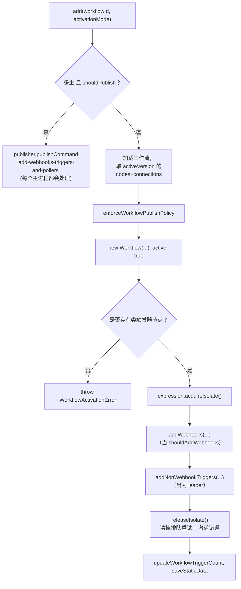

# 深度剖析 2 —— 触发器注册中心 Trigger Registry

> **你在这里：** 第 5 阶段，第 2/11 篇深度剖析——`ActiveWorkflowManager` + `WebhookService`。
> **读完本文件后**，你会确切知道"发布一个工作流"在服务端做了什么、一个 webhook 地址存在数据库的什么地方，以及激活过程在重试和多主进程场景下如何表现。

缩写：**DB**（Database，数据库）、**HTTP**（Hypertext Transfer Protocol，超文本传输协议）、**ID**（Identifier，标识符）、**TTL**（Time To Live，存活时间）、**UI**（User Interface，用户界面）、**V8**（Google's JavaScript engine，谷歌的 JavaScript 引擎）。

---

## 角色回顾

**负责：** 把"这个版本的工作流已发布"转化为*真正的事件接入*——为 webhook 类触发器在 `webhook_entity` 中插入数据行，为其他类型的触发器在内存中建立监听器/轮询器/定时任务。
**掌握：** 哪些工作流处于活动状态、已注册的 webhook 数据行、激活错误信息。
**不做：** 不处理 HTTP 请求（那是 [Webhook 接入层](03-webhook-ingress.md) 的工作），也不运行节点（那是[执行引擎](06-execution-engine.md)的工作）。
**出现于：** **S2**。

## 内部设计

### 三种接入方式

| 节点能力（`INodeType`） | 示例 | 注册中心在发布时做的事 |
|---|---|---|
| `webhook()` | Webhook、Form Trigger | 插入**数据库记录**——不需要内存状态；之后任何主进程/webhook 进程都能响应它 |
| `poll()` | RSS Feed Trigger | 在 Leader 节点**内存中**调度一个轮询任务 |
| `trigger()` | 定时器、长驻监听器 | 调用一次 `trigger()`，把返回的句柄保存在 Leader 节点**内存中** |

### webhook 数据行

`WebhookEntity`（`@n8n/db/src/entities/webhook-entity.ts`）：`workflowId`、`webhookPath`、`method`、`node`（名称）、可选的 `webhookId` 和 `pathLength`；**主键是 `(webhookPath, method)`**。这个主键就是这套设计的仲裁机制：两个工作流不能拥有同一个"URL + 方法"组合。

### `ActiveWorkflowManager.add()` —— 逐步拆解

`cli/src/active-workflow-manager.ts` 第 539 行：



*图注：`add()` 做了什么——其中每一步都可能抛出异常，而任何异常都会被记录为一条激活错误。*

1. **使用已发布版本，而不是草稿。** `Workflow` 对象是从 `dbWorkflow.activeVersion.{nodes, connections}` 构建出来的——编辑草稿不会改变线上行为，直到发布为止。
2. **校验。** `validateWorkflowHasTriggerLikeNode(..., STARTING_NODES)`——没有触发器的工作流无法发布。
3. **在整个注册过程中持有一个表达式隔离实例**（`acquireIsolate`），因为 webhook 路径和触发器参数里可能含有表达式（见[表达式引擎](08-expression-engine.md)）。
4. **`addWebhooks`**（第 149 行）：`getWorkflowWebhooks` 向每个节点询问它的 `IWebhookData[]`（`WebhookService.getNodeWebhooks`，它通过 `NodeHelpers.getNodeWebhookPath` 计算出每个路径）；然后对每个 webhook 执行：`createWebhook` → `storeWebhook`（插入；若主键冲突来自*另一个*工作流 → 抛出 `WebhookPathTakenError`；若来自*同一个*工作流 → 刷新这条过期记录）→ `createWebhookIfNotExists`，它会调用节点自身的 `webhookMethods.default.checkExists / create`——像 Telegram 这类节点就是通过这个机制在*第三方那一侧*注册回调的。
5. **`addNonWebhookTriggers`**（第 1099 行）：只在 Leader 上执行；收集 `workflow.getTriggerNodes()` + `getPollNodes()`，交给 `ActiveWorkflowTriggers.addTriggers`。
6. **收尾工作：** 清除激活错误、更新触发器计数、持久化 `staticData`（webhook 节点可能会把 id 暂存在里面）。

### 路径是怎么算出来的——为什么 Ada 的地址是 `/webhook/orders`

`NodeHelpers.getNodeWebhookPath`（`workflow/src/node-helpers.ts` 第 1170 行）：

| 节点有 `webhookId` 吗？ | `isFullPath` | 存储的路径 |
|---|---|---|
| 没有 | —— | `${workflowId}/${小写并经过 URL 编码的节点名}/${path}` |
| 有 | `true`（Webhook 节点的默认描述） | 若 `path` 非空就用 `path`，否则用 `webhookId` |
| 有 | `false` | `${webhookId}/${path}` |

编辑器在创建 Webhook 节点时会分配一个 `webhookId`，而 Webhook 节点的描述把 `isFullPath` 设为 `true`——所以路径 `orders` 就原样存储为 `orders`。

### 多主进程与启动流程

- **启动时：** `addActiveWorkflows('init')`（第 394 行）按批次遍历所有处于活动状态的工作流 id，对每一个调用 `add`。
- **`shouldAddWebhooks`：** 在 `init`/`leadershipChange` 时总是为真；其他情况下只有 Leader 会写入数据行。
- **`shouldAddNonWebhookTriggers`：** *只有 Leader*——这样一个定时触发器才只会触发一次，而不是每个主进程各触发一次。
- **Leader 变更：** 新的 Leader 会重新添加触发器（`activationMode: 'leadershipChange'`）。

## 交互关系

| 对象 | 契约 |
|---|---|
| 编辑器 / `WorkflowService.activateWorkflow` | 调用 `add(workflowId, 'activate')` |
| `webhook_entity` 表 + 缓存 | `storeWebhook` 先插入，再缓存到键 `webhook:${method}-${path}` 下 |
| 节点的 `webhookMethods` | `checkExists` / `create` / `delete` 在一个 `HookContext` 中运行 |
| [Webhook 接入层](03-webhook-ingress.md) | 之后只读取这些数据行/缓存，从不写入 |

## ⚓ 回到示例 —— S2

Ada 点击发布。`add('wf123', 'activate')` 开始执行（单主进程：直接执行；多主进程：先广播命令，再各自执行）。这个工作流里只有一个 webhook 节点，所以 `getNodeWebhooks` 返回：

```json
{ "httpMethod": "POST", "node": "Order Webhook", "path": "orders", "workflowId": "wf123", "isFullPath": true }
```

`storeWebhook` 插入：

| webhookPath | method | workflowId | node | webhookId | pathLength |
|---|---|---|---|---|---|
| `orders` | `POST` | `wf123` | `Order Webhook` | *（null——静态路径）* | *（null）* |

Webhook 节点没有定义 `webhookMethods`，所以 `createWebhookIfNotExists` 什么也不做。没有触发器/轮询节点，所以 `addNonWebhookTriggers` 返回 `false`。激活成功；触发器计数被设为 1。从此刻起，**任何能读取这个数据库的进程都可以响应 `POST /webhook/orders`**。

## 失败行为

| 失败情形 | 会发生什么 |
|---|---|
| 路径已被另一个工作流占用 | 抛出 `WebhookPathTakenError`；该工作流已部分注册的数据行会被清除（`clearWebhooks`）；记录一条激活错误 |
| 没有类触发器节点 | 抛出 `WorkflowActivationError`（级别：警告） |
| 外部服务注册失败（`create` 抛异常） | 同样做清理；异常的 `detail` 会成为错误信息 |
| 启动时的瞬时失败 | `addQueuedWorkflowActivation` 以指数退避方式重试，上限为 `WORKFLOW_REACTIVATE_MAX_TIMEOUT`（遇到 `IsolateError` 时不翻倍）；策略拒绝*不会*被重试 |
| 非正常关闭后留下的陈旧记录 | 在 `init`/`leadershipChange` 时，来自*同一个*工作流的主键冲突插入会被容忍并刷新 |
| 激活错误 | 通过 `activationErrorsService.register` 存储，让编辑器能显示工作流为什么没能上线 |

**下一步：** [03 —— Webhook 接入层](03-webhook-ingress.md) · **返回：** [01 —— 编辑器](01-editor.md) · [概念地图](../03-concept-map.md)
