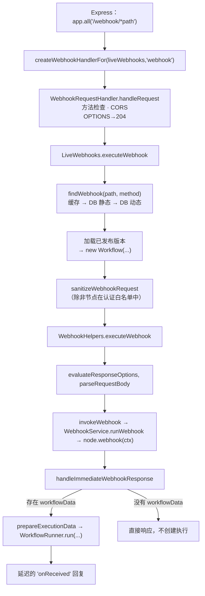

# 深度剖析 3 —— Webhook 接入层 Webhook Ingress

> **你在这里：** 第 5 阶段，第 3/11 篇深度剖析——从一个原始 HTTP 请求到调用 `WorkflowRunner.run` 之间发生的一切。
> **读完本文件后**，你能从 Express 一路追踪请求直到第一个数据项，能解释各种响应模式，并能说清为什么 Webhook 节点会在*执行记录存在之前*就先运行。

缩写：**HTTP**（Hypertext Transfer Protocol，超文本传输协议）、**CORS**（Cross-Origin Resource Sharing，跨域资源共享）、**ID**（Identifier，标识符）、**DB**（Database，数据库）、**JSON**（JavaScript Object Notation，JavaScript 对象表示法）、**V8**（Google's JavaScript engine，谷歌的 JavaScript 引擎）。

---

## 角色回顾

**负责：** HTTP 请求 →（找到对应 webhook、加载已发布工作流、生成首个数据项、给出 HTTP 响应）。
**掌握：** 路由 → 数据行的映射（通过 `WebhookService`）、响应模式、请求/响应对象。
**不做：** 不遍历图；不决定跑在主进程还是工作进程；不持久化执行记录。
**出现于：** **S3、S4、S5**（以及 S6 末尾那个被延迟发出的回复）。

## 内部设计



*图注：接入层的处理流水线——注意节点自己的 `webhook()` 是先执行的，它甚至可能决定根本不启动任何执行。*

1. **路由。** `AbstractServer` 把 `app.all('/<endpointWebhook>/*path', createWebhookHandlerFor(liveWebhooks, 'webhook'))` 挂载在*请求体解析器之前*，这样 Webhook 节点才能自己流式处理二进制请求体（`cli/src/abstract-server.ts` 第 240–252 行）。表单（Form）以及等待中的 webhook/表单恢复接口有对应的兄弟路由；测试 webhook 由 `TestWebhooks` 在 `webhook-test` 前缀下提供服务。
2. **处理器。** `WebhookRequestHandler.handleRequest` 拒绝不支持的方法，只在存在 `origin` 请求头时才应用 CORS，用 `204` 响应 `OPTIONS`，然后把请求交给 `webhookManager.executeWebhook`。错误会被转换成 HTTP 错误响应（未知的 webhook → `WebhookNotFoundError`）。
3. **查找。** `WebhookService.findWebhook` → 静态缓存（`webhook:${method}-${path}`）→ 静态数据库记录 → 动态路径探测（路径中带 `:param` 段的情况；路径参数会被复制进 `request.params`）。
4. **加载*已发布*的版本。** `loadWebhookExecutionData` 使用 `workflow.activeVersion`（或者在某个开关后面的新发布服务）——`nodes`/`connections` 来自已发布的版本，绝不是草稿。构建出一个 `Workflow`；`getBase(...)` 创建 `additionalData`（凭据辅助对象、钩子占位、设置、生产调用下的 `userId` = 发布者）。
5. **表达式隔离实例——仅在需要时才创建。** `webhookPhaseNeedsIsolate` 会跳过创建 V8 隔离实例，前提是满足一个很常见的场景：Webhook 节点 v2 及以上版本、参数是静态的、描述字段能原生解析。只要有任何一点无法证明是静态的，就会去获取一个隔离实例。
6. **`WebhookHelpers.executeWebhook`**（`webhook-helpers.ts` 第 804 行）：
   - 通过 `evaluateResponseOptions` 解析出 `responseMode` 等；不支持的模式 → HTTP 500。支持的模式有：`onReceived`、`lastNode`、`responseNode`、`formPage`、`streaming`、`hostedChat`；
   - `parseRequestBody`；
   - **`invokeWebhook`** → `WebhookService.runWebhook`（`webhook.service.ts` 第 646 行）构建一个 `WebhookContext`，调用节点的 `webhook()`。这一步出错会被上报，并以一个通用错误作答；**不会创建任何执行记录**。
7. **由节点来决定。** Webhook 节点的 `webhook()`（`Webhook.node.ts` 第 225 行）会检查 IP 白名单、机器人过滤、认证方式（基础认证/请求头/JWT/n8n OAuth）、一个可选的"仅在满足条件时运行"表达式，然后构建出：

   ```ts
   { json: { headers: req.headers, params: req.params, query: req.query, body: req.body } }
   ```

   并返回 `{ webhookResponse, workflowData: [[item]] }`。如果认证失败，它会自己写出 `403`/`401`，并返回 `{ noWebhookResponse: true }`（没有 `workflowData` → 不会创建执行）。
8. **响应模式**（决定*调用方*在等什么）：

   | 模式 | 调用方会收到…… |
   |---|---|
   | `onReceived`（默认） | 一旦执行记录存在，就立刻收到一个 JSON 回复：如果配置了 `responseData` 就用它，否则是 `{ "message": "Workflow was started" }` |
   | `lastNode` | 运行结束时最后一个执行节点的输出 |
   | `responseNode` | *Respond to Webhook* 节点发送的任何内容 |
   | `streaming` | 运行过程中的分块流（`sendChunk` 钩子） |
   | `formPage` / `hostedChat` | Form / Chat 触发器对应的界面页面流程 |

9. **启动运行。** `prepareExecutionData` 构建出初始的 `IRunExecutionData`——关键是 `executionData.nodeExecutionStack = [{ node: <起始节点>, data: { main: <workflowData> }, source: null }]`——然后：

   ```ts
   executionId = await Container.get(WorkflowRunner).run(
     runData, /*loadStaticData*/ true,
     /*realtime*/ !didSendResponse && !shouldDeferOnReceivedResponse,
     existingExecution /* 只有在恢复一次 Wait 时才有值 */, responsePromise);
   ```

   对于 `onReceived` 模式，回复会**延迟到 `run` 返回之后**，这样 `responseData` 表达式里就能用上 `$execution.id`（`webhook-helpers.ts` 约第 1262–1290 行）。

## 交互关系

| 对象 | 契约 |
|---|---|
| 触发器注册中心 | 读取它写入的数据行；启动时会预先填充静态缓存（`populateCache`） |
| 节点 | 调用 `webhook(ctx)`；期望得到 `IWebhookResponseData`（`workflowData`、`webhookResponse`、`noWebhookResponse`） |
| [工作流运行器](04-workflow-runner.md) | `run(IWorkflowExecutionDataProcess, …)` → 返回一个执行 ID |
| 队列模式 | 对于 `responseNode`/`lastNode`，工作进程会把响应转发回*这个*进程（见[伸缩队列](05-scaling-queue.md)） |

## ⚓ 回到示例 —— S3 → S5

`POST /webhook/orders`，内容为 `{"customer":"ACME","amount":100}`（`Content-Type: application/json`）：

1. `createWebhookHandlerFor` 拼出 `params.path` = `orders`。调试日志：`Received webhook "POST" for path "orders"`。
2. `findWebhook('POST','orders')` → 缓存未命中 → 数据库命中 `(orders, POST)` → 写入缓存。
3. 加载已发布版本；`webhookPhaseNeedsIsolate` 返回**假**（Webhook v2、参数是静态的）→ 不构建隔离实例。
4. `runWebhook` 调用 `Webhook.webhook(ctx)`；没有配置认证，`validateAuth` 通过；结果：

   ```json
   { "workflowData": [[ { "json": {
       "headers": { "content-type": "application/json", "…": "…" },
       "params": {}, "query": {},
       "body": { "customer": "ACME", "amount": 100 } } } ]] }
   ```

5. `prepareExecutionData` 把这个数据项放进初始栈里；`WorkflowRunner.run` 被调用（S6 开始）。它返回例如 `"1042"`；直到这时接入层才发出：

   ```http
   HTTP/1.1 200 OK
   {"message":"Workflow was started"}
   ```

## 失败行为

| 失败情形 | 结果 |
|---|---|
| 找不到 `(path, method)` 对应的记录 | 抛出 `WebhookNotFoundError` → 404（错误信息里会列出这个路径已注册的其他方法） |
| `webhook()` 中认证失败 | 节点自己写出 401/403，返回 `noWebhookResponse`；**不创建执行** |
| `webhook()` 抛出异常 | 上报给错误报告器；返回一个通用错误响应；**不创建执行** |
| 不支持的响应模式 | 500，提示 `The response mode '…' is not valid!` |
| 调用方断开连接 | 对 `onReceived` 模式没有影响——执行记录已经创建好了 |
| `WorkflowRunner.run` 抛出异常（例如执行前被阻断） | 异常会一路传到 HTTP 响应；`PreExecuteBlockedError` 会在运行器里被解包 |

**下一步：** [04 —— 工作流运行器](04-workflow-runner.md) · **返回：** [02 —— 触发器注册中心](02-trigger-registry.md) · [概念地图](../03-concept-map.md)
