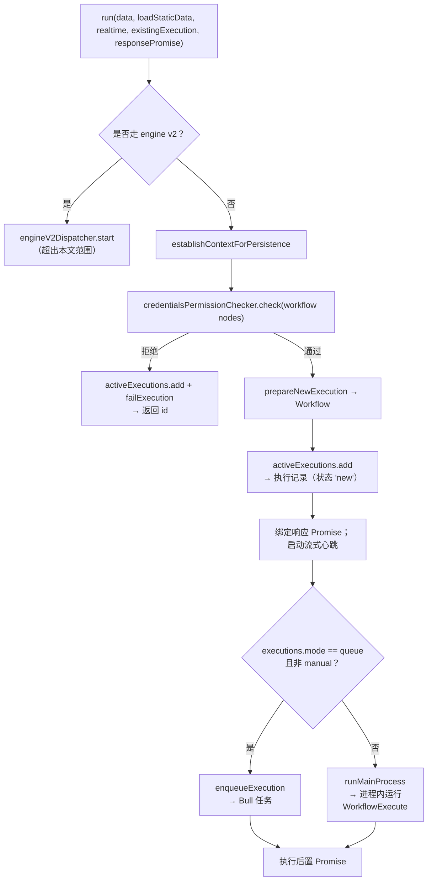

# 深度剖析 4 —— 工作流运行器 Workflow Runner

> **你在这里：** 第 5 阶段，第 4/11 篇深度剖析——`WorkflowRunner` 与 `ActiveExecutions`。
> **读完本文件后**，你会知道一次执行是如何被创建出来的、n8n 如何决定它*在哪里*运行，以及围绕着一次正在运行的执行有哪些簿记工作（超时、取消、响应 Promise）。

缩写：**DB**（Database，数据库）、**ID**（Identifier，标识符）、**HTTP**（Hypertext Transfer Protocol，超文本传输协议）、**JSON**（JavaScript Object Notation，JavaScript 对象表示法）。

---

## 角色回顾

**负责：** 把"用这些首批数据项运行这个工作流"变成一条持久化的执行记录和一次正在进行中的运行——可以在本地跑，也可以经由队列跑。
**掌握：** 执行 ID、设置（超时时间）、正在等待的 HTTP 调用方的响应 Promise、取消句柄。
**不做：** 不知道节点内部如何工作；不在节点之间搬运数据。
**出现于：** **S5 → S6**（以及每一次手动运行、每一次由触发器发起的运行）。

## 内部设计

`cli/src/` 下两个相互协作的类：

| 类 | 文件 | 角色 |
|---|---|---|
| `WorkflowRunner` | `workflow-runner.ts` | 编排的"配方"（`run`、`runMainProcess`、`enqueueExecution`） |
| `ActiveExecutions` | `active-executions.ts` | 正在运行的执行的内存登记表；创建数据库记录（`add`），持有 `PCancelable` 句柄、响应 Promise，以及"执行后置"Promise |

### `WorkflowRunner.run()`（第 407 行）



*图注：运行器是一棵决策树，最终走到两条"运行"路径之一；无论走哪条，都会返回一个执行 ID。*

1. **持久化上下文**（`establishContextForPersistence`）和**凭据访问检查**（`credentialsPermissionChecker.check`）排在最前面——如果一个工作流引用了当前执行方所在项目无权使用的凭据，它会*作为一次执行而失败*（因而在历史记录里可见），而不是直接把请求丢弃。
2. **`prepareNewExecution`** 构建 `Workflow` 对象（在手动/评估模式下会解析出 pin data）。
3. **`ActiveExecutions.add`**（第 71 行）通过 `executionPersistence.create({ data, mode, finished:false, workflowData, status:'new', workflowId, … })` 插入记录——此时*整个* `IRunExecutionData`（包括预先填好的 `nodeExecutionStack`）就已经存进去了——并预留**并发容量**（`ConcurrencyCapacityReservation`；`evaluation` 模式下跳过）。在常规模式下会立即执行 `setRunning`。
4. **决定在哪里运行。**

   ```ts
   const shouldEnqueue = OFFLOAD_MANUAL_EXECUTIONS_TO_WORKERS === 'true'
     ? mode === 'queue'
     : mode === 'queue' && data.executionMode !== 'manual';
   ```

   所以在队列模式下，**生产运行会进工作进程；手动（编辑器）运行留在主进程**，除非某个环境变量开关另有规定。
5. **`runMainProcess`**（第 569 行）：设置一个软超时（`workflowSettings.executionTimeout` 或全局默认值，上限由 `maxTimeout` 决定），构建带执行超时时间戳的 `additionalData`，调用 `setRunning(executionId)`，组装**生命周期钩子**（`getLifecycleHooksForRegularMain`），加上 `sendResponse`（解析 HTTP 响应 Promise）和 `sendChunk`（流式输出）两个处理器，然后调用 `new WorkflowExecute(additionalData, mode, data.executionData).processRunExecutionData(workflow)`——一个 `PCancelable<IRun>`——并把它挂到登记表上。完成时调用 `finalizeExecution(executionId, fullRunData)`。
6. **`enqueueExecution`**（第 740 行）→ 见[伸缩队列](05-scaling-queue.md)。
7. **超时是"软"的。** 计时器触发时，`stopExecution(id, TimeoutExecutionCancelledError)` 会在*当前节点跑完之后*才取消——引擎会在节点之间检查 `shouldStopExecuting()`。

### `ActiveExecutions` 的职责

| 方法 | 用途 |
|---|---|
| `add`（第 71 行） | 创建记录（或续接一条已存在的等待中记录）、预留容量、返回 id |
| `attachWorkflowExecution`（第 199 行） | 存下可取消的 Promise，这样 `stopExecution` 才能取消它 |
| `attachResponsePromise` / `resolveResponsePromise` | 连通到在 `lastNode` / `responseNode` 模式下等待中的 HTTP 调用方 |
| `stopExecution`（第 225 行） | 以一个带类型的 `ExecutionCancelledError` 取消（手动、超时、关闭） |
| `finalizeExecution`（第 255 行） | 解析执行后置 Promise、释放容量、从登记表中移除 |
| `getPostExecutePromise`（第 295 行） | 让调用方可以等待完成（供 `lastNode` 模式和子工作流使用） |

## 交互关系

| 对象 | 契约 |
|---|---|
| [Webhook 接入层](03-webhook-ingress.md)、触发器、编辑器手动运行、子工作流节点 | 调用 `run(IWorkflowExecutionDataProcess, …)`；得到一个执行 ID |
| [引擎](06-execution-engine.md) | 构造 `WorkflowExecute`；收到 `IRun` |
| [伸缩队列](05-scaling-queue.md) | 调用 `addJob`，监听任务消息 |
| [钩子](11-lifecycle-persistence-push.md) | 根据当前进程角色*选用哪一套钩子* |
| 并发控制 | 容量预留；可能在执行开始前就先把它延后 |

## ⚓ 回到示例 —— S5 → S6

接入层调用 `run(...)`，带上 `executionMode: 'webhook'`、包含预填好的栈（`Order Webhook` + 该数据项）的 `executionData`，`workflowData` = 已发布版本。

1. `credentialsPermissionChecker.check('wf123', nodes)`——`httpHeaderAuth` 凭据 `cred42` 属于 Ada 的项目 → 通过。
2. `ActiveExecutions.add` 插入 `execution_entity`（状态 `new`，模式 `webhook`）及其 `execution_data` 负载；假设 id 为 `1042`。
3. 队列模式且模式 ≠ `manual` → `enqueueExecution('1042', 'wf123', data, loadStaticData=false, realtime=false, …)`。
   - `realtime` 为**假**，因为 `onReceived` 会延迟回复（`!didSendResponse && !shouldDeferOnReceivedResponse` → `false`），所以任务优先级是 `100` 而不是 `50`。
4. `run` 返回 `'1042'`；接入层发出此前延迟的 `200 {"message":"Workflow was started"}`。

在*常规*模式下，同样的调用会直接走到 `runMainProcess`，S7–S12 会在这个进程里原地发生。

## 失败行为

| 失败情形 | 结果 |
|---|---|
| 凭据访问被拒绝 | 创建执行记录并立即失败（`failExecution`），返回 id，在历史记录中可见 |
| 无法建立持久化上下文 | 同上——是一次失败的执行，而不是一个直接抛出的 HTTP 错误 |
| `enqueueExecution` 抛出异常（Redis 挂了） | 用工作进程式的钩子跑一遍 `processError`，让执行以 `error` 结束，然后重新抛出异常 |
| 超时 | 软取消：引擎会在下一次循环迭代时注意到（`shouldStopExecuting`），把运行标记为 `canceled`，结果中带有一个 `TimeoutExecutionCancelledError` |
| 关闭 | 对正在运行的执行抛出 `SystemShutdownExecutionCancelledError` |
| 执行后置 Promise 被拒绝 | 记录日志并上报；取消类错误会被忽略 |

**下一步：** [05 —— 伸缩队列](05-scaling-queue.md) · **返回：** [03 —— Webhook 接入层](03-webhook-ingress.md) · [概念地图](../03-concept-map.md)
