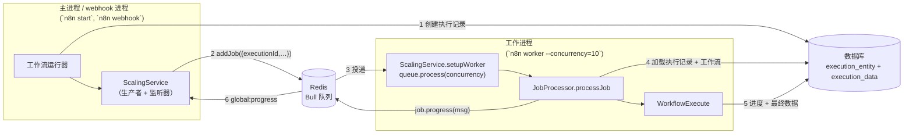
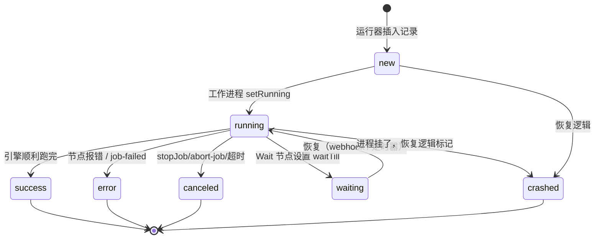

# 深度剖析 5 —— 伸缩队列 Scaling Queue（队列模式）

> **你在这里：** 第 5 阶段，第 5/11 篇深度剖析——`ScalingService`、`JobProcessor`、`worker` 命令。这是一个*可选*子系统：常规模式下不存在。
> **读完本文件后**，你能解释为什么队列里只携带一个执行 ID、一个工作进程如何把一个任务变成一次运行，以及结果和 HTTP 响应是如何传回主进程的。

缩写：**DB**（Database，数据库）、**ID**（Identifier，标识符）、**HTTP**（Hypertext Transfer Protocol，超文本传输协议）、**JSON**（JavaScript Object Notation，JavaScript 对象表示法）、**TTL**（Time To Live，存活时间）、**MCP**（Model Context Protocol，模型上下文协议；只出现在任务字段里）。

---

## 角色回顾

**负责：** 把*执行 ID* 从主进程/webhook 进程搬运到工作进程（基于 Redis 的 Bull），并把进度和结果转发回去。
**掌握：** 队列名称、任务优先级、工作进程并发数、Leader 选举。
**不做：** 不在任务里携带运行数据；不自己运行节点（那是工作进程里的引擎做的）。
**出现于：** **S6**（入队）和 **S7**（工作进程启动），以及 S12 末尾的返回路径。

## 内部设计

### 进程角色



*图注：Redis 双向都只携带小小的任务消息；**所有**运行数据都走数据库。*

### 任务负载——刻意做得很小

`JobData`（`cli/src/scaling/scaling.types.ts`）：`workflowId`、`executionId`、`loadStaticData`、`pushRef?`、`streamingEnabled?`、`restartExecutionId?`、`projectId?`、`poolName?`、`encryptedRunnerIdentity?`，外加几个 MCP 专用字段。**没有节点，没有数据项，没有凭据。**为什么？

- 运行数据可能很大；Redis 不是存放它的好地方。
- S6 中创建的那条数据库记录已经包含了完整的 `IRunExecutionData`；工作进程直接读它就行。
- 一个小任务，丢了重试的代价很低。

### 生产者一侧 —— `enqueueExecution`（`workflow-runner.ts` 第 740 行）

1. 惰性加载 `ScalingService` 并调用 `setupQueue()`（创建一个 `maxStalledCount: 0` 的 Bull 队列以及 Redis 客户端；`scaling.service.ts` 第 97–107 行）。
2. `poolConfigService.resolvePoolForExecution(data)` 选出 `{ queueName, poolName }`（工作进程池）。
3. `scalingService.addJob(jobData, { priority: realtime ? 50 : 100, queueName })`。
4. 通过 *scaling-main* 钩子（`getLifecycleHooksForScalingMain`）运行 `workflowExecuteBefore`，并返回一个 `PCancelable`：（a）取消时调用 `stopJob(job)`，（b）任务结果到达时 resolve。

### 消费者一侧 —— `JobProcessor.processJob`（`job-processor.ts` 第 121 行）

1. `executionPersistence.findSingleExecution(executionId, { includeData: true, unflattenData: true })`；找不到 → 报错。
2. 如果状态是 `crashed` → **什么也不做**（防止 Bull 隐式重试机制把一条已崩溃的执行再跑一遍）。
3. `executionRepository.setRunning(executionId)` → 状态变为 `running`，写入 `startedAt`。
4. 可选地从工作流记录重新加载 `staticData`（`loadStaticData`）。
5. 计算执行超时，从 `execution.workflowData` 构建 `new Workflow(...)`，`getBase(...)` 生成 `additionalData`。
6. 构建**工作进程钩子**（`getLifecycleHooksForScalingWorker`），加上两个*经 Bull 转发*的处理器：
   - `sendResponse` → `job.progress({ kind: 'respond-to-webhook', executionId, response, workerId })`
   - `sendChunk` → `job.progress({ kind: 'send-chunk', … })`
7. `new WorkflowExecute(additionalData, execution.mode, execution.data).processRunExecutionData(workflow)`（如果没有 `executionData`——即手动/部分运行——则改用 `manualExecutionService.runManually`）。
8. 结束时发送 `job-finished`（v2 版本带有 `status`、`startedAt`、`stoppedAt`、`waitTill`、`lastNodeExecuted`、`metadata`）。

### 返回路径——`global:progress` 上的消息

`JobMessage` 的种类有：`respond-to-webhook`、`job-finished`、`job-failed`、`abort-job`、`send-chunk`、`mcp-response`。主进程的 `registerMainOrWebhookListeners`（`scaling.service.ts`）会根据 `msg.kind` 做分发：

| 种类 | 主进程的动作 |
|---|---|
| `respond-to-webhook` | 解码响应体，`activeExecutions.resolveResponsePromise(executionId, response)` → 正在等待的 HTTP 调用方收到回复 |
| `send-chunk` | `activeExecutions.sendChunk` → 流式发给调用方 |
| `job-finished` | 解析任何挂起的响应；存入 `jobResults[executionId]`（之所以需要，是因为 `removeOnComplete: true` 会丢弃任务原本的返回值） |
| `job-failed` | 把错误连同堆栈一起记录日志 |

工作进程监听 `abort-job` 消息，并调用 `jobProcessor.stopJob(jobId)`。

### 多主进程与 Leader 选举

`leader-election-client.ts`、`multi-main-setup.ee.ts`、`redis-lock.service.ts`：当有多个主进程时，其中一个是 **Leader**；只有它负责管理非 webhook 类触发器（[触发器注册中心](02-trigger-registry.md)）和定期恢复。像 *add-webhooks-triggers-and-pollers* 这类命令走的是 n8n 自己的发布/订阅通道，*不是* Bull——`JobMessage` 的注释特别提醒不要把两者搞混。

## 交互关系

| 对象 | 契约 |
|---|---|
| 工作流运行器 | `addJob`、`stopJob`、`popJobResult`；任务优先级 50（实时）vs. 100 |
| 数据库 | 双方都读写执行记录；工作进程的钩子负责持久化结果 |
| 引擎 | 工作进程用*存储下来的* `IRunExecutionData` 实例化 `WorkflowExecute` |
| Redis | Bull 队列；键名带有 `queue.bull.prefix` 前缀 |

## ⚓ 回到示例 —— S6 → S7

主进程添加：

```json
{ "workflowId": "wf123", "executionId": "1042", "loadStaticData": false, "projectId": "<ada 所在项目>", "poolName": "<解析出的池>" }
```

（取值仅为示意；字段名是真实的 `JobData` 字段。）

某个工作进程的 `queue.process(JOB_TYPE_NAME, concurrency, processJob)` 收到它。日志（info 级别）：

```
Worker started execution 1042 (job 77)
```

`processJob` 读取执行 `1042`（状态 `new`，数据里的栈是 `[Order Webhook]`），把它设为 `running`，构建 `Workflow`，接好工作进程钩子，调用 `processRunExecutionData`。因为 `Order Webhook` 用的是 `onReceived` 模式，不需要 `sendResponse` 消息——调用方已经在主进程上拿到回复了。

如果 Ada 选的是 `lastNode` 模式，*Respond* 的流程会是：工作进程 `sendResponse` 钩子 → `job.progress(respond-to-webhook)` → Redis → 主进程的监听器 → `resolveResponsePromise` → 主进程上那个仍然打开着的 HTTP 连接。

## 失败行为



*图注：跨进程的执行状态生命周期；`crashed` 是由恢复逻辑写入的，不是由这次运行本身写入的。*

| 失败情形 | 行为 |
|---|---|
| 工作进程在运行中途挂掉 | 数据库中的执行会停留在 `running`；恢复逻辑会把处于进行中状态的记录（`new`、`running`、`unknown`——合称 `CRASHABLE_EXECUTION_STATUSES`）标记为 `crashed`。`maxStalledCount: 0` 能阻止 Bull 悄悄地重新投递一个已停滞的任务 |
| Bull 重试一条已崩溃的执行 | 如果状态已经是 `crashed`，`processJob` 返回 `{ success: false }` |
| 入队时 Redis 不可用 | 走错误路径，执行以 `error` 结束，并重新抛出异常 |
| 工作进程启动时连不上 Redis | 致命错误 `Error initializing Lua scripts` → 工作进程 `process.exit(1)` |
| 从界面取消 | 主进程 `stopJob(job)` → `abort-job` 消息 → 工作进程中止那个 `PCancelable` |
| 工作进程还在跑时主进程挂了 | 工作进程仍会跑完并写入数据库；丢失的是*回复*（响应 Promise），*执行记录*不会丢 |

**下一步：** [06 —— 执行引擎](06-execution-engine.md) · **返回：** [04 —— 工作流运行器](04-workflow-runner.md) · [概念地图](../03-concept-map.md)
