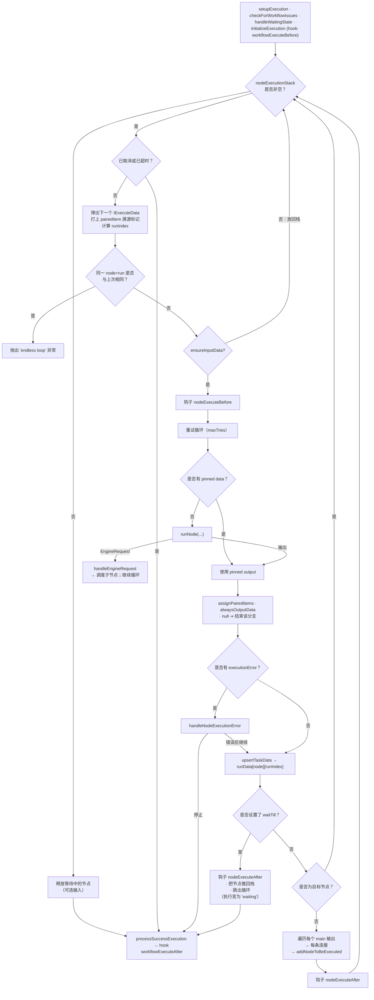

# 深度剖析 6 —— 执行引擎 Execution Engine（`WorkflowExecute`）

> **你在这里：** 第 5 阶段，第 6/11 篇深度剖析——n8n 的心脏。`packages/core/src/execution-engine/workflow-execute.ts`（3,168 行）。
> **读完本文件后**，对于任意一个工作流，你都能预测出*下一个该跑哪个节点、用什么数据*、多输入节点如何等待、错误和重试如何被路由，以及一次执行是如何暂停和恢复的。

缩写：**DAG**（Directed Acyclic Graph，有向无环图）、**ID**（Identifier，标识符）、**JSON**（JavaScript Object Notation，JavaScript 对象表示法）、**DB**（Database，数据库）、**UI**（User Interface，用户界面）、**AI**（Artificial Intelligence，人工智能）。

---

## 角色回顾

**负责：** 决定节点运行的*顺序*和每个节点收到什么数据；把每次运行记进 `runData`；错误路由；暂停/恢复；取消检查。
**掌握：** 整个运行状态，即 `IRunExecutionData`（见下文）。
**不做：** 不知道任何节点具体做什么（只是调用它）；不负责持久化（它只触发钩子）；不解析表达式。
**出现于：** **S7 → S12**（S8 是引擎自己的步骤；它同时驱动着 S9–S11）。

## 内部设计

### 1. 运行状态就是普通的、可序列化的数据

`IRunExecutionData` v1（`workflow/src/run-execution-data/run-execution-data.v1.ts`）：

```
IRunExecutionData
├─ startData?           { startNodes, destinationNode, runNodeFilter }   ← 部分执行/手动运行时才有
├─ resultData
│   ├─ runData          { [nodeName]: ITaskData[] }                      ← 该节点每跑一次就有一条记录
│   ├─ pinData?  lastNodeExecuted?  error?  metadata?
├─ executionData?       ← 引擎自己的"工作内存"
│   ├─ nodeExecutionStack   IExecuteData[]     ← 接下来要跑什么
│   ├─ waitingExecution     { [node]: { [runIndex]: ITaskDataConnections } }  ← 多输入节点、数据尚未凑齐
│   ├─ waitingExecutionSource, contextData, metadata, runtimeData
├─ waitTill?  resumeToken?  pushRef?  manualData?  parentExecution?
```

- `IExecuteData` = `{ node, data: { main: Array<items[] | null> }, source, runIndex?, metadata? }`——*一个节点，加上它将要收到的确切输入*。
- `ITaskData`（`interfaces.ts` 第 3591 行）= `{ startTime, executionTime, executionStatus, data: { main: [items[]…] }, error?, source[], … }`——*某个节点某一次运行产出了什么*。

因为*所有*引擎内存都活在这一个对象里，它才能被**存进数据库、在另一台机器上重新加载**——队列模式、`Wait` 节点、崩溃取证之所以可能，正是因为这一点。

### 2. 这个循环（`processRunExecutionData`，第 2226 行）



*图注：引擎的一次迭代——弹出、运行、记录、调度子节点；除此之外的一切都只是这四个动作的变体。*

### 3. `runNode` —— 按节点能力分发（第 1349 行）

在处理完恢复错误、禁用节点的直通逻辑、`prepareConnectionInputData` 之后：

| 节点拥有…… | 引擎调用 |
|---|---|
| `execute`（或某个 `customOperation`） | `executeNode` → 新建一个 `ExecuteContext` → `nodeType.execute.call(context)` |
| `poll` | `executePollNode` |
| `trigger` | `executeTriggerNode`（对触发器的手动测试） |
| `webhook` 且没有声明式的 `requestDefaults` | **原样透传输入**——webhook 已经在[接入层](03-webhook-ingress.md)跑过了；节点的"执行"就是把数据项转发出去 |
| 其他情况 | `executeDeclarativeNodeInTest`（声明式/路由风格的节点，见[节点](07-nodes.md)） |

### 4. 调度子节点 —— `addNodeToBeExecuted`（第 444 行）

对每个输出序号 → 每条 `IConnection`，引擎都会把*目标节点连同它的输入数据*加进栈里，规则如下：

- **只有当输出里有数据项时**（`length !== 0`），或者目标节点是旧版执行顺序下的*第二/可选输入*。空输出会**终止该分支**——`IF` 节点正是靠这一点来剪枝。
- **单输入的目标节点：** 直接把 `{ node, data: { main: [items] }, source: { previousNode, previousNodeOutput, previousNodeRun } }` 压进栈里。
- **多输入的目标节点（例如 Merge）：** 把尚不完整的数据暂存在 `waitingExecution[node][runIndex].main[inputIndex]` 里。等所有输入都到齐，才会挪进栈里。如果栈空了而仍有节点在等待，引擎会**逐个**释放它们（尊重 `requiredInputs` 设置），对缺失的输入传入 `[]`。
- **顺序：** `executionOrder: 'v1'`（新建工作流的默认值）会把*兄弟节点按"左上优先"排序*，再用 `unshift` 压栈，所以栈表现为**深度优先**——先把一条分支彻底跑完，再跑下一条。旧版 `v0` 用 `push`（接近广度优先）。

### 5. 数据项与溯源链

循环开始时，每个输入数据项都会被打上 `pairedItem: { item: <它的序号>, input }` 标记（`addPairedItemLineage`）。节点跑完之后，`assignPairedItems` 会为缺少溯源信息的输出补上——对 1→1、数量相同、多→1 这几种形状会自动完成。正是这一点让 `$('Node').item` 以及各种"配对项"表达式能够找到"是哪个输入产生了这个输出"（见[表达式引擎](08-expression-engine.md)）。

### 6. 错误、重试、`onError`

| 节点上的设置 | 效果 |
|---|---|
| `retryOnFail`、`maxTries`、`waitBetweenTries` | 不设置 `retryOnFail` 时，节点只会尝试**一次**。设置了的话：`maxTries` 会被限制在 2–5 之间（默认 3），`waitBetweenTries` 限制在 0–5000 毫秒之间（默认 1000）——见 `getRetryParams`，第 1805 行 |
| `onError: 'stopWorkflow'`（默认） | `handleNodeExecutionError` 写入 `taskData.error`，把节点推回栈里（这样它可以**被重新启动**），触发 `nodeExecuteAfter`，然后停止运行 → 状态变为 `error` |
| `onError: 'continueRegularOutput'` | 输入数据项照常传给下一个节点，就像成功了一样（`continuesOnError`） |
| `onError: 'continueErrorOutput'` | 第二个输出会收到错误数据项（`handleNodeErrorOutput`） |
| `alwaysOutputData` | 如果节点没有返回任何数据项，就发出一个空数据项，让这条分支继续走下去 |

取消和超时会在**每次迭代开始时**被检查（`shouldStopExecuting`）：超时会把状态翻转为 `canceled` 并设置 `timedOut`，报告为一个 `TimeoutExecutionCancelledError`。正在执行中的节点不会被中途打断（除非通过传给 `runNode` 的中止信号）。

### 7. 暂停与恢复（`Wait`）

如果某个节点设置了 `runExecutionData.waitTill`，引擎会触发 `nodeExecuteAfter`，**把同一个 `IExecuteData` 重新压回栈里**，然后退出循环——这次执行会被保存为 `waiting` 状态。恢复时，`handleWaitingState` 会清除 `waitTill`，把等待中那个栈条目对应的节点标记为**禁用**（这样它会直接透传数据，而不是再次进入等待），并弹出它最后一条 `runData` 记录（这样它不会看起来像是跑了两次）；然后循环从同一个栈继续往下走。

### 8. 防止死循环

`currentExecutionTry === lastExecutionTry`（即 `节点名:runIndex` 相同）⇒ 抛出 `UserError('Stopped execution because it seems to be in an endless loop')`。合法的循环（Split In Batches / Loop Over Items）之所以能正常工作，是因为每次重新进入时都会通过 `computeRunIndex` 拿到一个新的 `runIndex`。

## 交互关系

| 对象 | 契约 |
|---|---|
| [运行器 / JobProcessor](04-workflow-runner.md) | 以 `(additionalData, mode, runExecutionData)` 构造；`processRunExecutionData(workflow): PCancelable<IRun>` |
| [节点](07-nodes.md) | `INodeType.execute(this: IExecuteFunctions)`；返回 `INodeExecutionData[][]`（输出 × 数据项）或一个 `EngineRequest` |
| [钩子](11-lifecycle-persistence-push.md) | `workflowExecuteBefore/After`、`nodeExecuteBefore/After`、`sendResponse`、`sendChunk` |
| `Workflow` | 只读的图结构：`connectionsBySourceNode`、`connectionsByDestinationNode`、`getNode`、`getParentNodes` |

## ⚓ 回到示例 —— S7 → S12 引擎内部

从执行 `1042` 加载出的初始状态：

```
nodeExecutionStack: [ { node: "Order Webhook", data: { main: [[ item0 ]] }, source: null } ]
waitingExecution:   {}
runData:            {}
```

| 迭代 | 弹出 | `runNode` 做了什么 | 之后的 `runData` | 之后的栈 |
|---|---|---|---|---|
| 0 | `Order Webhook` | webhook 分支：原样转发 `item0` | `Order Webhook: [task0]` | `[ Add VAT{main:[[item0']]} ]` |
| 1 | `Add VAT` | `executeNode` → `SetV2.execute`（见 [S9](08-expression-engine.md)） | `+ Add VAT` | `[ Create Invoice ]` |
| 2 | `Create Invoice` | `executeNode` → HTTP Request（见 [S10](09-credentials.md)） | `+ Create Invoice` | `[ Summarize ]` |
| 3 | `Summarize` | `executeNode` → Code → 任务运行器（见 [S11](10-task-runner.md)） | `+ Summarize` | `[]` |

到第 3 次迭代，`connectionsBySourceNode` 里没有 `Summarize` 的条目，所以不会添加任何子节点；栈空了，`waitingExecution` 也是空的，循环结束。`processSuccessExecution` 构建出这个 `IRun`（`getFullRunData`：`{ data: runExecutionData, mode, startedAt, stoppedAt, storedAt, status }`），并触发 `workflowExecuteAfter`——工作进程的钩子就是在这里把一切持久化下来的。

debug 级别的日志（真实的格式字符串）：

```
Start executing node "Add VAT"
Running node "Add VAT" started
Running node "Add VAT" finished successfully
```

每个节点的 `nodeExecuteAfter` 也会触发——*保存进度*和*推送*就发生在这里（见[钩子深度剖析](11-lifecycle-persistence-push.md)）。想看同样的循环用 90 行代码实现是什么样子，运行 [`examples/mini-engine.mjs`](../examples/mini-engine.mjs)。

## 失败行为

假设 `Create Invoice` 从计费 API 那边收到了一个 HTTP 500，并且这个节点用的是默认设置：

1. `executeNode` 抛出 `NodeApiError`；由于没有设置 `retryOnFail`，重试循环只允许一次机会。
2. `reportNodeExecutionError` 把它包装一层；`handleNodeExecutionError` 写入 `taskData.error` 和 `executionStatus: 'error'`。
3. `onError` 是 `stopWorkflow` → 节点被推回栈里（可重启），触发 `nodeExecuteAfter`，循环 `break`。
4. `processSuccessExecution(…, executionError)` 产出一个 `IRun`，`status: 'error'`，带有 `resultData.error` 和 `lastNodeExecuted: "Create Invoice"`；`Summarize` 从未运行。
5. 钩子以状态 `error` 保存这次执行，并且（对于非手动运行）如果配置了的话还会触发**错误工作流**。

如果进程在第 1 步中途死掉，2–5 步都不会发生；这条记录会一直停留在 `running`，直到恢复逻辑把它标记为 `crashed`（见[伸缩队列](05-scaling-queue.md)）。

**下一步：** [07 —— 节点](07-nodes.md) · **返回：** [05 —— 伸缩队列](05-scaling-queue.md) · [概念地图](../03-concept-map.md)
