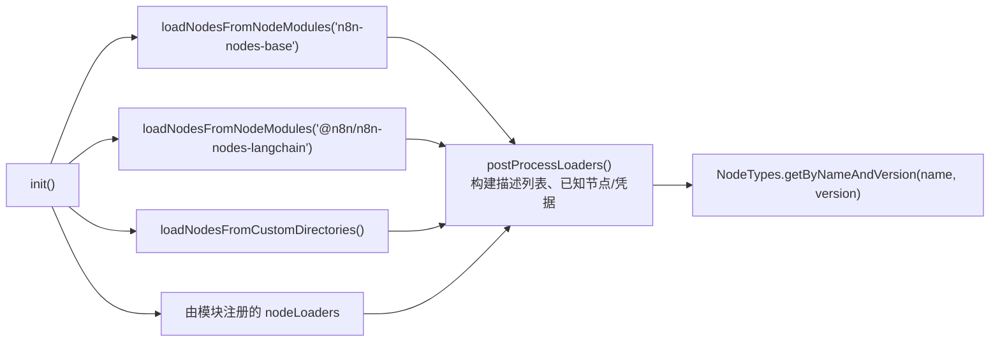

# 深度剖析 7 —— 节点 Nodes：类型、执行上下文与加载机制

> **你在这里：** 第 5 阶段，第 7/11 篇深度剖析——`INodeType`、执行上下文、`NodeTypes`、`LoadNodesAndCredentials`，以及三个真实节点。
> **读完本文件后**，你能读懂 `nodes-base` 里的任何节点，能解释 `execute` 内部的 `this` 到底是什么，并能说清一个 JSON 里写的节点名是怎么变成实际运行代码的。

缩写：**API**（Application Programming Interface，应用程序编程接口）、**HTTP**（Hypertext Transfer Protocol，超文本传输协议）、**JSON**（JavaScript Object Notation，JavaScript 对象表示法）、**UI**（User Interface，用户界面）、**ID**（Identifier，标识符）、**AI**（Artificial Intelligence，人工智能）。

---

## 角色回顾

**负责：** 每一步真正要做的工作——读取参数、调用服务、整形数据项。
**掌握：** 通过一个*上下文*对象拿到自己的参数和输入数据项。
**不做：** 不选择下一个节点；不保存自己的输出；不直接跟 Redis/数据库打交道——一切都通过上下文上的辅助方法完成。
**出现于：** **S4**（Webhook 节点的 `webhook()`）、**S8–S11**（Webhook 透传、Set、HTTP Request、Code）。

## 内部设计

### 1. 两样分开的东西：`INode` 与 `INodeType`

| | `INode`（数据，存在工作流 JSON 里） | `INodeType`（代码，存在某个包里） |
|---|---|---|
| 存放位置 | `workflow.nodes[]` | `nodes-base/nodes/…`，编译进 `dist` |
| 内容 | `id, name, type, typeVersion, parameters, credentials, position, onError, retryOnFail, webhookId, …`（`interfaces.ts` 第 1730 行） | `description` 加上可选的 `execute / poll / trigger / webhook / supplyData / methods / webhookMethods / customOperations`（第 2559 行） |
| 关联方式 | `type: "n8n-nodes-base.set"` + `typeVersion: 3.4` | 通过 `NodeTypes.getByNameAndVersion(type, version)` 解析出来 |

一个节点实现了哪个能力方法，就决定了它是哪种类型的节点：

| 方法 | 种类 | 调用方 |
|---|---|---|
| `execute` | 常规/动作节点 | 引擎（[`executeNode`](06-execution-engine.md)） |
| `webhook` | Webhook 触发器 | [接入层](03-webhook-ingress.md)（`WebhookService.runWebhook`） |
| `trigger` | 长驻触发器 | 发布时由触发器注册中心调用，经由 `ActiveWorkflowTriggers` |
| `poll` | 轮询触发器 | 轮询调度器 |
| `supplyData` | AI 子节点（模型、记忆、工具） | 由父节点调用，不是引擎主循环 |
| `methods.loadOptions` 等 | 界面辅助方法（下拉选项、凭据测试） | 编辑器发起的请求 |
| `webhookMethods` | *外部* webhook 注册的生命周期 | 注册中心（`checkExists`/`create`/`delete`） |

### 2. 版本管理

`VersionedNodeType`（`workflow/src/versioned-node-type.ts`）把 `version → INodeType` 映射起来，取 `defaultVersion ?? latest`。旧的工作流会保留它们当初保存的 `typeVersion`，这样行为就不会在它们脚下悄悄变化——例如 Set 节点有 `Set/v1` 和 `Set/v2` 两个目录，`HttpRequest` 有 `V1/V2/V3` 三个目录。

### 3. 编程式节点 vs. 声明式节点

- **编程式：** 用 TypeScript 写 `execute()`（Set、Code、Webhook）。
- **声明式：** 在 `description.requestDefaults` 加上按属性配置的 `routing` 元数据里描述请求，**没有 `execute`**；`NodeTypes.getByNameAndVersion` 会给它分配一个运行 `RoutingNode` 的实现（`cli/src/node-types.ts` 第 114–120 行）。很多服务类节点都是这样构建的。

### 4. 上下文——`this` 到底是什么

在 `execute(this: IExecuteFunctions)` 内部，引擎给出的是一个 `ExecuteContext`（`core/src/execution-engine/node-execution-context/execute-context.ts`）。它的构造函数接收 `(workflow, node, additionalData, mode, runExecutionData, runIndex, connectionInputData, inputData, executeData, closeFunctions, abortSignal)`。针对每种能力都存在对应的兄弟上下文：`WebhookContext`、`TriggerContext`、`PollContext`、`SupplyDataContext`、`LoadOptionsContext`、`HookContext`、`CredentialsTestContext`。

关键成员：

| 成员 | 含义 |
|---|---|
| `getInputData()` | 本次运行收到的数据项 |
| `getNodeParameter(name, itemIndex, fallback?, {rawExpressions?})` | 读取 `node.parameters`，并通过 `workflow.expression.getParameterValue(…)` **解析表达式**（见[深度剖析 8](08-expression-engine.md)） |
| `getCredentials(type)` | 解密对应的凭据（见[深度剖析 9](09-credentials.md)） |
| `helpers.httpRequest / requestWithAuthentication / requestOAuth2 / …` | 带认证的网络 I/O（输入输出） |
| `helpers.returnJsonArray`、`constructExecutionMetaData` | 把普通对象包装成带 `pairedItem` 的数据项 |
| `helpers.getBinaryDataBuffer / prepareBinaryData` | 二进制附件（由二进制数据服务存储，数据项里只保留引用） |
| `continueOnFail()`、`getMode()`、`getWorkflow()`、`getNode()` | 引擎设置和元数据 |
| `startJob(...)` | 把工作发给任务运行器（见[深度剖析 10](10-task-runner.md)） |

正是这层间接，才让节点具备**可移植性**：同一份节点代码能跑在主进程、工作进程、编辑器测试运行、或子工作流里，因为变化的只有上下文本身。

### 5. 加载机制——从 `node_modules` 到 `NodeTypes`

`LoadNodesAndCredentials.init()`（`cli/src/load-nodes-and-credentials.ts` 第 78 行）：



*图注：工作流里的一个节点类型字符串，是如何在运行时变成一个可调用的 `INodeType` 的。*

加载器（`core/src/nodes-loader/`）：`PackageDirectoryLoader`（读取 `package.json` 里 `n8n.nodes`/`n8n.credentials` 列表）、`CustomDirectoryLoader`，外加一个惰性加载的变体。每个加载器都维护一张 `known` 映射表（`节点类型 → 源码路径`），在首次用到时才真正加载节点类。

### 6. 三个真实节点

**Webhook**（`nodes-base/nodes/Webhook/Webhook.node.ts`）——`description.webhooks = [defaultWebhookDescription]`（`isFullPath: true`，`httpMethod` 来自一个参数）；`webhook(context)`（第 225 行）做完认证/IP/机器人检查后，返回 `{ workflowData: [[ {json:{headers,params,query,body}} ]] }`。

**Set / Edit Fields**（`nodes-base/nodes/Set/v2/SetV2.node.ts`，`execute` 第 309 行）：

```ts
const items = this.getInputData();
const mode = this.getNodeParameter('mode', 0) as Mode;      // 'manual' | 'raw'
for (let i = 0; i < items.length; i++) {
  const newItem = await setNode[mode].execute.call(this, items[i], i, options, rawData, node);
  returnData.push(newItem);
}
return [returnData];
```

它逐个遍历数据项；在 `manual.mode.ts` 内部，每条赋值的值都是通过 `getNodeParameter(..., i)` 取出来的，所以**表达式会针对每个数据项重新求值一次**。

**HTTP Request v3**（`nodes-base/nodes/HttpRequest/V3/HttpRequestV3.node.ts`，`execute` 第 110 行）——读取 `authentication`；对于 `genericCredentialType` / `predefinedCredentialType`，调用 `this.helpers.requestWithAuthentication.call(this, credentialType, requestOptions, …)`（第 798 行）；不带认证时，调用 `this.helpers.request(...)`。分页和批处理相关的选项都包了一层同样的辅助方法。

## 交互关系

| 对象 | 契约 |
|---|---|
| 引擎 | `execute` 返回 `INodeExecutionData[][]`（每个输出一个数组）或 `null`；也可能返回一个 `EngineRequest` 来运行子节点（AI 场景） |
| 表达式引擎 | 只通过 `getNodeParameter` 接触 |
| 凭据 | 只通过 `getCredentials` / `helpers.*WithAuthentication` 接触 |
| 编辑器 | `description.properties`（表单）、`inputs/outputs`、`credentials`、`methods.loadOptions`——*同一份*描述同时驱动界面表单和运行时行为 |

## ⚓ 回到示例

- **S4：** `Webhook.webhook(context)`——在[深度剖析 3](03-webhook-ingress.md)里讲过。
- **S8：** 引擎的 `runNode` 发现 `nodeType.webhook` 存在且没有 `requestDefaults` → 转发该数据项。
- **S9：** `SetV2.execute`——输入是 `[ {json:{body:{customer:"ACME",amount:100},…}} ]`，循环只跑一次（`i = 0`）；它的 `total` 赋值通过 `getNodeParameter('assignments…', 0)` 取得；返回的数据项是 `{ json: { …input, total: 120 } }`。
- **S10：** `HttpRequestV3.execute`——`authentication: genericCredentialType`、`genericAuthType: httpHeaderAuth`，它拿到凭据类型名并调用 `requestWithAuthentication`——详见[深度剖析 9](09-credentials.md)。
- **S11：** `Code.execute` 构建一个 `JsTaskRunnerSandbox(mode, this, …)`，调用 `startJob('javascript', { code, nodeMode: 'runOnceForAllItems', … })`——见[深度剖析 10](10-task-runner.md)。

## 失败行为

| 失败情形 | 结果 |
|---|---|
| 未知的 `type`/`typeVersion` | `Workflow` 构造函数会**悄悄跳过**未知的节点类型（这样针对其他节点的表达式仍能正常解析）；`checkReadyForExecution` 会报告 `typeUnknown`；版本不在 `nodeVersions` 里会抛出 `NodeVersionNotFoundError` |
| `execute` 抛出异常 | 被包装成 `NodeOperationError` / `NodeApiError` → 走引擎的错误路由（见[深度剖析 6](06-execution-engine.md)） |
| 缺少必填参数 | `getNodeParameter` 抛出 `Could not get parameter "…"`；手动运行之前，`checkReadyForExecution` 会标出参数问题 |
| 某个包加载失败 | 记录日志并上报；其他包照常加载 |
| 节点注册了 `closeFunctions` | 在 `execute` 之后的 `finally` 中运行；只有当节点本身成功时，它们的错误才会被抛出来 |

**下一步：** [08 —— 表达式引擎](08-expression-engine.md) · **返回：** [06 —— 执行引擎](06-execution-engine.md) · [概念地图](../03-concept-map.md)
