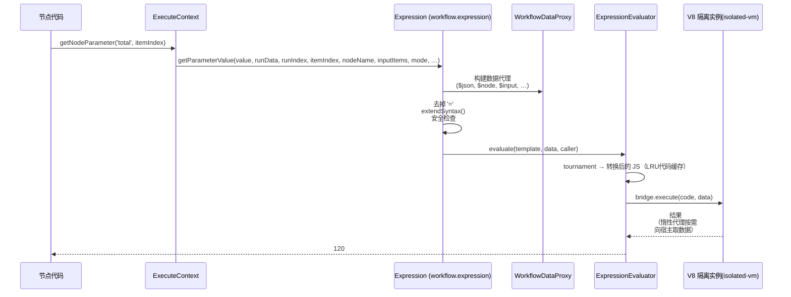

# 深度剖析 8 —— 表达式引擎 Expression Engine

> **你在这里：** 第 5 阶段，第 8/11 篇深度剖析——`={{ $json.body.amount * 1.2 }}` 是怎么安全地变成 `120` 的。
> **读完本文件后**，你会知道表达式在数据层面是什么、它能看到哪些数据，以及 n8n 如何阻止用户写的 JavaScript 碰到服务端本身。

缩写：**AST**（Abstract Syntax Tree，抽象语法树）、**VM**（Virtual Machine，虚拟机——这里指一个沙箱化的 JavaScript 上下文）、**V8**（Google's JavaScript engine，谷歌的 JavaScript 引擎）、**WASM**（WebAssembly，一种可移植的字节码格式）、**JSON**（JavaScript Object Notation，JavaScript 对象表示法）、**UI**（User Interface，用户界面）、**LRU**（Least Recently Used，最近最少使用）、**ID**（Identifier，标识符）。

---

## 角色回顾

**负责：** 在沙箱里，针对本次运行的数据对表达式字符串求值。
**掌握：** 一个覆盖在 `runData`/当前数据项之上的*数据代理*、一个隔离实例池、一份代码缓存。
**不做：** 不做网络 I/O（输入输出）、不访问文件系统、无法触达宿主进程——而且它绝不会修改运行数据。
**出现于：** **S9**（`Add VAT` 的 `total`）、**S10**（请求头认证里的 `{{$credentials.value}}`），以及在发布（S2）和 webhook 处理（S4）阶段不可见地出现。

## 内部设计

### 1. 表达式*是什么*

一个节点参数的值要么是字面量，要么是一个**以 `=` 开头的字符串**。`isExpression(value)` 做的正是这个判断（`workflow/src/expression.ts`，`resolveSimpleParameterValue` 第 610 行）：去掉这个 `=`，剩下的部分就是一个*模板*：里面散布着 `{{ … }}` 这样的 JavaScript 代码片段。

```
"={{ $json.body.amount * 1.2 }}"        → 数字 120（整体就是一个表达式时，会保留其原始类型）
"=Total: {{ $json.total }} EUR"         → 字符串 "Total: 120 EUR"
```

只有当调用方要求时（`returnObjectAsString`），对象结果才会被转成字符串；如果结果落得是一个函数，会抛出"this is a function, please add ()"。

### 2. 求值在哪里被触发



*图注：`getNodeParameter` 是唯一的入口——每一个表达式都要经过这六跳。*

`getNodeParameter`（`node-execution-context.ts` 第 514–570 行）用 lodash 的 `get` 读取 `node.parameters`；如果设了 `options.rawExpressions`，就直接返回原始字符串（Set 节点用这个做预扫描）；否则调用 `workflow.expression.getParameterValue(...)`，它会递归地解析嵌套的对象/数组。

### 3. 表达式能看到哪些数据

`WorkflowDataProxy`（`workflow/src/workflow-data-proxy.ts`）构建出一个 `Proxy` 对象，暴露出（其中包括）：`$json`（当前数据项的 JSON）、`$input`/`$items(...)`、`$node[...]` 和 `$('Node Name')`（其他节点的输出，带配对项解析）、`$parameter`、`$prevNode`、`$runIndex`、`$itemIndex`、`$mode`、`$workflow`、`$execution`、`$now`、`$today`、`DateTime`/`Duration`/`Interval`（来自 Luxon）、`$jmespath`，以及——在凭据上下文里——`$credentials`。数据是通过代理**惰性**取得的，所以除非真正被用到，上游一个巨大的输出不会被整个复制进沙箱里。

配对项查找依赖的是[引擎](06-execution-engine.md)打上的 `pairedItem` 溯源链。

### 4. 解析与安全：Tournament

`@n8n/tournament` 把模板解析成一棵 AST（抽象语法树），再对它做改写。各个钩子（`expressionSandboxHooks`）包括 `ThisSanitizer`、`PrototypeSanitizer`、`DollarSignValidator`——它们分别阻止 `this`、原型污染和构造函数花招。在这之前，`Expression` 还会用一个正则表达式拒绝任何 `.constructor` 调用。`extendSyntax` 则加上了 n8n 自己的扩展方法（`"abc".toUpperCase()`、`[1,2].sum()`、`.toDateTime()` 等等）。

### 5. 代码究竟跑在哪里：三种引擎

`ExpressionEngineConfig`（`@n8n/config/src/configs/expression-engine.config.ts`）：

| `N8N_EXPRESSION_ENGINE` | 沙箱 | 备注 |
|---|---|---|
| `vm`（**默认**） | 通过 `isolated-vm` 实现的 V8 隔离实例（`IsolatedVmBridge`） | 超时 **5000 毫秒**，内存 **128 MB**，池大小 1，代码缓存 1024 条 |
| `legacy` | 不做任何隔离（通过 `evaluateExpression`，类似 `new Function`） | "安全性较低，即将废弃" |
| `quickjs` | 编译到 WASM（WebAssembly）的 QuickJS | 实验性；编辑器可以在浏览器里用它（`N8N_EXPRESSION_ENGINE_FRONTEND`） |

`ExpressionEvaluator`（`@n8n/expression-runtime/src/evaluator/expression-evaluator.ts`）持有：Tournament 实例（惰性创建）、**代码缓存**（模板 → 转换后的 JS；根据源码注释命中率约 99.9%），以及一个**隔离实例池**（`IsolatePool`/`IdleScalingPool`）。它对外暴露 `acquire(caller)` / `evaluate(...)` / `release(caller)`。

### 6. 隔离实例的生命周期——"获取"模式

在任何代码求值 `{{ }}` 之前，必须先**为这个工作流获取一个隔离实例**：

| 位置 | 调用 |
|---|---|
| 引擎运行时 | `WorkflowExecute.initializeExecution` → `workflow.expression.acquireIsolate()`；在 `processRunExecutionData` 的 `.finally` 中释放 |
| 发布 / 触发器注册 | `ActiveWorkflowManager.add`（见[深度剖析 2](02-trigger-registry.md)） |
| webhook 处理 | `LiveWebhooks.executeWebhook`——当 `webhookPhaseNeedsIsolate` 能证明不会求值任何东西时会**跳过** |
| 凭据解析、轮询、聊天 | `credentials-helper.ts`、`poll-trigger-task-handler.ts`、`chat-execution-manager.ts` |
| 通用辅助函数 | `withExpressionIsolate(workflow, fn)`（`cli/src/utils.ts`）——只有*这个作用域*自己获取了实例，它才会释放 |

释放**不是引用计数式的**，所以嵌套作用域只能释放自己获取的实例——这个辅助函数会强制保证这一点。

## 交互关系

| 对象 | 契约 |
|---|---|
| 节点 | `getNodeParameter`（按数据项调用）——返回带类型的值 |
| 引擎 | 提供 `runExecutionData`、`runIndex`、`connectionInputData`，用于构建代理对象 |
| 凭据 | `authenticate` 会把*解密后*的数据作为 `$credentials` 注入，用来解析 `={{$credentials.x}}`（见[深度剖析 9](09-credentials.md)） |
| 配置 | 引擎选择、超时、内存、池大小，都通过 `N8N_EXPRESSION_ENGINE*` 环境变量控制 |

## ⚓ 回到示例 —— S9

`Add VAT` 运行 `SetV2.execute`。针对数据项 0，手动模式取出赋值列表；`total` 这条赋值的值是 `"={{ $json.body.amount * 1.2 }}"`。

1. `getNodeParameter('assignments…', 0)` → `workflow.expression.getParameterValue(value, runExecutionData, runIndex=0, itemIndex=0, 'Add VAT', connectionInputData, mode='webhook', additionalKeys, executeData)`。
2. `isExpression` → 真；去掉 `=` → `{{ $json.body.amount * 1.2 }}`；`extendSyntax`（没有需要扩展的内容）。
3. `renderExpression` → `evaluator.evaluate(template, data, caller, { timezone })`。
4. Tournament 把模板转换成一段 JS 函数体（按字符串缓存）；隔离实例对它求值；`$json` 惰性解析（`nodeDataGetter(contextNodeName, …).json`）为 `Add VAT` *当前输入数据项*的 JSON——也就是 `Order Webhook` 产出的那个数据项——所以 `body.amount` = `100` → `100 * 1.2` = `120`。
5. `120`（一个数字，因为该参数整体就是一个表达式）返回给 `SetV2`，由它写进输出数据项里。

第二次使用，即 **S10**：HTTP Request 节点的请求体参数 `={{ $json.total }}` 以同样的方式解析 → 得到 `120`，之后凭据里的 `={{$credentials.value}}`（深度剖析 9）也是如此。

## 失败行为

| 失败情形 | 结果 |
|---|---|
| 语法错误 | 抛出 `UserError('invalid syntax')`（旧版路径）/ 被映射过的 VM（虚拟机）错误 |
| 用户 JS 的运行时错误 | 抛出带 `runIndex`/`itemIndex` 上下文的 `ExpressionError` → 节点错误 → 走引擎的错误路由 |
| 隔离实例超时（>5 秒）或内存超限（>128 MB） | 错误被 `mapVmError` 映射；该隔离实例会被池销毁/补充 |
| 没有获取隔离实例 | 抛出 `IsolateError('No bridge acquired for this context. Call acquire() first.')` |
| 池耗尽 | 抛出 `PoolExhaustedError`；在激活流程里，遇到 `IsolateError` 时会跳过重试退避的翻倍逻辑 |
| 选定了某个引擎但尚未初始化 | 抛出 `UnexpectedError("The … expression engine has not been initialized")`——后端拒绝悄悄地退回 `legacy` |
| 模板中出现 `.constructor` | 抛出 `ExpressionError('Expression contains invalid constructor function call')` |

**下一步：** [09 —— 凭据](09-credentials.md) · **返回：** [07 —— 节点](07-nodes.md) · [概念地图](../03-concept-map.md)
