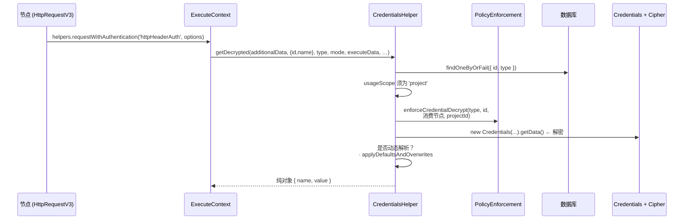
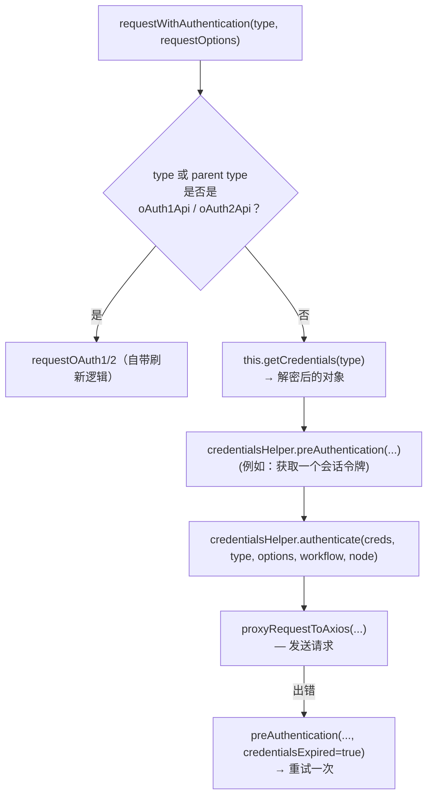

# 深度剖析 9 —— 凭据 Credentials

> **你在这里：** 第 5 阶段，第 9/11 篇深度剖析——`ICredentialType`、`Credentials`、`Cipher`、`CredentialsHelper`，以及 `requestWithAuthentication`。
> **读完本文件后**，你会知道一个密钥存在哪里、它在什么时候被解密、它是怎么被附加到一个 HTTP 请求上的，以及为什么它永远不会出现在工作流 JSON 或执行数据里。

缩写：**AES**（Advanced Encryption Standard，高级加密标准）、**CBC**（Cipher Block Chaining，密码分组链接模式）、**GCM**（Galois/Counter Mode，伽罗瓦计数器模式）、**OAuth**（Open Authorization，开放授权）、**HTTP**（Hypertext Transfer Protocol，超文本传输协议）、**JSON**（JavaScript Object Notation，JavaScript 对象表示法）、**ID**（Identifier，标识符）、**DB**（Database，数据库）、**API**（Application Programming Interface，应用程序编程接口）、**UI**（User Interface，用户界面）。

---

## 角色回顾

**负责：** 把密钥加密存储，在调用时解密，并根据凭据的*类型*把它应用到发出的请求上。
**掌握：** 加密密钥（通过 `InstanceSettings`/密钥提供方）、凭据类型定义、访问策略。
**不做：** 不把密钥放进工作流 JSON 或 `runData` 里；保存之后不再向编辑器暴露明文。
**出现于：** **S1**（Ada 创建 "Billing API key"）、**S6**（运行前的访问检查）、**S10**（解密 + 认证 + 调用）。

## 内部设计

### 1. 三个部件，三个地方

| 部件 | 是什么 | 存放位置 |
|---|---|---|
| **凭据类型**（`ICredentialType`，`interfaces.ts` 第 417 行） | 代码：`name`、`properties`（表单字段）、`authenticate`（如何应用）、可选的 `test`、`genericAuth`…… | `nodes-base/credentials/*.credentials.ts`（本次研究的提交版本中有 412 个文件），由 `LoadNodesAndCredentials` 加载 |
| **凭据记录**（`CredentialsEntity`） | 数据行：`id`、`name`、`type`、**`data` = 加密后的二进制块**、`usageScope`、项目归属 | 数据库 |
| **节点里的引用**（`INode.credentials`） | `{ [type]: { id, name } }`——*只有一个 id 和一个展示用的名字* | 工作流 JSON |

### 2. 加密

`Credentials`（`core/src/credentials.ts`）继承自 `ICredentials`；`setData(obj)` → `cipher.encryptV2(obj)`；`getData()` → `cipher.decryptV2` 之后再 `jsonParse`，并带有分类型的错误（`CREDENTIAL_ERRORS.NO_DATA`、`DECRYPTION_FAILED`、`INVALID_JSON`）。`Cipher`（`core/src/encryption/cipher.ts`）支持 `aes-256-cbc` 和 `aes-256-gcm` 两种实现，把密钥材料的管理委托给一个密钥提供方（`EncryptionKeyProxy`），并能配合密钥轮换/被包裹的密钥一起工作；显式传入 `customEncryptionKey` 时会直接走原始 CBC 模式。这个实例的加密密钥是实例级别的状态——**一旦密钥丢失，所有存储的密钥也就全部丢失**。

### 3. 解密路径 —— `CredentialsHelper.getDecrypted`（`cli/src/credentials-helper.ts` 第 551 行）



*图注：每一次解密都要先通过一次存在性检查、一次范围检查、一次策略检查，之后才会产出任何明文。*

值得了解的细节：

- 如果节点的引用里没有 `id`，`getCredentialsEntity` 会抛出 `CredentialMissingIdError`；如果没有记录能匹配 `(id, type)`，会抛出 `CredentialNotFoundError`；如果 `usageScope !== 'project'`，会抛出 `UserError('This credential cannot be used in workflows')`。
- `enforceCredentialDecrypt` 会在*解密之前*就针对*当前执行所在项目*的策略做校验。
- **动态凭据：** 一个凭据可以是*可解析*的（按用户区分），这种情况下由这个辅助对象在运行时解析出具体的值；手动运行会刻意退回到静态数据，方便开发者测试。本指南不深入展开这一块。
- `applyDefaultsAndOverwrites` 会合并类型默认值和实例级别的覆盖设置（`credentials-overwrites.ts`）。

### 4. 应用密钥 —— `requestWithAuthentication`

`core/src/execution-engine/node-execution-context/utils/request-helpers/authentication.ts` 第 165 行：



*图注：OAuth 类型走自己的一套路径；其他所有类型都是解密 → 可选的预认证 → 认证 → 发送，外加一次"刷新再重试"。*

`CredentialsHelper.authenticate`（第 122 行）支持两种风格：

- **函数式：** `credentialType.authenticate(credentials, requestOptions)`——完全自定义的控制权。
- **声明式通用型：** `{ type: 'generic', properties: { headers|qs|body|auth: { key: value } } }`，其中键和值都可以是**表达式**，并以 `$credentials` = 解密后的数据来解析（`resolveValue(..., { $credentials: credentials }, workflow, node)`）。`HttpHeaderAuth` 正是这样工作的：

```ts
// nodes-base/credentials/HttpHeaderAuth.credentials.ts
authenticate: IAuthenticateGeneric = {
  type: 'generic',
  properties: { headers: { '={{$credentials.name}}': '={{$credentials.value}}' } },
};
```

这个密钥只在内存里以明文形式存在，而且只存在于构建请求的那一瞬间——它从不会被写进 `runData`（节点收到的是*请求配置项*，不是凭据本身；被记录下来的数据项是响应结果）。

## 交互关系

| 对象 | 契约 |
|---|---|
| 节点 | `getCredentials(type)` 或 `helpers.requestWithAuthentication(type, opts)` |
| [表达式引擎](08-expression-engine.md) | 在 `authenticate` 中解析 `={{$credentials.*}}` |
| [工作流运行器](04-workflow-runner.md) | 在执行开始*之前*调用 `credentialsPermissionChecker.check(workflowId, nodes)` |
| 编辑器 | 创建/更新字段；界面可以运行某个凭据的 `test` 请求（`methods.credentialTest`） |
| 数据库 | `CredentialsEntity` 数据行；按项目共享 |

## ⚓ 回到示例 —— S1、S6、S10

**S1。** Ada 选择 "Header Auth"，填入 `Name = X-Api-Key`，`Value = sk_live_…`。服务端构建一个 `Credentials` 对象，`setData({ name:'X-Api-Key', value:'sk_live_…' })` → `data` 变成一段加密字符串；这条记录是 `{ id:'cred42', name:'Billing API key', type:'httpHeaderAuth', data:'<密文>' }`。节点里只存了 `credentials: { httpHeaderAuth: { id:'cred42', name:'Billing API key' } }`。

**S6。** `credentialsPermissionChecker.check('wf123', nodes)` 验证 `cred42` 可以被这个工作流所在的项目使用。

**S10。** `HttpRequestV3.execute` → `authentication = 'genericCredentialType'`，`genericAuthType = 'httpHeaderAuth'` → `requestWithAuthentication.call(this, 'httpHeaderAuth', requestOptions, …)`：

1. `getCredentials('httpHeaderAuth')` → `getDecrypted` → `{ name: 'X-Api-Key', value: 'sk_live_…' }`。
2. `preAuthentication` → 这个类型不需要做任何事。
3. `authenticate`（通用型）：把键 `={{$credentials.name}}` 解析成 `X-Api-Key`，值 `={{$credentials.value}}` 解析成 `sk_live_…`；设置 `requestOptions.headers['X-Api-Key']`。
4. `proxyRequestToAxios` 发送 `POST https://billing.example.com/invoices`，请求体为 `{ total: 120 }`。
5. 响应 `{ "invoiceId": "INV-1001" }` 成为该节点的输出数据项；**请求头里的密钥值不在其中**。

## 失败行为

| 失败情形 | 结果 |
|---|---|
| 凭据记录缺失/类型不对 | 抛出 `CredentialNotFoundError` → 节点报错 |
| 节点没有设置该类型的凭据 | 抛出 `NodeOperationError('Node "…" does not have any credentials of type "…" set')` |
| 加密密钥不对 / 密文损坏 | 抛出带 `DECRYPTION_FAILED` 的 `CredentialDataError`（附带原因） |
| 策略拒绝解密 | 在解密**之前**就失败 |
| HTTP 错误（例如令牌过期返回 401） | `requestWithAuthentication` 调用 `preAuthentication(…, credentialsExpired=true)` 来刷新，然后重试一次；如果仍然失败 → 抛出 `NodeApiError` |
| 项目无权使用该凭据 | 在任何节点执行之前，执行就已在 `run()` 中被创建并失败（见[深度剖析 4](04-workflow-runner.md)） |

**下一步：** [10 —— 任务运行器](10-task-runner.md) · **返回：** [08 —— 表达式引擎](08-expression-engine.md) · [概念地图](../03-concept-map.md)
