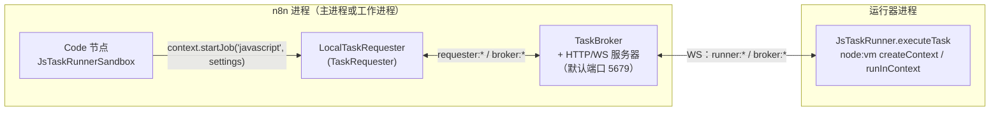
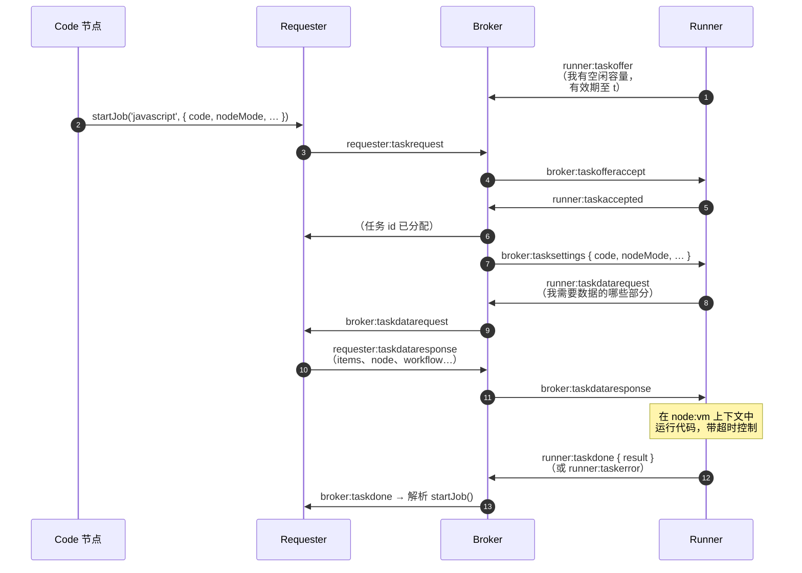

# 深度剖析 10 —— 任务运行器 Task Runner（Code 节点真正运行的地方）

> **你在这里：** 第 5 阶段，第 10/11 篇深度剖析——`@n8n/task-runner` 以及 `cli/src/task-runners/` 里的代理（broker）。
> **读完本文件后**，你会知道为什么 Code 节点里用户写的 JavaScript 不在 n8n 服务端进程内执行、一个任务是怎么在请求方 → 代理 → 运行器之间往返的，以及运行器挂掉时会发生什么。

缩写：**WS**（WebSocket，WebSocket 协议）、**HTTP**（Hypertext Transfer Protocol，超文本传输协议）、**RPC**（Remote Procedure Call，远程过程调用）、**IPC**（Inter-Process Communication，进程间通信）、**VM**（Virtual Machine，虚拟机——这里指 Node 的 `vm` 模块上下文）、**ID**（Identifier，标识符）、**JSON**（JavaScript Object Notation，JavaScript 对象表示法）、**OOM**（Out Of Memory，内存溢出）。

---

## 角色回顾

**负责：** 在一个独立的、可重启的进程里执行不受信任的用户代码（JavaScript，以及通过另一个运行器支持的 Python），并带有任务超时。
**掌握：** 任务的脚本和配置；它会*主动索要*输入数据，而不是自己持有数据。
**不做：** 不持有工作流状态、凭据或持久化逻辑。
**出现于：** **S11**（`Summarize` Code 节点）。

## 内部设计

### 1. 为什么要用一个独立进程？

Code 节点让任何用户都能运行 JavaScript。如果放在服务端进程里跑，就会和密钥以及其他租户的数据共享内存、环境变量和文件系统。一个经由 WebSocket 驱动的独立**运行器进程**带来了：一道崩溃边界、一个硬性超时（`taskTimeout`），以及一个 n8n 可以监控并重启的进程生命周期（有 OOM（内存溢出）检测器和重启循环检测器）。

### 2. 三个角色

*图注：请求方（requester）和代理（broker）都活在 n8n 内部；只有运行器在外面——它通过 WebSocket 连回来。*

| 角色 | 类 | 职责 |
|---|---|---|
| **请求方 Requester** | `LocalTaskRequester extends TaskRequester`（`cli/src/task-runners/task-managers/`） | 打包请求（`TaskRequest`，其中 `TaskData` = 工作流、runExecutionData、inputData、node 等），之后负责回答运行器的数据请求 |
| **代理 Broker** | `TaskBroker`（`task-broker/task-broker.service.ts`）+ `TaskBrokerServer` / `TaskBrokerWsServer` | 把**任务请求**和运行器发来的**任务报价**撮合到一起；转发消息；关闭时执行排空（drain） |
| **运行器 Runner** | `JsTaskRunner`（`@n8n/task-runner/src/js-task-runner/js-task-runner.ts`，`executeTask` 第 200 行） | 建立连接，报出可用容量（`maxConcurrency` 默认 10），执行脚本 |

部署方式：`N8N_RUNNERS_MODE` = `internal`（n8n 把运行器作为子进程启动——`JsTaskRunnerProcess` / `PyTaskRunnerProcess`，带重启循环检测和 OOM 检测）或 `external`（由某个编排器来启动它；需要 `N8N_RUNNERS_AUTH_TOKEN`）。`TaskRunnerModule.start()` 负责接线，并在 `execution-cancelled` 事件上取消任务。

### 3. 协议（消息名称来自 `message-types.ts`）

*图注：运行器先报出自己的可用容量；请求会被撮合到某个报价上；之后运行器只会精确拉取自己需要的那部分输入数据。*

几个值得了解的设计要点：

- **先报价后撮合**（而不是直接把任务推给运行器），让代理能够容忍运行器随时上线/下线；报价带有一个 `validUntil`，运行器断开时报价会被丢弃。（协议里还有 `runner:taskrejected` / `runner:taskdeferred` 消息；它们的确切语义本文不展开。）
- **数据是按需拉取的，而且只拉取代码真正用到的部分。** `JsTaskRunner.executeTask` 会解析脚本，找出用到了哪些内置量（`builtInsParser.parseUsedBuiltIns(code)`）；如果代码从没引用过 `$('Node')` 或 `$input`，它就不会索要全部数据。无法判断时 → 索要全部数据。
- **三种模式：** `runOnceForAllItems`（一次调用处理全部数据项）、`runOnceForEachItem`（逐个数据项，可选地分*块*处理）、以及 `runCode`（一个锁死的上下文，没有内置量也没有 RPC（远程过程调用），用于工具场景）。
- **回调 n8n 的 RPC：** 协议里有 `runner:rpc` / `broker:rpc` / `rpcresponse` 这组消息，让脚本可以通过请求方调用宿主端挑选出的若干函数，而不必自己做 I/O（见 `js-task-runner.ts` 中的 `RpcCallObject`）。
- **超时：** `N8N_RUNNERS_TASK_TIMEOUT` 默认 300 秒（`taskTimeout`）。被 `abort` 时，运行器会以 `TimeoutError` 拒绝任务。
- **结果校验：** 节点会校验返回形状（`validateRunCodeAllItems`，以及它针对单个数据项的对应版本），并规范化数据项（`helpers.normalizeItems`）——所以 `return {a:1}` 和 `return [{json:{a:1}}]` 这两种写法都能用。

## 交互关系

| 对象 | 契约 |
|---|---|
| Code 节点（`Code.node.ts` 第 215 行：`new JsTaskRunnerSandbox(workflowMode, this)`） | `runCodeAllItems(code)` / `runCodeForEachItem(code, n)` → `startJob` |
| `additionalData.startRunnerTask` | 各种上下文到达请求方的接口（`base-execute-context.ts` 第 444 行） |
| [引擎](06-execution-engine.md) | 完全无感知——在它看来只是一次跑得久一点的普通 `execute`；取消信号通过 `execution-cancelled` 事件传播 |
| 环境变量 | `runners.config.ts` 中的 `N8N_RUNNERS_*` 系列配置 |

## ⚓ 回到示例 —— S11

`Summarize` 的输入：一个数据项 `{ json: { invoiceId: "INV-1001", total: 120, … } }`。代码是 `return [{ json: { summary: \`Invoice ${$input.first().json.invoiceId}\` } }];`。

1. `Code.execute` → `new JsTaskRunnerSandbox(mode, this)`；模式是 `runOnceForAllItems` → 调用 `runCodeAllItems(code)`。
2. `startJob('javascript', { code, nodeMode:'runOnceForAllItems', workflowMode:'webhook', continueOnFail:false }, 0)` → `additionalData.startRunnerTask(...)` → `LocalTaskRequester.startTask` → 发出 `requester:taskrequest`。
3. 代理把它撮合给内部 JS 运行器的一个报价；运行器收到配置。
4. 运行器的解析器在代码里看到了 `$input` → 请求输入数据（不是整个运行历史）；请求方作答。
5. `runInContext(...)` 执行脚本（超时 300 秒）；结果 `[{ json: { summary: "Invoice INV-1001" } }]` → 发出 `runner:taskdone`。
6. `validateRunCodeAllItems` 规范化结果 → 作为节点输出返回 → 引擎把它记进 `runData['Summarize']`（S12 继续）。

## 失败行为

| 失败情形 | 结果 |
|---|---|
| 脚本抛出异常 | `runner:taskerror` → `throwExecutionError(...)` → 节点报错（遵守*失败时继续*设置） |
| 脚本超时 | 300 秒后抛出 `TimeoutError`（可配置） |
| 没有运行器连接 / 报价过期 | 请求方等待；未被撮合的请求可能会过期（`broker:requestexpired`），并表现为一次任务错误 |
| 运行器进程崩溃 / OOM | internal 模式下：`TaskRunnerModule` 有断连分析器和 OOM 检测器用来解释失败原因，还有重启循环检测器来阻止不断崩溃重启；正在进行中的任务具体如何被判失败，本指南未深入追踪 |
| 执行被取消 | `execution-cancelled` → `taskRequester.cancelTasks(executionId)` → 发出 `broker:taskcancel` |
| 关闭 | 代理进入*排空*：通知运行器停止报价、拒绝新请求、在超时时间内等待进行中的任务结束 |

**下一步：** [11 —— 生命周期、持久化与推送](11-lifecycle-persistence-push.md) · **返回：** [09 —— 凭据](09-credentials.md) · [概念地图](../03-concept-map.md)
