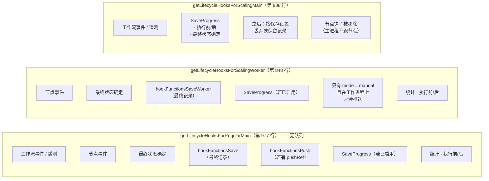

# 深度剖析 11 —— 生命周期钩子、持久化与推送

> **你在这里：** 第 5 阶段，第 11/11 篇深度剖析——`ExecutionLifecycleHooks`、各种保存钩子、执行相关的数据表，以及推送服务。
> **读完本文件后**，你会知道一次执行是怎么变成一条持久化记录的、为什么生产环境的运行不会流式推送到编辑器、"保存进度"要付出什么代价，以及主进程/工作进程的拆分如何改变钩子分别在哪里运行。

缩写：**DB**（Database，数据库）、**ID**（Identifier，标识符）、**UI**（User Interface，用户界面）、**WS**（WebSocket，WebSocket 协议）、**SSE**（Server-Sent Events，服务器发送事件）、**JSON**（JavaScript Object Notation，JavaScript 对象表示法）、**PII**（Personally Identifiable Information，个人身份信息）、**HTTP**（Hypertext Transfer Protocol，超文本传输协议）。

---

## 角色回顾

**负责：** 所有对执行事件做出*反应*的事情——保存、流式推送到编辑器、统计、触发错误工作流、HTTP 响应转发。
**掌握：** 保存设置（按工作流 + 全局默认值）、`pushRef`、执行记录。
**不做：** 不决定下一个该跑哪个节点，也不决定它输出什么。引擎只是*触发*钩子，不读取钩子的返回结果。（钩子是一个接一个 `await` 的，`runHook` 没有 `try/catch`，所以一个抛出异常的处理器*会*直接传播进这次运行——这正是为什么像保存进度这样的内置处理器要自己捕获并记录自己的错误。）
**出现于：** **S12**——以及从 S8 开始，在每个节点边界处都不太显眼地出现一次。

## 内部设计

### 1. 钩子总线

`ExecutionLifecycleHooks`（`core/src/execution-engine/execution-lifecycle-hooks.ts`）是一份按事件分类、带类型的处理器列表。`addHandler(name, fn)`、`runHook(name, params)`（处理器依次执行，`this` 就是这个钩子对象本身，携带着 `executionId`、`mode`、`workflowData`）。

| 事件 | 由谁触发 | 典型处理器 |
|---|---|---|
| `workflowExecuteBefore` | `initializeExecution` | 遥测事件、推送 `executionStarted`、执行前处理 |
| `nodeExecuteBefore` | 每个节点开始前 | 推送、节点事件簿记 |
| `nodeExecuteAfter` | 每个节点之后（失败时也会，除非被取消） | **保存进度**、推送 |
| `workflowExecuteAfter` | `processSuccessExecution` / 捕获到异常时 | **保存执行记录**、错误工作流、统计、推送 `executionFinished` |
| `sendResponse` | Respond-to-Webhook / lastNode | 解析正在等待的 HTTP 调用方 |
| `sendChunk` | 流式输出、报错时 | 给 HTTP 响应写入一个数据块 |
| `nodeFetchedData` | 拉取数据的节点 | 工作流统计 |

### 2. 钩子集合取决于进程角色

`cli/src/execution-lifecycle/execution-lifecycle-hooks.ts`：



*图注：同一组事件，接线方式却不同——队列模式下由工作进程写入结果；主进程只负责收尾。*

### 3. 保存设置

`toSaveSettings(workflowSettings)`（`to-save-settings.ts`）把按工作流的覆盖设置与 `GlobalConfig.executions` 里的全局默认值合并起来：

| 设置项 | 含义 |
|---|---|
| `saveDataSuccessExecution`（`all`/`none`/`DEFAULT`） | 是否保留成功运行的记录 |
| `saveDataErrorExecution` | 是否保留失败运行的记录 |
| `saveManualExecutions` | 是否保留编辑器里的测试运行；关闭时会被**软删除**，在一个宽限期后（`EXECUTIONS_DATA_HARD_DELETE_BUFFER`）才真正硬删除，这样用户在搭建流程时仍能取到二进制数据 |
| `saveExecutionProgress` | **每个节点跑完后**都把整个运行状态写一次数据库 |

`saveExecutionProgress`（`save-execution-progress.ts`）执行的是 `updateExistingExecution(executionId, { data: executionData, status: 'running' }, { requireNotFinished: true, requireNotCanceled: true })`——这样即使运行中途崩溃，也会留下一条*部分记录*可供检查，也能让一个 `Wait` 节点之后恢复；代价是每个节点都要多写一次数据库（源码注释里提到，在繁忙的 SQLite 上可能会遇到 "Database is locked" 错误）。

### 4. 最终保存 —— `hookFunctionsSave` / `hookFunctionsSaveWorker`

在 `workflowExecuteAfter`（第 566 / 713 行）里：

1. 恢复/复制二进制数据的 id（`restoreBinaryDataId`；子工作流会把二进制数据复制一份给父级）。
2. 如果不是手动模式且有 `newStaticData` → 调用 `saveStaticDataById`。
3. 如果是手动模式且 `!saveSettings.manual` → 软删除，返回。
4. 如果这次结果*不应该被保存*（成功但 `!success`，或者非成功但 `!error`）且不是 `waiting` → 如果适用就先触发错误工作流，再调用 `deleteInFlightExecution`，返回。
5. 否则 `prepareExecutionDataForDbUpdate({ runData, workflowData, workflowStatusFinal, retryOf })` → `updateExistingExecution(..., { requireNotCanceled: true })`——**一次已完成的运行永远不会覆盖用户已经设置成 `canceled` 的状态**。
6. `updateExistingExecutionMetadata`（自定义的元数据键值对）；对非成功、非等待、非手动的运行触发 `executeErrorWorkflow(...)`（除非被抑制）；触发 `workflowStatisticsService.emit('workflowExecutionCompleted', …)`。

### 5. 持久化模型

`@n8n/db` 中的实体：

| 实体 | 存放内容 |
|---|---|
| `ExecutionEntity`（`execution-entity.ts`） | **你在列表/筛选里看到的那一行**：`id`、`workflowId`、`mode`、`status`、`finished`（已废弃）、`retryOf`、`createdAt`、`startedAt`（处理开始前为 null）、`stoppedAt`、`waitTill`、`deletedAt`（软删除）、`storedAt`（负载存在哪里）、`deduplicationKey`（唯一；供定时触发器使用）、`jsonSizeBytes`、`workflowVersionId`、`usedPrivateCredentials`；索引包括 `(workflowId, id)`、`(waitTill, id)`，以及仅 Postgres 下的局部索引 `(workflowId, status, id)` |
| `ExecutionData`（`execution-data.ts`） | **负载本身**：序列化后的 `IRunExecutionData` 以及 `workflowData` 快照，与实体一一对应 |
| `ExecutionMetadata` | 从工作流里设置的自定义键值对 |
| `ExecutionAnnotation`（`.ee`） | 标签/评分 |

负载可以存在数据库之外：`ExecutionDataStorageLocation = 'db' | 'fs' | 's3' | 'az'`（`storedAt`）。`ExecutionPersistence` 是统一的外观接口（`create`、`updateExistingExecution`、`findSingleExecution({ includeData, unflattenData })`、`deleteInFlightExecution`）。*工作流的快照会和每次执行一起存下来*——所以即使之后又编辑过，历史记录展示的依然是当初跑的那张图。

**状态流转**（`ExecutionStatus`：`canceled, crashed, error, new, running, success, unknown, waiting`）——见[伸缩队列](05-scaling-queue.md#失败行为)里的状态图。`hookFunctionsFinalizeExecutionStatus` 会*先于其他 after 钩子*运行，这样所有钩子看到的最终状态都是一致的。

### 6. 推送——通向某一个浏览器标签页的实时通道

`hookFunctionsPush`（第 271 行）：`if (!pushRef) return;`——**没有 `pushRef`，就没有推送。** 生产环境的 webhook 和触发器运行都没有这个值。

当存在 `pushRef` 时，会通过 `Push.send(message, pushRef)`（`cli/src/push/`，走 WebSocket 或 SSE）发送：`executionStarted`、`nodeExecuteBefore { executionId, nodeName, sequenceNumber, data }`、`nodeExecuteAfter { …, itemCountByConnectionType, data: taskData 但不含数据项本身 }`、`executionFinished { executionId, workflowId, status, source }`。数据项的实际内容在 `nodeExecuteAfter` 里是刻意**不**推送的（只推送数量）；编辑器需要的话会单独去取完整数据。`sequenceNumber` 是按这次运行递增的单调计数器，这样一个被挂起过的浏览器标签页恢复后，也能把迟到的事件排好序。推送钩子里还带着一个脱敏代理（`ExecutionRedactionServiceProxy`）——这是一套从推送内容里剥离敏感数据的机制；它的具体规则本文不展开。

在队列模式下，一次在工作进程上执行的手动运行，会先把节点事件通过内部发布/订阅通道转发到主进程，再送到浏览器（`sequenceNumber` 计数器旁边的注释提到了这一点）；而推送相关的*钩子*，只有在模式为 `manual` 时才会被安装到工作进程上。

## 交互关系

| 对象 | 契约 |
|---|---|
| 引擎 | 触发事件；会 `await` `nodeExecuteAfter` 的处理器，这样保存操作就不会出现竞态 |
| [运行器](04-workflow-runner.md) / [JobProcessor](05-scaling-queue.md) | 选用哪一套钩子；添加 `sendResponse` / `sendChunk` 处理器 |
| 错误工作流 | `executeErrorWorkflow(workflowData, fullRunData, mode, executionId, retryOf)` 会启动设置里指定的那个工作流的另一次执行 |
| 编辑器 | 按 `pushRef` 接收推送消息；通过 REST 读取执行记录列表 |
| 统计 / 遥测 / 事件总线 | `workflow-pre-execute`、`workflow-post-execute`、`workflow-executed` 等事件 |

## ⚓ 回到示例 —— S12

Ada 的工作流用的是默认保存设置（保存成功和失败的记录，关闭进度保存，保存手动运行）。

- **每个节点之后**（`nodeExecuteAfter`）：工作进程钩子里的 `SaveProgress` 什么也不做（进度保存是关闭的）；推送相关的钩子不存在（这是生产运行，没有 `pushRef`，而工作进程只在手动模式下才会安装推送）。统计/节点事件照常触发。
- **`Summarize` 之后**（`workflowExecuteAfter`）：`hookFunctionsFinalizeExecutionStatus` 把状态定为 `success`；`hookFunctionsSaveWorker` → `prepareExecutionDataForDbUpdate` → `updateExistingExecution` 写入：`status: 'success'`、`finished: true`、`stoppedAt`，以及一个 `resultData.runData` 带有四个键的负载：

  ```
  "Order Webhook" · "Add VAT" · "Create Invoice" · "Summarize"   （每个都是 [ { startTime, executionTime, data: { main: [[items]] }, … } ]）
  ```

  没有触发错误工作流（状态是成功）。工作进程发出 `job-finished`（v2 版本带状态和时间戳）→ 主进程的 `ScalingService` 存下结果，并（经由主进程一侧的钩子）保留这条记录，因为成功的运行是会被保存的。
- **Ada 打开执行记录页面** → 通过 REST 读取 `ExecutionEntity` 的数据行；打开 `#1042` 会加载负载（`findSingleExecution({ includeData: true })`），编辑器会展示每个节点的输入/输出数据项。凭据的值在其中哪里都找不到。

## 失败行为

| 失败情形 | 结果 |
|---|---|
| 某个钩子处理器抛出异常 | `runHook` 不会捕获它：异常会继续传播。在引擎最外层的 `.catch` 里，这次运行会被记为失败，并再尝试一次 `workflowExecuteAfter`，但*这一次*钩子里的错误只会被记录日志（`console.error("There was a problem running hook \"workflowExecuteAfter\"")`）。内置的处理器通过自己捕获错误来规避这个问题。如果最终的*保存*本身失败了，这条记录可能会一直停留在 `running`，直到恢复逻辑把它标记为 `crashed` |
| 保存进度时数据库写入失败 | 上报并记录日志；这次运行继续进行 |
| 运行在用户取消之后才结束 | `requireNotCanceled: true` 会保持 `canceled` 状态不被覆盖 |
| 保存策略说"不保留" | 删除这条进行中的记录（`deleteInFlightExecution`）——但对于失败的情况，错误工作流还是会先被触发 |
| 推送连接丢失 | 该标签页的事件被丢弃；执行本身不受影响；编辑器会通过重新拉取数据来对齐状态 |
| 进程在最终保存之前就挂了 | 记录停留在 `running` → 恢复逻辑介入 → 标记为 `crashed` |

**下一步：** [06 —— 完整走查](../06-walkthrough.md) · **返回：** [10 —— 任务运行器](10-task-runner.md) · [概念地图](../03-concept-map.md)
