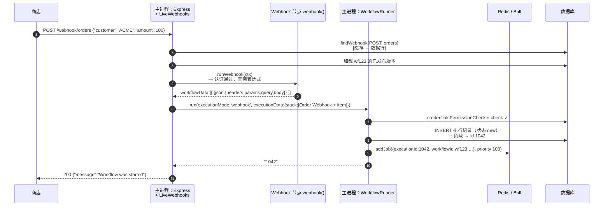
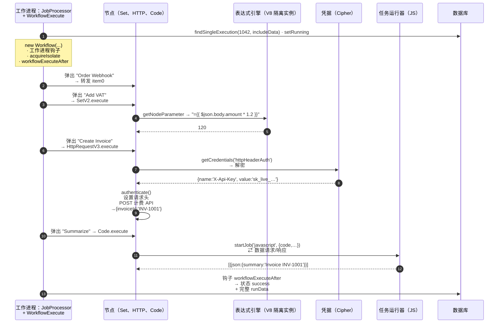
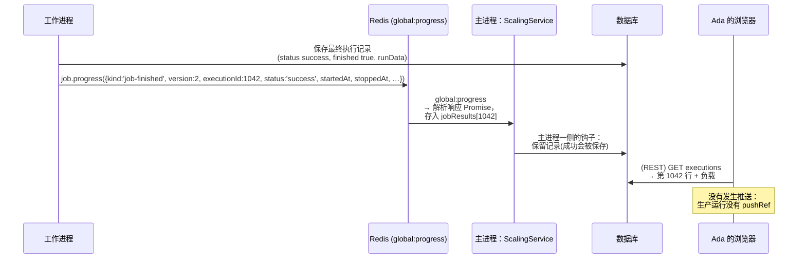
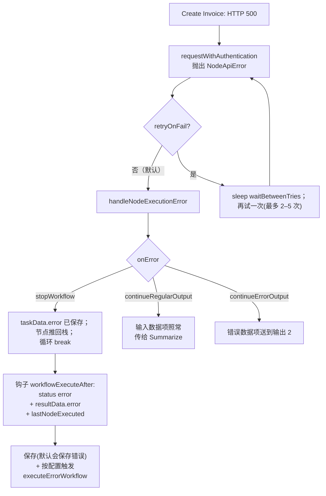

# 06 —— 完整走查：Ada 的订单，从头到尾

> **你在这里：** 第 6 阶段（共 6 阶段）——把贯穿示例**完整地重新跑一遍，全程深入**，把十一篇深度剖析缝合成一条连续的故事线。
> **读完本文件后**，每一个概念、每一个组件都已经被你看着它*亲自完成了自己的工作*，而且是在同一个连贯的故事里，带着每一跳上真实传递的数据。

缩写：**HTTP**（Hypertext Transfer Protocol，超文本传输协议）、**JSON**（JavaScript Object Notation，JavaScript 对象表示法）、**API**（Application Programming Interface，应用程序编程接口）、**DB**（Database，数据库）、**ID**（Identifier，标识符）、**UI**（User Interface，用户界面）、**V8**（Google's JavaScript engine，谷歌的 JavaScript 引擎）、**WS**（WebSocket，WebSocket 协议）、**REST**（Representational State Transfer，表征状态转移）。

> **诚实声明。** 下文出现的函数名、字段名、消息种类、日志格式字符串和默认值，均来自提交 `c1463d0e` 的源码。但**具体的 ID、时间戳和取值**（执行号 `1042`、任务号 `77`、`sk_live_…`）都是示意性的。我并没有为写这篇指南而真的跑起一个 n8n 实例；唯一被我实际执行过的代码，是 [`examples/mini-engine.mjs`](examples/mini-engine.mjs) 里的那个玩具引擎。

---

## 登场角色（提醒一下）

编辑器 · 触发器注册中心 · Webhook 接入层 · 工作流运行器 · 伸缩队列 · 执行引擎 · 节点 · 表达式引擎 · 凭据 · 任务运行器 · 钩子/持久化/推送——详见 [03-concept-map](03-concept-map.md)。

## 第 A 部分 —— 订单到来之前：搭建与发布（S1–S2）

| 环节 | 传递了什么 | 内部发生了什么 |
|---|---|---|
| **A1** 浏览器 → 服务端 | `PATCH /rest/workflows/wf123`，内容 `{ nodes:[4], connections:{…} }` | 工作流以 JSON 形式存储（`WorkflowEntity`，外加一条历史版本）。不含任何密钥。 |
| **A2** 浏览器 → 服务端 | 凭据字段 `{ name:"X-Api-Key", value:"sk_live_…" }` | `Credentials.setData` → `Cipher.encryptV2` → 记录 `{ id:cred42, type:httpHeaderAuth, data:<密文> }` |
| **A3** 浏览器 → 服务端 | `POST /rest/workflows/wf123/activate`，内容 `{ versionId, expectedChecksum }`，外加 `push-ref` 请求头 | `@ProjectScope('workflow:publish')`，写锁检查 → `WorkflowService.activateWorkflow` |
| **A4** 服务端 → 注册中心 | `ActiveWorkflowManager.add('wf123','activate')` | 加载已发布版本；`new Workflow({...active:true})`；`acquireIsolate`；`getNodeWebhooks` → `{POST,'orders'}`；`storeWebhook` 插入记录 `(orders, POST) → wf123 / "Order Webhook"`；`releaseIsolate`；触发器计数 = 1 |

第 A 部分结束后的状态——这是让实时接入得以工作的**唯一**要素：

```
webhook_entity:  webhookPath=orders  method=POST  workflowId=wf123  node="Order Webhook"
```

## 第 B 部分 —— 订单到来（S3–S6）

```bash
curl -i -X POST https://n8n.example.com/webhook/orders \
  -H 'Content-Type: application/json' \
  -d '{"customer":"ACME","amount":100}'
```



*图注：S3–S6——执行记录一旦存在、任务一旦入队，就立刻回复调用方。*

带注释的数据流转：

| 环节 | 数据 |
|---|---|
| **B1** 商店 → 接入层 | 原始 HTTP 请求；Express 把 `/webhook/*path` 路由到 `createWebhookHandlerFor(liveWebhooks,'webhook')`；日志：`Received webhook "POST" for path "orders"` |
| **B2** 接入层 → 数据库/缓存 | `findCachedStaticWebhook('POST','orders')` → 键 `webhook:POST-orders` |
| **B3** 接入层 → Webhook 节点 | 一个 `WebhookContext`，带着 `req`、`res`、节点参数（`httpMethod: POST`、`path: orders`、`responseMode` 默认 `onReceived`） |
| **B4** Webhook 节点 → 接入层 | `{ webhookResponse: undefined, workflowData: [[ { json: { headers:{…}, params:{}, query:{}, body:{customer:"ACME",amount:100} } } ]] }` |
| **B5** 接入层 → 运行器 | `IWorkflowExecutionDataProcess { executionMode:'webhook', executionData: IRunExecutionData{ executionData.nodeExecutionStack:[{node:"Order Webhook", data:{main:[[item0]]}, source:null}] }, workflowData, projectId, … }` |
| **B6** 运行器 → 数据库 | `executionPersistence.create({ mode:'webhook', status:'new', finished:false, workflowId, data, workflowData })` → 得到 `1042` |
| **B7** 运行器 → Redis | `JobData { workflowId:'wf123', executionId:'1042', loadStaticData:false, projectId, poolName }`；**不含任何数据项** |
| **B8** 接入层 → 商店 | `HTTP/1.1 200` `{"message":"Workflow was started"}`——在 `run()` 返回 id *之后*才发出（这样自定义响应里就可以用上 `$execution.id`） |

## 第 C 部分 —— 工作进程运行这张图（S7–S12）



*图注：S7–S12 在工作进程内部——一个循环，四个节点，三个专职帮手（表达式隔离实例、加密组件、任务运行器）。*

### 引擎的状态，逐次迭代

（摘自[引擎深度剖析](05-deep-dives/06-execution-engine.md)；`unshift`/`shift` 给出的是深度优先的顺序。）

```
起始   stack=[Order Webhook]                                   runData={}
第0轮  弹出 Order Webhook   → out=[item0]                      runData={Order Webhook:[t0]}       stack=[Add VAT]
第1轮  弹出 Add VAT         → out=[item0 + total:120]          runData+={Add VAT:[t0]}            stack=[Create Invoice]
第2轮  弹出 Create Invoice  → out=[{…, invoiceId:'INV-1001'}]  runData+={Create Invoice:[t0]}     stack=[Summarize]
第3轮  弹出 Summarize       → out=[{summary:'Invoice INV-1001'}] runData+={Summarize:[t0]}        stack=[]  → 循环结束
```

每次迭代之间，引擎会：（1）给输入打上 `pairedItem` 标记，（2）触发 `nodeExecuteBefore/After`，（3）对每条输出非空的连接调用 `addNodeToBeExecuted`。

### 每个节点上的数据

| 节点 | 输入数据项（`json`） | 输出数据项（`json`） |
|---|---|---|
| Order Webhook | `{headers,params,query,body:{customer:"ACME",amount:100}}` | 相同（原样转发） |
| Add VAT | 相同 | `{…同上, total: 120}`——来自**表达式**的赋值 |
| Create Invoice | `{…, total:120}` | `{invoiceId:"INV-1001", …}`——这是**HTTP 响应体**；请求头里的密钥*不在*这里 |
| Summarize | `{invoiceId:"INV-1001", …}` | `{summary:"Invoice INV-1001"}`——在**任务运行器**里算出来的 |

### 存储下来的产物（精简版 `resultData.runData`）

```json
{
  "Order Webhook":  [ { "startTime": 1790000000000, "executionTime": 1, "executionStatus": "success",
                        "source": [], "data": { "main": [[ { "json": { "body": { "customer": "ACME", "amount": 100 } }, "pairedItem": { "item": 0 } } ]] } } ],
  "Add VAT":        [ { "executionStatus": "success", "source": [ { "previousNode": "Order Webhook" } ],
                        "data": { "main": [[ { "json": { "body": { "…": "…" }, "total": 120 }, "pairedItem": { "item": 0 } } ]] } } ],
  "Create Invoice": [ { "executionStatus": "success", "source": [ { "previousNode": "Add VAT" } ],
                        "data": { "main": [[ { "json": { "invoiceId": "INV-1001" }, "pairedItem": { "item": 0 } } ]] } } ],
  "Summarize":      [ { "executionStatus": "success", "source": [ { "previousNode": "Create Invoice" } ],
                        "data": { "main": [[ { "json": { "summary": "Invoice INV-1001" }, "pairedItem": { "item": 0 } } ]] } } ]
}
```

*（结构来自 `ITaskData`；具体取值为示意性数据。）*

### debug 级别的日志（来自源码的真实格式字符串）

```
[webhook 进程]  Received webhook "POST" for path "orders"
[webhook 进程]  Started execution of workflow "Order intake" from webhook with execution ID 1042
[工作进程]      Worker started execution 1042 (job 77)
[工作进程]      Start executing node "Add VAT"
[工作进程]      Running node "Add VAT" started
[工作进程]      Running node "Add VAT" finished successfully
   ……（Create Invoice、Summarize 也各有同样的三行）……
[主进程]        Execution 1042 (job 77) finished
```

## 第 D 部分 —— 返回路径（S12）



*图注：工作进程负责写结果；那条任务消息只是一个通知——主进程读取结果走的是数据库，不是 Redis。*

## 第 E 部分 —— 自己动手跑一遍这个形状

```bash
cd n8n-guide/examples && node mini-engine.mjs
```

输出（已验证真实跑过）：

```
ran Order Webhook   -> [{"body":{"customer":"ACME","amount":100}}]
ran Add VAT         -> [{"body":{"customer":"ACME","amount":100},"total":120}]
ran Create Invoice  -> [{"body":{…},"total":120,"invoiceId":"INV-1001","_called":"https://billing.example.com/invoices"}]
ran Summarize       -> [{"summary":"Invoice INV-1001 for 120"}]
```

这个玩具实现用的是同样的四个动词——**弹出、运行、记录、把子节点入队**——建立在同样的数据模型之上（`nodes`、`connections`、数据项、一个栈、`runData`）。它省略了一切让 n8n 之所以成为 n8n 的东西：多输入等待、重试/`onError`、表达式与凭据、pairedItem 溯源链、钩子、持久化、取消与队列。

## 一个失败变体（已追踪的边缘流程）

*如果计费 API 返回了 500 会怎样？*（见[引擎深度剖析的"失败行为"一节](05-deep-dives/06-execution-engine.md#失败行为)。）



*图注：一个节点失败，三种可能的路由——默认行为是停止运行，但会保留目前为止已经算出的一切。*

## 回顾——问题是怎么被解决的

第 1 阶段里的痛点是**胶水代码**：毫无可见性、密钥散落各处、只有开发者能改、扩容全靠自己硬凑。在这次走查里：

- 业务流程是 Ada 画出来的**一张 JSON 图**，而不是代码（**工作流、节点、连接**）。
- 外部世界通过一条**注册过的 webhook 记录**进入系统，变成最初的**数据项**（**触发器、接入层**）。
- 这次运行是一条持久化的**执行**记录，它的全部状态都活在一个可序列化的对象里，所以一个**队列**才能只凭一个 ID 就把它交给某个**工作进程**（**运行器、伸缩队列、引擎**）。
- 具体的值由**表达式**在沙箱中算出；Ada 自定义的逻辑跑在一个**任务运行器**里——从来不在服务端自己的内存中执行。
- **凭据**始终保持加密状态，只为一次请求解密一次，从不进入运行记录。
- 每个节点的输入和输出都被**记录**下来，所以 Ada 能准确审查发生过什么（**钩子、持久化**）。

这就是整个设计的全部：*图即数据，一个引擎负责遍历它，密钥只有一个存放之处，每次运行都有一份记录。*

**下一步：** [07-next-steps.md](07-next-steps.md) · **返回：** [深度剖析 11](05-deep-dives/11-lifecycle-persistence-push.md) · [总览](00-overview.md)
