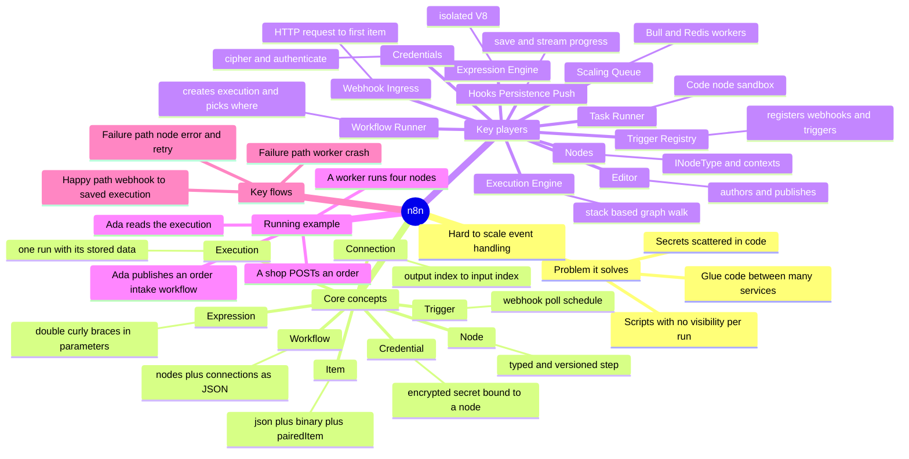

# n8n — A Cognitive Mental-Model Guide

> **Where you are:** the front door of the guide pack. **After this file** you will hold the whole territory of n8n in one picture (the mindmap) and know the order in which to read the rest.

**Snapshot studied:** n8n `2.41.0`, commit `c1463d0e` (2026-09-26), shallow clone of `github.com/n8n-io/n8n`.
All source paths below are relative to `packages/` in that repository.

---

## 1. The path this guide follows

```
WHY → WHAT → CONCEPT MAP → RUNNING EXAMPLE → DEPTH DIVES → FULL WALKTHROUGH
```

One scenario — **Ada's order-intake workflow** — is the spine. Every deep dive anchors back to it (⚓), and the walkthrough re-runs it at full depth.

| Stage | File | You will learn |
|---|---|---|
| Why | [01-why.md](01-why.md) | The pain that made n8n inevitable |
| What | [02-what.md](02-what.md) | Definition, boundaries, ecosystem |
| Concept map | [03-concept-map.md](03-concept-map.md) | 8 concepts, 11 key players, one coordination diagram |
| Running example | [04-running-example.md](04-running-example.md) | Ada's workflow, traced shallowly in 12 steps |
| Depth dives | [05-deep-dives/](05-deep-dives/) | One file per key player (below) |
| Walkthrough | [06-walkthrough.md](06-walkthrough.md) | The example again, end to end, with real payloads and a runnable toy |
| Next steps | [07-next-steps.md](07-next-steps.md) | Exercises, source entry points, what is *not* covered |

Deep dives, in the order they appear in the running example:

1. [Editor](05-deep-dives/01-editor.md) — where workflows are authored and published
2. [Trigger Registry](05-deep-dives/02-trigger-registry.md) — `ActiveWorkflowManager` + `WebhookService`
3. [Webhook Ingress](05-deep-dives/03-webhook-ingress.md) — how an HTTP request becomes the first item
4. [Workflow Runner](05-deep-dives/04-workflow-runner.md) — creates the execution, chooses *where* it runs
5. [Scaling Queue](05-deep-dives/05-scaling-queue.md) — Bull/Redis main ↔ worker split
6. [Execution Engine](05-deep-dives/06-execution-engine.md) — `WorkflowExecute`, the graph-walking loop
7. [Nodes](05-deep-dives/07-nodes.md) — node types, contexts, loading
8. [Expression Engine](05-deep-dives/08-expression-engine.md) — `{{ … }}` in a sandbox
9. [Credentials](05-deep-dives/09-credentials.md) — encrypted secrets and request authentication
10. [Task Runner](05-deep-dives/10-task-runner.md) — where the Code node really runs
11. [Lifecycle, Persistence & Push](05-deep-dives/11-lifecycle-persistence-push.md) — hooks, the execution record, live UI updates

---

## 2. Abbreviation glossary

| Abbreviation | Full English name | Meaning here |
|---|---|---|
| API | Application Programming Interface | A callable interface, usually HTTP |
| HTTP | Hypertext Transfer Protocol | How webhooks and the HTTP Request node talk |
| JSON | JavaScript Object Notation | The data format of every item and every workflow |
| UI | User Interface | The editor in the browser |
| ID | Identifier | e.g. execution ID, workflow ID |
| REST | Representational State Transfer | Style of the editor ↔ server API |
| SSE | Server-Sent Events | One of two push transports to the editor |
| WS | WebSocket | The other push transport; also runner ↔ broker |
| DB | Database | SQLite or Postgres |
| AST | Abstract Syntax Tree | Parsed form of an expression, sanitized before it runs |
| VM | Virtual Machine (here: a sandboxed JavaScript context) | Expression and Code sandboxes |
| V8 | Google's JavaScript engine | `isolated-vm` runs expressions in a V8 isolate |
| AES | Advanced Encryption Standard | Cipher used for credentials |
| CBC / GCM | Cipher Block Chaining / Galois-Counter Mode | Two AES modes the cipher supports |
| OAuth | Open Authorization | Token-based delegated login used by many credentials |
| DAG | Directed Acyclic Graph | Mental picture of a workflow (n8n also permits loops, see [engine dive](05-deep-dives/06-execution-engine.md)) |
| CORS | Cross-Origin Resource Sharing | Handled by the webhook request handler |
| IPC | Inter-Process Communication | Runner ↔ broker |
| MCP | Model Context Protocol | An AI-tool protocol n8n can serve; out of scope here |

---

## 3. The whole territory in one picture



*Caption: which concepts and components exist in n8n, and how they group — read this before entering any other file.*

---

## 4. Reading paths

- **New to n8n:** `01 → 02 → 03 → 04`, then dives in order, then `06`.
- **Experienced engineer:** skim `01–02`, read `03` (players' "does not do" column), jump to dives `04`, `05`, `06`, `09`, `11`.
- **Only want the runtime:** `04-running-example` → dives 03 (ingress), 04 (runner), 05 (queue), 06 (engine) → `06-walkthrough`.
- **Just want to run something:** [`examples/mini-engine.mjs`](examples/mini-engine.mjs) — a 90-line toy of the engine loop (`node mini-engine.mjs`).

**Next:** [01-why.md](01-why.md)
