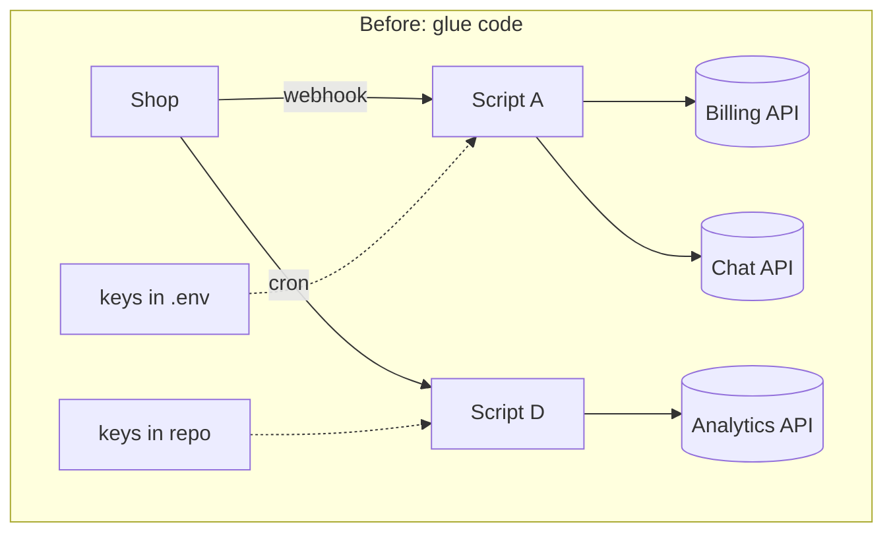
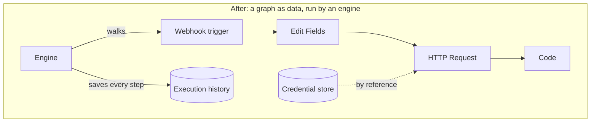

# 01 — Why n8n exists

> **Where you are:** Stage 1 of 6 — the problem. Abbreviations: **API** (Application Programming Interface), **HTTP** (Hypertext Transfer Protocol), **SaaS** (Software as a Service), **SQL** (Structured Query Language).
>
> **After this file** you should be able to say "if n8n didn't exist, someone would have to invent it" and roughly predict what it must do.

---

## 1. The world before

A company runs a shop. A new order arrives and someone needs it to (a) create an invoice in the billing system, (b) notify the team, (c) record it for analytics. Each system has its own HTTP API, authentication scheme, rate limits and failure modes.

The usual answer was **glue code**: a script, a cron job, a small service. It works — until:

| Pain | What it looks like in practice |
|---|---|
| **Boilerplate per integration** | Every new service means re-writing auth, pagination, retries, error mapping |
| **No visibility** | A script failed at 3 a.m.; which step? with what input? Only logs, if you remembered to write them |
| **Secrets scatter** | API keys end up in environment files, repos, and chat messages |
| **Only developers can change it** | The person who understands the business process cannot read or edit the script |
| **Scaling is bespoke** | Bursts of events need queues, workers, back-pressure — each script reinvents them |
| **Event intake is fiddly** | Registering webhooks with third parties, keeping them alive, routing requests to the right script |

*Caption: what the pain looks like — every arrow is hand-written code with its own keys, retries and logging.*

## 2. Why existing solutions were not enough

| Alternative | Good at | Where it falls short for this problem |
|---|---|---|
| **Hand-written scripts / microservices** | Total control | All of the pain table above |
| **Hosted no-code automation SaaS** (Zapier-style) | Zero setup, huge catalogs | Your data and secrets live in someone else's cloud; pricing tied to usage; limited room for custom code |
| **Flow-based visual tools** (Node-RED-style) | Visual wiring, self-hosted | Oriented to device/message flows; weaker story for per-run history, credential management, multi-user projects |
| **Batch orchestrators** (Airflow-style) | Scheduled, dependency-aware pipelines in code | Code-first and batch-first; not shaped for "an HTTP event arrives, react now" business automation, nor for non-developers |
| **Durable-execution engines** (Temporal-style) | Guaranteed completion of long code workflows | You write the workflow *as code*; no catalog of ready integrations |

> These are characterizations of categories, not benchmarks of specific products.

## 3. The constraints that shaped the solution

1. **Self-hostable and inspectable.** Data and secrets must be able to stay on the company's own infrastructure. (The repository's `LICENSE.md` describes a "Sustainable Use License", with `.ee.` files under a separate enterprise license.)
2. **Visual *and* programmable.** Non-developers need a canvas; developers need an escape hatch (a Code node, custom nodes).
3. **Integrations as a catalog.** Auth, pagination and quirks should be solved once per service, not per workflow. (The `nodes-base` package alone holds 308 node directories and 412 credential files at this commit.)
4. **Every run is inspectable.** You should see the data at every step, for every run, after the fact.
5. **Secrets are first-class.** Stored encrypted, referenced by name, never pasted into workflow JSON.
6. **Scales sideways.** Run on a laptop with SQLite; run in production with Postgres + Redis + many workers.

## 4. The design that falls out

Put the constraints together and the shape is almost forced:

- Represent a business process as **data** (a graph of typed steps) — so a canvas can edit it, a database can store it, a worker can load it.
- Make each step a **node** from a catalog with a uniform contract: *items in → items out*.
- Keep secrets in a separate **credential** store and let nodes reference them.
- Give steps a way to compute values from earlier steps: **expressions**.
- Have **triggers** that turn outside events into the first items.
- Store every **execution** with the data of every step.
- Let executions run **in-process or on workers** behind a queue.

*Caption: the same process after n8n — the graph is data; one engine, one credential store, one history.*

**Quality check:** can you now predict that n8n needs a *node contract*, a *credential store*, an *expression language*, a *trigger mechanism* and an *execution record*? Those are exactly the concepts in [03-concept-map.md](03-concept-map.md).

**Next:** [02-what.md](02-what.md) · **Back:** [00-overview.md](00-overview.md)
