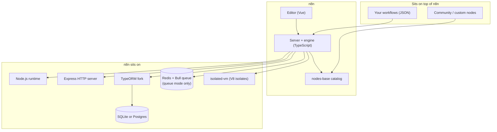

# 02 — What n8n is

> **Where you are:** Stage 2 of 6 — definition, boundaries, ecosystem. Abbreviations: **ETL** (Extract-Transform-Load), **HTTP** (Hypertext Transfer Protocol), **JSON** (JavaScript Object Notation), **SQL** (Structured Query Language), **ORM** (Object-Relational Mapper), **DB** (Database), **V8** (Google's JavaScript engine), **GB** (Gigabyte), **CSV** (Comma-Separated Values), **EE** (Enterprise Edition).
>
> **After this file** you can classify n8n correctly and decide whether it fits a given problem, before knowing how it works inside.

---

## 1. One-sentence definition

> **n8n is a self-hostable workflow-automation platform that removes integration glue code by storing a business process as a graph of nodes — pre-built integrations or code steps — whose JSON items flow along connections, executed by a Node.js engine that also handles triggers, credentials, and a per-run history.**

Mapping to Stage 1: *glue code* → nodes; *no visibility* → per-run history; *secrets scatter* → credentials; *event intake* → triggers; *scaling* → queue mode.

## 2. Boundaries — what it is **not**

| It is not… | Because… |
|---|---|
| A message broker (Kafka, RabbitMQ) | It *consumes* events and *calls* services; it does not provide durable pub/sub topics. (Redis appears only as its internal job queue.) |
| A batch/ETL orchestrator | Data flows as in-memory items per execution, not as partitioned datasets in a warehouse |
| A deterministic-replay durable-execution engine | It persists run data (always at the end; optionally after each node; and at `Wait` nodes so an execution can resume), but it does not replay code to reconstruct state. An execution interrupted by a crash is marked `crashed` by recovery logic rather than transparently resumed |
| A general-purpose application framework | It hosts *workflows*; you cannot build arbitrary services on top of its HTTP layer beyond webhooks |
| Finished with its "engine v2" | `packages/@n8n/engine` describes itself as *"currently a scaffold and is not yet wired into n8n"* — this guide documents the engine that actually runs (`WorkflowExecute`) |

## 3. Position in the ecosystem

*Caption: what depends on what — n8n is a Node.js server plus a Vue editor, backed by a SQL database and optionally Redis.*

Evidence in the repo: database types are `sqlite` (default) or `postgresdb` (`@n8n/config/src/configs/database.config.ts`); queue is `bull` (`cli/src/scaling/scaling.service.ts`); expressions default to the `vm` engine using `isolated-vm` (`@n8n/config/src/configs/expression-engine.config.ts`); the editor lives in `frontend/editor-ui`.

### Closest neighbors (one line each)

| Neighbor | How n8n differs |
|---|---|
| Zapier / Make | Same audience; n8n is self-hostable and exposes a code escape hatch and the full execution data |
| Node-RED | Also node-and-wire, but n8n centers on business integrations: credentials, multi-user projects, per-execution history |
| Apache Airflow | Airflow = scheduled batch DAGs authored as Python; n8n = event-driven graphs authored visually |
| Temporal | Temporal = code-defined durable workflows with replay; n8n = data-defined graphs with an integration catalog |

## 4. Package map (used throughout the guide)

| Package (under `packages/`) | Role |
|---|---|
| `workflow` (`n8n-workflow`) | **The vocabulary**: `Workflow`, `INode`, `IConnections`, `INodeExecutionData`, `INodeType`, expressions — shared by backend and editor |
| `core` (`n8n-core`) | **The engine**: `WorkflowExecute`, node execution contexts, request helpers, `Credentials`/cipher |
| `cli` (`n8n`) | **The server**: HTTP routes, webhooks, `WorkflowRunner`, scaling, database wiring, commands `start`/`worker`/`webhook` |
| `nodes-base` | **The catalog**: ~300 integrations and ~400 credential types |
| `@n8n/nodes-langchain` | AI nodes (out of scope in this guide) |
| `@n8n/task-runner` | Sandbox process for Code-node execution |
| `@n8n/expression-runtime`, `@n8n/tournament` | Expression parsing and isolated evaluation |
| `@n8n/db` | Entities and repositories (`WorkflowEntity`, `ExecutionEntity`, `WebhookEntity`, `CredentialsEntity`) |
| `frontend/editor-ui` | The Vue editor |

**Quality check:** could you now tell a colleague whether n8n fits "when a Shopify order arrives, create an invoice and Slack the team"? (Yes.) And "stream 10 GB CSVs into a warehouse nightly"? (Probably not — that is batch ETL.)

**Next:** [03-concept-map.md](03-concept-map.md) · **Back:** [01-why.md](01-why.md) · [Overview](00-overview.md)
