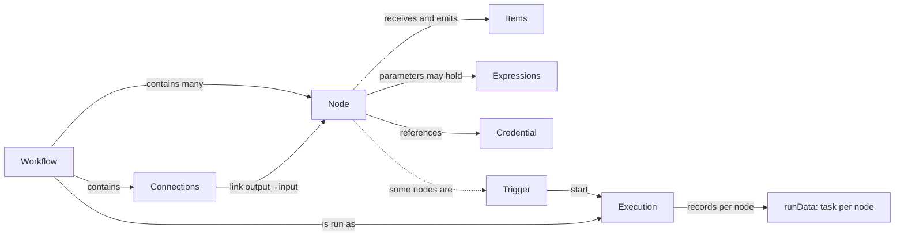
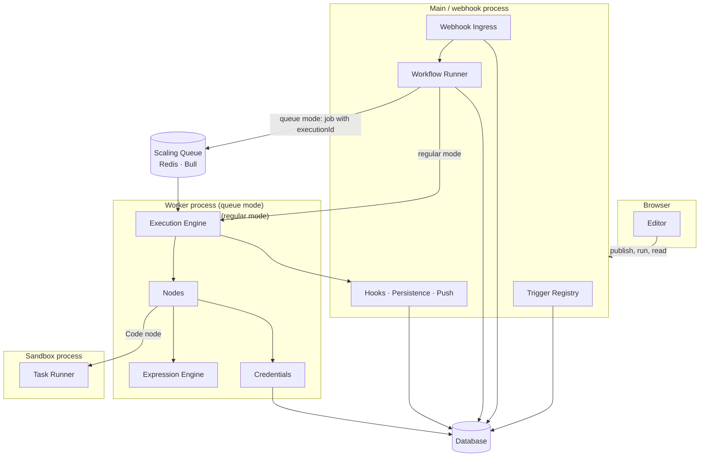
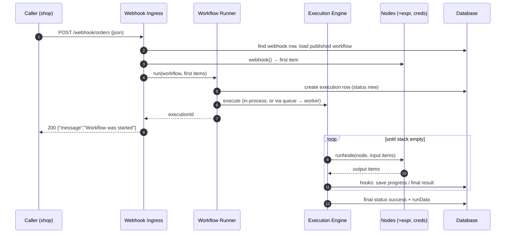

# 03 — The Concept Map (breadth first)

> **Where you are:** Stage 3 of 6 — every core concept and every key player, one shallow pass.
> **After this file** you can sketch n8n's architecture on a whiteboard and justify each component — without yet knowing how any one works inside.

Abbreviations used here: **HTTP** (Hypertext Transfer Protocol), **JSON** (JavaScript Object Notation), **API** (Application Programming Interface), **ID** (Identifier), **UI** (User Interface), **DB** (Database), **REST** (Representational State Transfer), **V8** (Google's JavaScript engine). Full table in [00-overview](00-overview.md#2-abbreviation-glossary).

---

## 3.1 Domain mapping — from problem to concepts

Introduced in **dependency order** (each builds only on earlier rows).

| # | Real-world problem element | n8n concept | One-line definition | Why this abstraction | Source of truth |
|---|---|---|---|---|---|
| 1 | "One step of a business process" | **Node** | A typed, versioned unit (`INode` = configuration, `INodeType` = behaviour) that turns input items into output items | Uniform contract lets a catalog of 300+ integrations and the engine interoperate | `workflow/src/interfaces.ts` — `INode` (l.1730), `INodeType` (l.2559) |
| 2 | "A record moving through the process" | **Item** | `INodeExecutionData`: `{ json, binary?, pairedItem?, error? }` | Per-record processing, lineage (`pairedItem`), and binary attachments without changing node code | `interfaces.ts` l.1844 |
| 3 | "Which step feeds which" | **Connection** | `IConnections`: source node → output index → list of `{ node, type, index }` | Makes the process a graph, supports branches (IF), merges (multi-input), and sub-node wiring | `interfaces.ts` l.509 |
| 4 | "The whole process" | **Workflow** | `IWorkflowBase`: `nodes[]` + `connections` + settings; at runtime wrapped by the `Workflow` class that precomputes `connectionsBySourceNode` / `connectionsByDestinationNode` | Data, not code → editable on a canvas, storable, versionable, loadable by any worker | `interfaces.ts` l.3667, `workflow/src/workflow.ts` |
| 5 | "Something outside happened" | **Trigger** | A node that *starts* executions: webhook (HTTP request in), poll (ask periodically), or trigger (long-lived listener/schedule) | Separates *event intake* from *processing*; lets the platform register/unregister intake on publish | `INodeType.webhook / poll / trigger` |
| 6 | "Use data from an earlier step" | **Expression** | A parameter string beginning with `=` containing `{{ … }}` JavaScript, evaluated against `$json`, `$node[...]`, etc. | Dynamic wiring without writing a Code node; evaluated in a sandbox | `workflow/src/expression.ts` |
| 7 | "The API key for that service" | **Credential** | An encrypted, typed record (`ICredentialType` defines its fields and how to authenticate) referenced from a node by `{ id, name }` | Secrets live outside workflow JSON, shareable by project, decrypted only at call time | `interfaces.ts` l.417, `core/src/credentials.ts` |
| 8 | "One run of the process" | **Execution** | An `IRunExecutionData` state machine (`nodeExecutionStack`, `waitingExecution`, `resultData.runData`) plus a database record with a status | Makes runs resumable, inspectable, and transferable between processes | `workflow/src/run-execution-data/run-execution-data.v1.ts` |

**Derived, not core:** *pin data* (frozen test output), *static data* (per-workflow persistent key/value, e.g. webhook ids), *execution mode* (`manual`, `webhook`, `trigger`, …), *published/active version*, *sub-workflows*, *error workflows*, *sub-nodes* (AI).

*Caption: how the eight concepts relate — a workflow is nodes + connections; triggers start executions; each execution records what every node produced.*

## 3.2 Key players — from concepts to components

Each player gets a deep dive in `05-deep-dives/`, in the order they appear in the running example.

| # | Key player | **Owns** (one responsibility) | **Knows** | **Does *not* do** | Where (under `packages/`) |
|---|---|---|---|---|---|
| 1 | **Editor** | Authoring, testing and publishing workflows; showing executions | The workflow being edited (Vue stores), live node states via push | Never executes production workflows; never sees decrypted secrets | `frontend/editor-ui`; server side `cli/src/workflows/workflows.controller.ts`, `cli/src/push` |
| 2 | **Trigger Registry** | Turning "published" into live intake: webhook rows + in-memory triggers/pollers | Which workflows are active; `webhook_entity` rows; activation errors | Does not handle requests or run workflows | `cli/src/active-workflow-manager.ts`, `cli/src/webhooks/webhook.service.ts` |
| 3 | **Webhook Ingress** | Turning an HTTP request into the first items and an HTTP response | Route → webhook row → workflow; response mode | Does not walk the graph; does not decide where the run happens | `cli/src/webhooks/live-webhooks.ts`, `webhook-helpers.ts`, `webhook-request-handler.ts` |
| 4 | **Workflow Runner** | Creating an execution and choosing *where* it runs (in-process vs queue) | Execution ID, timeouts, response promises (via `ActiveExecutions`) | Does not know how nodes run | `cli/src/workflow-runner.ts`, `cli/src/active-executions.ts` |
| 5 | **Scaling Queue** | Moving execution IDs from mains to workers (Bull on Redis) and relaying results back | Jobs, worker concurrency, leader election | Does not carry run data in the job — data goes through the database | `cli/src/scaling/*` |
| 6 | **Execution Engine** | Walking the graph: which node next, with which items | `IRunExecutionData` (stack, waiting nodes, `runData`) | Does not know *what* a node does, nor persistence/HTTP | `core/src/execution-engine/workflow-execute.ts` |
| 7 | **Nodes** | The actual work of each step, via a uniform context API | Its own parameters and the input items | Does not choose the next node; does not store its own output | `nodes-base/nodes/*`, `core/.../node-execution-context/*`, `cli/src/node-types.ts`, `cli/src/load-nodes-and-credentials.ts` |
| 8 | **Expression Engine** | Safely evaluating `{{ … }}` against the run's data | Data proxy over `runData`; isolate pool | Does not fetch data from the network; cannot reach the host process | `workflow/src/expression.ts`, `@n8n/expression-runtime`, `@n8n/tournament` |
| 9 | **Credentials** | Encrypting, storing, decrypting and applying secrets to requests | Cipher key, credential types, policies | Never places secrets in workflow JSON or execution data | `core/src/credentials.ts`, `core/src/encryption`, `cli/src/credentials-helper.ts` |
| 10 | **Task Runner** | Running user JavaScript/Python from the Code node in an isolated process | Task offers, script, requested input data | Does not own workflow state; asks the main process for data | `@n8n/task-runner`, `cli/src/task-runners/*` |
| 11 | **Lifecycle Hooks, Persistence & Push** | Reacting to execution events: save, stream to UI, statistics, error workflow | Save settings, `pushRef`, execution record | Does not influence which nodes run | `cli/src/execution-lifecycle/*`, `@n8n/db` repositories, `cli/src/push` |

*Caption: the eleven players and the processes they live in — the database is the shared memory; Redis carries only job IDs.*

## 3.3 Coordination at a glance

Happy path: **a webhook order arrives and becomes a saved execution.**

*Caption: who calls whom, in what order, and what crosses each hop on the happy path.*

Two failure/edge flows to know by name (mechanics deferred to the dives):

1. **Node error** — retry → `onError` routing (`continueRegularOutput` / `continueErrorOutput` / `stopWorkflow`) → execution status `error` → error workflow. See [Execution Engine](05-deep-dives/06-execution-engine.md).
2. **Worker or process crash** — the execution row is left `running`; recovery marks it `crashed`. See [Scaling Queue](05-deep-dives/05-scaling-queue.md) and [Lifecycle](05-deep-dives/11-lifecycle-persistence-push.md).

**Quality check:** point at the diagram and explain why the queue carries only an execution ID, and why the database is drawn as the shared hub. (Answer in [05-scaling-queue](05-deep-dives/05-scaling-queue.md).)

**Next:** [04-running-example.md](04-running-example.md) · **Back:** [02-what.md](02-what.md) · [Overview](00-overview.md)
