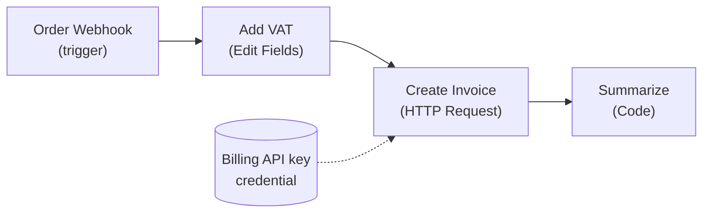
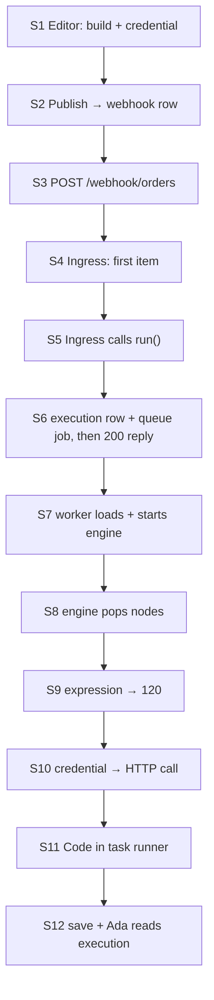

# 04 — The Running Example: Ada's order-intake workflow

> **Where you are:** Stage 4 of 6 — the spine scenario, traced *shallowly* through the concept map.
> **After this file** you can retell the scenario from memory and name which component is on stage at every step — even though you do not yet know any component's internals.

Abbreviations: **HTTP** (Hypertext Transfer Protocol), **JSON** (JavaScript Object Notation), **API** (Application Programming Interface), **UI** (User Interface), **ID** (Identifier), **DB** (Database).

---

## The scenario in three sentences

*Ada* builds a workflow in the **editor**: an order arrives at a **webhook**, an **Edit Fields** node adds VAT using an **expression**, an **HTTP Request** node creates an invoice with a stored **credential**, and a **Code** node writes a summary. She **publishes** it. Later a shop's backend POSTs an order to `/webhook/orders`; n8n, running in **queue mode**, executes the four nodes on a **worker** and Ada reads the saved **execution**.

This touches **every concept** (workflow, node, item, connection, trigger, expression, credential, execution) and **every key player** (all 11).

## The workflow (as data)

```json
{
  "name": "Order intake",
  "nodes": [
    { "id": "n1", "name": "Order Webhook", "type": "n8n-nodes-base.webhook",  "typeVersion": 2,
      "webhookId": "6f1c2b7e-0000-4000-8000-000000000001",
      "parameters": { "httpMethod": "POST", "path": "orders" } },
    { "id": "n2", "name": "Add VAT",       "type": "n8n-nodes-base.set",      "typeVersion": 3.4,
      "parameters": { "assignments": { "assignments": [
        { "name": "total", "type": "number", "value": "={{ $json.body.amount * 1.2 }}" } ] } } },
    { "id": "n3", "name": "Create Invoice","type": "n8n-nodes-base.httpRequest","typeVersion": 4.2,
      "parameters": { "method": "POST", "url": "https://billing.example.com/invoices",
                      "authentication": "genericCredentialType", "genericAuthType": "httpHeaderAuth",
                      "sendBody": true, "bodyParameters": { "parameters": [
                        { "name": "total", "value": "={{ $json.total }}" } ] } },
      "credentials": { "httpHeaderAuth": { "id": "cred42", "name": "Billing API key" } } },
    { "id": "n4", "name": "Summarize",     "type": "n8n-nodes-base.code",     "typeVersion": 2,
      "parameters": { "jsCode": "return [{ json: { summary: `Invoice ${$input.first().json.invoiceId}` } }];" } }
  ],
  "connections": {
    "Order Webhook":  { "main": [[ { "node": "Add VAT",        "type": "main", "index": 0 } ]] },
    "Add VAT":        { "main": [[ { "node": "Create Invoice", "type": "main", "index": 0 } ]] },
    "Create Invoice": { "main": [[ { "node": "Summarize",      "type": "main", "index": 0 } ]] }
  }
}
```

> Illustrative: the shape (`nodes`, `connections`, `parameters`, `credentials: {type: {id, name}}`) matches the interfaces in `workflow/src/interfaces.ts`; exact parameter names and `typeVersion` numbers of the real Set / HTTP Request nodes differ by version and are simplified here.



*Caption: Ada's four-node workflow — the one graph every later file re-uses.*

## The 12 steps, shallowly

Steps are numbered **S1–S12**; each deep dive says which steps it owns.

| Step | What happens | On stage | Concept that appears |
|---|---|---|---|
| **S1** | Ada drags four nodes onto the canvas, wires them, and creates the **credential** "Billing API key". Test runs use a *test* webhook URL. | **Editor** | Workflow, Node, Connection, Credential |
| **S2** | Ada clicks **Publish**. The server loads the published version, builds a `Workflow`, and asks each node which webhooks it needs; a row `(POST, "orders") → workflow, node` is inserted into the `webhook_entity` table. | **Trigger Registry** | Trigger |
| **S3** | The shop's backend sends `POST /webhook/orders` with `{"customer":"ACME","amount":100}`. | (outside) | — |
| **S4** | Express routes it to **LiveWebhooks**, which looks up the row, loads the published workflow, and calls the Webhook node's `webhook()` method → the request becomes the **first item** (`json.body`, `json.headers`, `json.query`). | **Webhook Ingress** + **Nodes** | Item |
| **S5** | Ingress calls `WorkflowRunner.run(...)` with the first item. (The default response mode `onReceived` will answer the caller *as soon as `run` has returned the new execution ID* — it does not wait for the workflow to finish.) | **Webhook Ingress** → **Workflow Runner** | Execution |
| **S6** | The Runner checks credential access, inserts an **execution row** (status `new`), and — because n8n runs in queue mode — adds a **job** `{ executionId, workflowId, … }` to the Bull queue in Redis. It returns the execution ID; Ingress now sends the deferred reply `{"message":"Workflow was started"}` to the shop. | **Workflow Runner** + **Scaling Queue** | Execution |
| **S7** | A **worker** picks the job, loads the execution and workflow from the database, marks it `running`, builds a `Workflow` object, wires lifecycle hooks, and hands it to `WorkflowExecute`. | **Scaling Queue** → **Execution Engine** | — |
| **S8** | The **engine** loop pops `Order Webhook` (its data is already there), records its output, and pushes `Add VAT` onto the execution stack. | **Execution Engine** | Connection |
| **S9** | `Add VAT` asks for parameter `total`; the value `={{ $json.body.amount * 1.2 }}` is handed to the **expression engine**, which evaluates it in a V8 isolate → `120`. | **Nodes** + **Expression Engine** | Expression |
| **S10** | `Create Invoice` asks for its credential; the **credentials** layer decrypts `Billing API key`, adds the header to the request, and the HTTP call returns `{ invoiceId: "INV-1001" }`. | **Nodes** + **Credentials** | Credential |
| **S11** | `Summarize` (Code node) sends its script and a data request to the **task runner**, which runs it in a sandboxed process and returns the items. | **Nodes** + **Task Runner** | — |
| **S12** | After every node, **hooks** fire (save progress if enabled; push to the UI if a `pushRef` exists — not for production runs). At the end the worker writes the final `runData` and status `success`; Ada opens **Executions** and sees each node's input and output. | **Lifecycle, Persistence & Push** | Execution |



*Caption: the spine of the guide — twelve steps from drawing a workflow to reading its execution.*

## Two variants you should keep in mind

- **Regular mode** (no Redis): S6–S7 collapse — the same process runs `WorkflowExecute` directly (`runMainProcess`).
- **Manual test run** (Ada presses *Execute workflow* in the editor): a different entry (`POST /workflows/:id/run`) and a *test* webhook, but the **same engine** from S8 on. This is why "what you see in the editor is what runs in production" is (nearly) true.

**Quality check:** without looking, list which component is on stage at S4, S6, S9, S11. (Ingress, Runner+Queue, Expression Engine, Task Runner.)

**Next:** [Deep dive 1 — Editor](05-deep-dives/01-editor.md) · **Back:** [03-concept-map.md](03-concept-map.md) · [Overview](00-overview.md)
