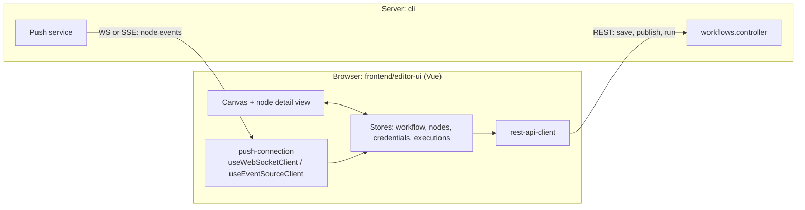

# Deep dive 1 — The Editor

> **Where you are:** Stage 5, dive 1 of 11 — a *supporting* player, so this dive is short.
> **After this file** you know what the editor does and does not do, which server endpoints it talks to, and how live node progress reaches the browser.

Abbreviations: **UI** (User Interface), **REST** (Representational State Transfer), **API** (Application Programming Interface), **WS** (WebSocket), **SSE** (Server-Sent Events), **ID** (Identifier), **JSON** (JavaScript Object Notation), **HTTP** (Hypertext Transfer Protocol).

---

## Role recap

**Owns:** authoring workflows (nodes, connections, parameters, expressions), creating credentials, triggering *manual* runs, publishing, and rendering executions.
**Appears in:** **S1** (build + credential), **S2** (publish), **S12** (read the execution).

## Internal design



*Caption: the editor edits state locally, calls REST to persist or run, and listens on a push channel for live progress.*

1. **The editor edits a JSON document.** What it saves is exactly `IWorkflowBase`: `nodes` and `connections` (see [03-concept-map](../03-concept-map.md)). There is no separate "editor format".
2. **Two channels to the server.**
   - *REST* for commands: `POST /workflows/:id/run` (manual execute), `POST /workflows/:id/activate` (the "Publish" button — the code still says *activate*, the UI says *publish*), `PATCH /workflows/:id` (save).
   - *Push* (WebSocket or Server-Sent Events) for events the server initiates: `executionStarted`, `nodeExecuteBefore`, `nodeExecuteAfter`, `executionFinished`… (`frontend/editor-ui/src/app/push-connection/`, `cli/src/push/websocket.push.ts`, `sse.push.ts`).
3. **`pushRef` ties a browser tab to its runs.** The editor sends a `push-ref` header on REST calls; the server passes it down into the execution, and the [hook layer](11-lifecycle-persistence-push.md) sends node events only to that tab.
4. **Manual runs are guarded and DB-anchored.** `WorkflowsController.runManually` (`cli/src/workflows/workflows.controller.ts` l.506) always loads the stored workflow from the database — the comment says this "prevents execution of arbitrary workflow definitions" — then calls `WorkflowExecutionService.executeManually` (`workflow-execution.service.ts` l.344), which marks the workflow inactive for the test, decides partial vs. full execution, and, if the start trigger is a webhook, registers a *test webhook* (`TestWebhooks`, path prefix `webhook-test`) that waits for one call.
5. **Publish requires a scope.** `@ProjectScope('workflow:publish')` on the activate route, plus a collaboration write-lock check (`collaborationService.validateWriteLock`) so two editors don't clobber each other. The body carries `versionId` and an `expectedChecksum`.

## Interactions

| Direction | Contract |
|---|---|
| Editor → server | Session cookie + `push-ref` header; JSON bodies validated by DTOs (`ManualRunDto`, `ActivateWorkflowDto`) |
| Server → editor | Typed push messages (`PushMessage`) delivered to a `pushRef` |
| Editor ↔ credentials | Sends credential *fields* to create/update; receives *no* plaintext back on read (see [Credentials dive](09-credentials.md)) |

## ⚓ Back to the example

**S1.** Ada's canvas changes live in the browser store. When she saves, `PATCH /workflows/:id` sends `{ nodes, connections, … }`. When she creates "Billing API key", the credential fields go to the credentials API and are encrypted server-side (S10 shows the decryption).

**S2.** Pressing *Publish* sends:

```http
POST /rest/workflows/<workflowId>/activate
push-ref: <tab id>
Content-Type: application/json

{ "versionId": "<uuid>", "expectedChecksum": "<hash>" }
```

The controller validates the write-lock, calls `workflowService.activateWorkflow(...)`, which eventually reaches `ActiveWorkflowManager.add(...)` — the [Trigger Registry](02-trigger-registry.md) takes over.

**S12.** Opening *Executions* is a REST read of stored data (production runs carry no `pushRef`, so nothing was pushed live).

> `rest` is the default REST endpoint prefix (`@n8n/config/.../endpoints.config.ts`).

## Failure behavior

| Failure | Behavior |
|---|---|
| Push connection drops | The editor reconnects (`useReconnectTimer`, `useHeartbeat`); events carry a per-run `sequenceNumber` so late/out-of-order events do not render the wrong "currently executing" node |
| Two people edit the same workflow | Write-lock validation on publish; `expectedChecksum` detects a stale copy |
| Test webhook never called | The test-webhook registration is temporary (`TEST_WEBHOOK_TIMEOUT` = 2 minutes in `cli/src/constants.ts`); production webhooks are separate database rows |

**Next:** [02 — Trigger Registry](02-trigger-registry.md) · **Back:** [04-running-example.md](../04-running-example.md) · [Concept map](../03-concept-map.md)
