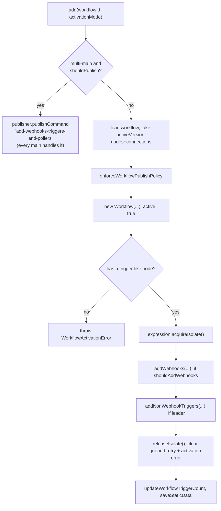

# Deep dive 2 — The Trigger Registry

> **Where you are:** Stage 5, dive 2 of 11 — `ActiveWorkflowManager` + `WebhookService`.
> **After this file** you know exactly what "publishing a workflow" does on the server, where a webhook URL lives in the database, and how activation behaves with retries and multiple main processes.

Abbreviations: **DB** (Database), **HTTP** (Hypertext Transfer Protocol), **ID** (Identifier), **TTL** (Time To Live), **UI** (User Interface), **V8** (Google's JavaScript engine).

---

## Role recap

**Owns:** turning "this workflow version is published" into *live intake* — rows in `webhook_entity` for webhook triggers, and in-memory listeners/pollers/schedules for the other trigger kinds.
**Knows:** which workflows are active, the registered webhook rows, activation errors.
**Does not do:** handle HTTP requests (that is [Webhook Ingress](03-webhook-ingress.md)) or run nodes (that is the [engine](06-execution-engine.md)).
**Appears in:** **S2**.

## Internal design

### Three kinds of intake

| Node capability (`INodeType`) | Example | What the registry does at publish |
|---|---|---|
| `webhook()` | Webhook, Form Trigger | Insert **database rows** — no in-memory state needed; any main/webhook process can serve them later |
| `poll()` | RSS Feed Trigger | Schedule a poll job **in memory** on the leader |
| `trigger()` | Schedule, long-lived listeners | Call `trigger()` once and keep the returned handle **in memory** on the leader |

### The webhook row

`WebhookEntity` (`@n8n/db/src/entities/webhook-entity.ts`): `workflowId`, `webhookPath`, `method`, `node` (name), optional `webhookId` and `pathLength`; **primary key `(webhookPath, method)`**. The primary key is the design's arbitration: two workflows cannot own the same URL+method.

### `ActiveWorkflowManager.add()` — step by step

`cli/src/active-workflow-manager.ts` l.539:



*Caption: what `add()` does — every step can throw, and any throw is recorded as an activation error.*

1. **Use the published version, not the draft.** The `Workflow` is built from `dbWorkflow.activeVersion.{nodes, connections}` — editing the draft does not change live behaviour until publish.
2. **Validate.** `validateWorkflowHasTriggerLikeNode(..., STARTING_NODES)` — a workflow with no trigger cannot be published.
3. **Hold an expression isolate** around the whole registration (`acquireIsolate`), because webhook paths and trigger parameters may contain expressions (see [Expression Engine](08-expression-engine.md)).
4. **`addWebhooks`** (l.149): `getWorkflowWebhooks` asks every node for its `IWebhookData[]` (`WebhookService.getNodeWebhooks`, which computes each path via `NodeHelpers.getNodeWebhookPath`); then per webhook: `createWebhook` → `storeWebhook` (insert; on duplicate primary key by *another* workflow → `WebhookPathTakenError`; by the *same* workflow → refresh the stale row) → `createWebhookIfNotExists`, which calls the node's own `webhookMethods.default.checkExists / create` — this is how nodes like Telegram register a callback on the *third party's* side.
5. **`addNonWebhookTriggers`** (l.1099): only on the leader; gathers `workflow.getTriggerNodes()` + `getPollNodes()` and hands them to `ActiveWorkflowTriggers.addTriggers`.
6. **Bookkeeping:** clear activation error, update trigger count, persist `staticData` (webhook nodes may stash ids there).

### Path computation — why Ada's URL is `/webhook/orders`

`NodeHelpers.getNodeWebhookPath` (`workflow/src/node-helpers.ts` l.1170):

| Node has `webhookId`? | `isFullPath` | Path stored |
|---|---|---|
| no | – | `${workflowId}/${nodeName lowercased, URL-encoded}/${path}` |
| yes | `true` (Webhook node's default description) | `path` if non-empty, else the `webhookId` |
| yes | `false` | `${webhookId}/${path}` |

The editor assigns a `webhookId` when a Webhook node is created, and the Webhook node's description sets `isFullPath: true` — so path `orders` is stored as `orders`.

### Multi-main and startup

- **On boot:** `addActiveWorkflows('init')` (l.394) iterates all active workflow ids in batches and calls `add` for each.
- **`shouldAddWebhooks`:** always true on `init`/`leadershipChange`; otherwise only the leader writes rows.
- **`shouldAddNonWebhookTriggers`:** *only the leader* — so a schedule trigger fires once, not once per main.
- **Leadership change:** the new leader re-adds triggers (`activationMode: 'leadershipChange'`).

## Interactions

| With | Contract |
|---|---|
| Editor / `WorkflowService.activateWorkflow` | Calls `add(workflowId, 'activate')` |
| `webhook_entity` table + cache | `storeWebhook` inserts then caches under `webhook:${method}-${path}` |
| Node's `webhookMethods` | `checkExists` / `create` / `delete` run with a `HookContext` |
| [Webhook Ingress](03-webhook-ingress.md) | Reads the rows/cache later; never writes them |

## ⚓ Back to the example — S2

Ada publishes. `add('wf123', 'activate')` runs (single-main: directly; multi-main: broadcast then run on each). The workflow contains one webhook node, so `getNodeWebhooks` returns:

```json
{ "httpMethod": "POST", "node": "Order Webhook", "path": "orders", "workflowId": "wf123", "isFullPath": true }
```

`storeWebhook` inserts:

| webhookPath | method | workflowId | node | webhookId | pathLength |
|---|---|---|---|---|---|
| `orders` | `POST` | `wf123` | `Order Webhook` | *(null — static path)* | *(null)* |

The Webhook node defines no `webhookMethods`, so `createWebhookIfNotExists` is a no-op. There are no trigger/poll nodes, so `addNonWebhookTriggers` returns `false`. Activation succeeds; the trigger count is set to 1. From now on **any process that can read the database can serve `POST /webhook/orders`**.

## Failure behavior

| Failure | What happens |
|---|---|
| Path already taken by another workflow | `WebhookPathTakenError`; the partially registered rows for this workflow are cleared (`clearWebhooks`); activation error stored |
| No trigger-like node | `WorkflowActivationError` (level: warning) |
| External service registration fails (`create` throws) | Same cleanup; the error's `detail` becomes the message |
| Transient failure at startup | `addQueuedWorkflowActivation` retries with exponential back-off, capped by `WORKFLOW_REACTIVATE_MAX_TIMEOUT` (skips doubling for `IsolateError`); policy refusals are *not* retried |
| Stale rows after unclean shutdown | On `init`/`leadershipChange` a duplicate-key insert from the *same* workflow is tolerated and refreshed |
| Activation errors | Stored via `activationErrorsService.register` so the editor can display why a workflow is not live |

**Next:** [03 — Webhook Ingress](03-webhook-ingress.md) · **Back:** [01 — Editor](01-editor.md) · [Concept map](../03-concept-map.md)
