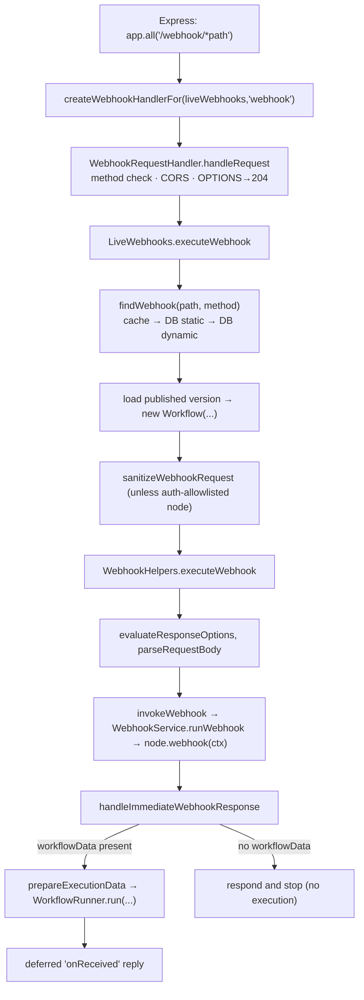

# Deep dive 3 — Webhook Ingress

> **Where you are:** Stage 5, dive 3 of 11 — everything between the raw HTTP request and the call to `WorkflowRunner.run`.
> **After this file** you can trace a request from Express to the first item, explain the response modes, and say why the Webhook node runs *before* an execution exists.

Abbreviations: **HTTP** (Hypertext Transfer Protocol), **CORS** (Cross-Origin Resource Sharing), **ID** (Identifier), **DB** (Database), **JSON** (JavaScript Object Notation), **V8** (Google's JavaScript engine).

---

## Role recap

**Owns:** HTTP request → (found webhook, loaded published workflow, first items, HTTP response).
**Knows:** route → row mapping (via `WebhookService`), response modes, the request/response objects.
**Does not do:** walk the graph, choose main vs. worker, persist executions.
**Appears in:** **S3, S4, S5** (and the deferred reply at the end of S6).

## Internal design



*Caption: the ingress pipeline — note the node's `webhook()` runs first and may decide that no execution should start at all.*

1. **Routing.** `AbstractServer` mounts `app.all('/<endpointWebhook>/*path', createWebhookHandlerFor(liveWebhooks, 'webhook'))` *before* the body parser so that the Webhook node can stream binary bodies itself (`cli/src/abstract-server.ts` l.240–252). Forms and waiting-webhook/form resume endpoints have sibling routes; test webhooks are served by `TestWebhooks` on the `webhook-test` prefix.
2. **Handler.** `WebhookRequestHandler.handleRequest` rejects unsupported methods, applies CORS only when an `origin` header is present, answers `OPTIONS` with `204`, then delegates to `webhookManager.executeWebhook`. Errors become HTTP error responses (unknown webhook → `WebhookNotFoundError`).
3. **Lookup.** `WebhookService.findWebhook` → static cache (`webhook:${method}-${path}`), then static DB row, then dynamic-path probe (paths with `:param` segments; the path-params are copied into `request.params`).
4. **Load the *published* version.** `loadWebhookExecutionData` uses `workflow.activeVersion` (or the newer publication service behind a flag) — `nodes`/`connections` come from the published revision, never the draft. A `Workflow` is built; `getBase(...)` creates `additionalData` (credentials helper, hooks placeholder, settings, `userId` = publisher for production calls).
5. **Expression isolate — only when needed.** `webhookPhaseNeedsIsolate` skips creating a V8 isolate for the very common case: Webhook node v2+, static parameters, natively resolvable description fields. Anything not proven static acquires one.
6. **`WebhookHelpers.executeWebhook`** (`webhook-helpers.ts` l.804):
   - resolves `responseMode` etc. via `evaluateResponseOptions`; unsupported mode → HTTP 500. Supported: `onReceived`, `lastNode`, `responseNode`, `formPage`, `streaming`, `hostedChat`;
   - `parseRequestBody`;
   - **`invokeWebhook`** → `WebhookService.runWebhook` (`webhook.service.ts` l.646) builds a `WebhookContext` and calls the node's `webhook()`. Errors here are reported and answered with a generic error; **no execution is created**.
7. **The node decides.** The Webhook node's `webhook()` (`Webhook.node.ts` l.225) checks IP allow-list, bot filter, authentication (basic/header/JWT/n8n OAuth), an optional "Only Run If" expression, then builds:

   ```ts
   { json: { headers: req.headers, params: req.params, query: req.query, body: req.body } }
   ```

   and returns `{ webhookResponse, workflowData: [[item]] }`. If auth fails it writes `403`/`401` itself and returns `{ noWebhookResponse: true }` (no `workflowData` → no execution).
8. **Response modes** (what the *caller* waits for):

   | Mode | The caller gets… |
   |---|---|
   | `onReceived` (default) | An immediate JSON reply once the execution exists: `responseData` if configured, else `{ "message": "Workflow was started" }` |
   | `lastNode` | The last executed node's output when the run finishes |
   | `responseNode` | Whatever a *Respond to Webhook* node sends |
   | `streaming` | Chunked stream while the run progresses (`sendChunk` hook) |
   | `formPage` / `hostedChat` | UI-page flows for Form / Chat triggers |

9. **Start the run.** `prepareExecutionData` builds the initial `IRunExecutionData` — crucially `executionData.nodeExecutionStack = [{ node: <start node>, data: { main: <workflowData> }, source: null }]` — then:

   ```ts
   executionId = await Container.get(WorkflowRunner).run(
     runData, /*loadStaticData*/ true,
     /*realtime*/ !didSendResponse && !shouldDeferOnReceivedResponse,
     existingExecution /* only when resuming a Wait */, responsePromise);
   ```

   For `onReceived`, the reply is **deferred until after `run` returns**, so that `$execution.id` can be used in `responseData` expressions (`webhook-helpers.ts` ~l.1262–1290).

## Interactions

| With | Contract |
|---|---|
| Trigger Registry | Reads rows it wrote; static cache is populated at startup (`populateCache`) |
| Nodes | Calls `webhook(ctx)`; expects `IWebhookResponseData` (`workflowData`, `webhookResponse`, `noWebhookResponse`) |
| [Workflow Runner](04-workflow-runner.md) | `run(IWorkflowExecutionDataProcess, …)` → returns an execution ID |
| Queue mode | For `responseNode`/`lastNode` the worker relays the response back to *this* process (see [Scaling Queue](05-scaling-queue.md)) |

## ⚓ Back to the example — S3 → S5

`POST /webhook/orders` with `{"customer":"ACME","amount":100}` (`Content-Type: application/json`):

1. `createWebhookHandlerFor` joins `params.path` = `orders`. Debug log: `Received webhook "POST" for path "orders"`.
2. `findWebhook('POST','orders')` → cache miss → DB hit on `(orders, POST)` → cached.
3. The published version is loaded; `webhookPhaseNeedsIsolate` returns **false** (Webhook v2, static parameters) → no isolate is built.
4. `runWebhook` calls `Webhook.webhook(ctx)`; no auth is configured, `validateAuth` passes; result:

   ```json
   { "workflowData": [[ { "json": {
       "headers": { "content-type": "application/json", "…": "…" },
       "params": {}, "query": {},
       "body": { "customer": "ACME", "amount": 100 } } } ]] }
   ```

5. `prepareExecutionData` puts that item on the initial stack; `WorkflowRunner.run` is called (S6 begins). It returns e.g. `"1042"`; only then does Ingress send:

   ```http
   HTTP/1.1 200 OK
   {"message":"Workflow was started"}
   ```

## Failure behavior

| Failure | Result |
|---|---|
| No row for `(path, method)` | `WebhookNotFoundError` → 404 (the message lists other methods registered for that path) |
| Auth fails in `webhook()` | Node writes 401/403 itself, returns `noWebhookResponse`; **no execution** |
| Node `webhook()` throws | Error reported to the error reporter; generic error response; **no execution** |
| Unsupported response mode | 500 `The response mode '…' is not valid!` |
| Caller disconnects | For `onReceived` nothing changes — the execution already exists |
| `WorkflowRunner.run` throws (e.g. pre-execute blocked) | The error propagates to the HTTP response; `PreExecuteBlockedError` is unwrapped in the runner |

**Next:** [04 — Workflow Runner](04-workflow-runner.md) · **Back:** [02 — Trigger Registry](02-trigger-registry.md) · [Concept map](../03-concept-map.md)
