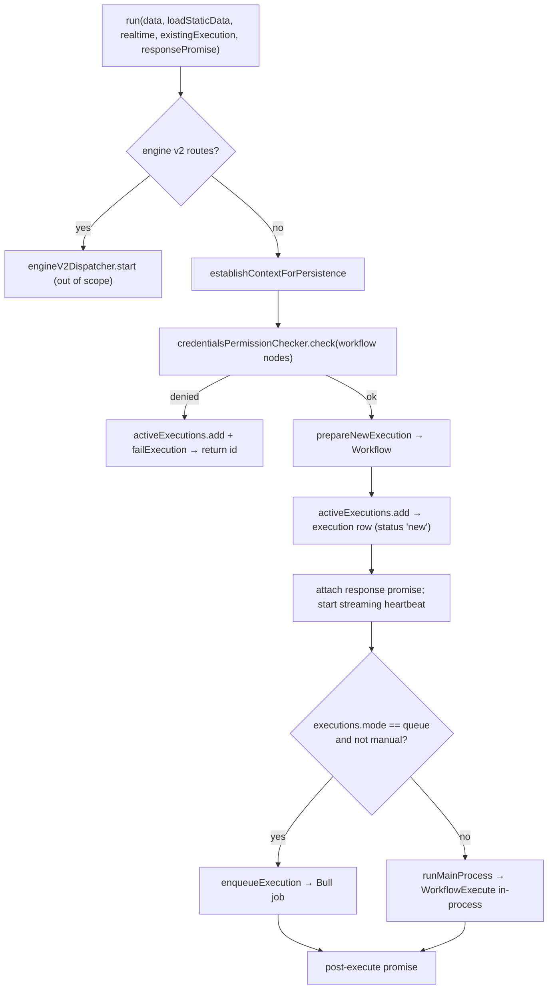

# Deep dive 4 — The Workflow Runner

> **Where you are:** Stage 5, dive 4 of 11 — `WorkflowRunner` and `ActiveExecutions`.
> **After this file** you know how an execution comes into existence, how n8n decides *where* it runs, and what bookkeeping surrounds a running execution (timeouts, cancellation, response promises).

Abbreviations: **DB** (Database), **ID** (Identifier), **HTTP** (Hypertext Transfer Protocol), **JSON** (JavaScript Object Notation).

---

## Role recap

**Owns:** turning "run this workflow with these first items" into a persisted execution and an in-flight run — locally or via the queue.
**Knows:** execution ID, settings (timeouts), the response promise for a waiting HTTP caller, cancellation handles.
**Does not do:** know how nodes work; move data between nodes.
**Appears in:** **S5 → S6** (and in every manual run and every trigger-started run).

## Internal design

Two collaborating classes in `cli/src/`:

| Class | File | Role |
|---|---|---|
| `WorkflowRunner` | `workflow-runner.ts` | The orchestration recipe (`run`, `runMainProcess`, `enqueueExecution`) |
| `ActiveExecutions` | `active-executions.ts` | In-memory registry of running executions; creates the DB row (`add`), holds `PCancelable` handles, response promises, and the "post-execute" promise |

### `WorkflowRunner.run()` (l.407)



*Caption: the runner is a decision tree ending in one of two "run" paths; every path returns an execution ID.*

1. **Persistence context** (`establishContextForPersistence`) and **credential access check** (`credentialsPermissionChecker.check`) come first — a workflow that references credentials the acting project cannot use *fails as an execution* (so it is visible in history) rather than throwing away the request.
2. **`prepareNewExecution`** builds the `Workflow` object (with pin data resolved for manual/evaluation modes).
3. **`ActiveExecutions.add`** (l.71) inserts the row via `executionPersistence.create({ data, mode, finished:false, workflowData, status:'new', workflowId, … })` — the *whole* `IRunExecutionData` (including the seeded `nodeExecutionStack`) is stored now — and reserves **concurrency capacity** (`ConcurrencyCapacityReservation`; skipped for `evaluation` mode). In regular mode it immediately `setRunning`.
4. **Where to run.**

   ```ts
   const shouldEnqueue = OFFLOAD_MANUAL_EXECUTIONS_TO_WORKERS === 'true'
     ? mode === 'queue'
     : mode === 'queue' && data.executionMode !== 'manual';
   ```

   So in queue mode, **production runs go to workers; manual (editor) runs stay on main** unless an env flag says otherwise.
5. **`runMainProcess`** (l.569): sets a soft timeout (`workflowSettings.executionTimeout` or the global default, capped by `maxTimeout`), builds `additionalData` with an execution timeout timestamp, `setRunning(executionId)`, assembles **lifecycle hooks** (`getLifecycleHooksForRegularMain`), adds `sendResponse` (resolves the HTTP response promise) and `sendChunk` (streaming) handlers, and calls `new WorkflowExecute(additionalData, mode, data.executionData).processRunExecutionData(workflow)` — a `PCancelable<IRun>` — which is attached to the registry. On completion: `finalizeExecution(executionId, fullRunData)`.
6. **`enqueueExecution`** (l.740) → see [Scaling Queue](05-scaling-queue.md).
7. **Timeout = soft.** When the timer fires, `stopExecution(id, TimeoutExecutionCancelledError)` cancels *after the current node* — the engine checks `shouldStopExecuting()` between nodes.

### `ActiveExecutions` responsibilities

| Method | Purpose |
|---|---|
| `add` (l.71) | Create row (or resume an existing waiting one), reserve capacity, return id |
| `attachWorkflowExecution` (l.199) | Store the cancelable promise so `stopExecution` can cancel |
| `attachResponsePromise` / `resolveResponsePromise` | Bridge to the HTTP caller waiting in `lastNode` / `responseNode` modes |
| `stopExecution` (l.225) | Cancel with a typed `ExecutionCancelledError` (manual, timeout, shutdown) |
| `finalizeExecution` (l.255) | Resolve the post-execute promise, release capacity, remove from the map |
| `getPostExecutePromise` (l.295) | Lets callers await completion (used by `lastNode` mode and sub-workflows) |

## Interactions

| With | Contract |
|---|---|
| [Webhook Ingress](03-webhook-ingress.md), triggers, editor manual runs, sub-workflow node | Call `run(IWorkflowExecutionDataProcess, …)`; get an execution ID |
| [Engine](06-execution-engine.md) | Constructs `WorkflowExecute`; receives `IRun` |
| [Scaling Queue](05-scaling-queue.md) | Calls `addJob`, listens for job messages |
| [Hooks](11-lifecycle-persistence-push.md) | Chooses *which set of hooks* fits this process role |
| Concurrency control | Capacity reservation; can delay an execution before it starts |

## ⚓ Back to the example — S5 → S6

Ingress calls `run(...)` with `executionMode: 'webhook'`, `executionData` containing the seeded stack (`Order Webhook` + the item), `workflowData` = the published version.

1. `credentialsPermissionChecker.check('wf123', nodes)` — the `httpHeaderAuth` credential `cred42` belongs to Ada's project → OK.
2. `ActiveExecutions.add` inserts `execution_entity` (status `new`, mode `webhook`) and its `execution_data` payload; suppose id `1042`.
3. Queue mode and mode ≠ `manual` → `enqueueExecution('1042', 'wf123', data, loadStaticData=false, realtime=false, …)`.
   - `realtime` is **false** because `onReceived` defers the reply (`!didSendResponse && !shouldDeferOnReceivedResponse` → `false`), so the job priority is `100` rather than `50`.
4. `run` returns `'1042'`; Ingress sends the deferred `200 {"message":"Workflow was started"}`.

In *regular* mode the same call would instead hit `runMainProcess`, and S7–S12 would happen in this very process.

## Failure behavior

| Failure | Result |
|---|---|
| Credential access denied | Execution created and immediately failed (`failExecution`), id returned, visible in history |
| Persistence context cannot be established | Same — failed execution, not a thrown HTTP error |
| `enqueueExecution` throws (Redis down) | `processError` with worker-style hooks so the execution ends in `error`, then rethrow |
| Timeout | Soft cancel: the engine notices at the next loop iteration (`shouldStopExecuting`), marks the run `canceled`, and the result carries a `TimeoutExecutionCancelledError` |
| Shutdown | `SystemShutdownExecutionCancelledError` for active executions |
| Post-execute promise rejects | Logged and reported; cancellation errors ignored |

**Next:** [05 — Scaling Queue](05-scaling-queue.md) · **Back:** [03 — Webhook Ingress](03-webhook-ingress.md) · [Concept map](../03-concept-map.md)
