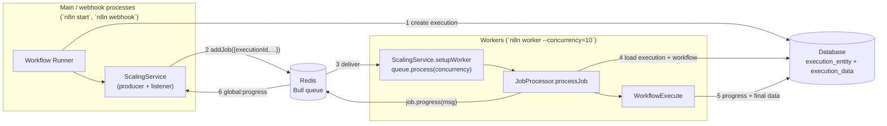
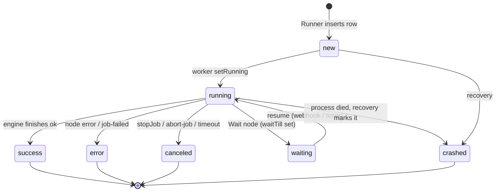

# Deep dive 5 — The Scaling Queue (queue mode)

> **Where you are:** Stage 5, dive 5 of 11 — `ScalingService`, `JobProcessor`, the `worker` command. An *optional* subsystem: absent in regular mode.
> **After this file** you can explain why the queue carries only an execution ID, how a worker turns a job into a run, and how results and HTTP responses travel back to main.

Abbreviations: **DB** (Database), **ID** (Identifier), **HTTP** (Hypertext Transfer Protocol), **JSON** (JavaScript Object Notation), **TTL** (Time To Live), **MCP** (Model Context Protocol; only mentioned in job fields).

---

## Role recap

**Owns:** moving *execution IDs* from main/webhook processes to worker processes (Bull on Redis), and relaying progress and results back.
**Knows:** queue names, job priority, worker concurrency, leader election.
**Does not do:** carry run data in the job; run nodes itself (the worker's engine does).
**Appears in:** **S6** (enqueue) and **S7** (worker start), and the return path at the end of S12.

## Internal design

### Process roles



*Caption: Redis carries small job messages both ways; **all** run data goes through the database.*

### Job payload — deliberately tiny

`JobData` (`cli/src/scaling/scaling.types.ts`): `workflowId`, `executionId`, `loadStaticData`, `pushRef?`, `streamingEnabled?`, `restartExecutionId?`, `projectId?`, `poolName?`, `encryptedRunnerIdentity?`, plus MCP-specific fields. **No nodes, no items, no credentials.** Why?

- Run data can be huge; Redis is the wrong place for it.
- The database row created in S6 already contains the whole `IRunExecutionData`; the worker just reads it.
- A job is cheap to retry or to lose.

### Producer side — `enqueueExecution` (`workflow-runner.ts` l.740)

1. Lazily loads `ScalingService` and calls `setupQueue()` (creates a Bull queue with `maxStalledCount: 0` and Redis clients; `scaling.service.ts` l.97–107).
2. `poolConfigService.resolvePoolForExecution(data)` picks `{ queueName, poolName }` (worker pools).
3. `scalingService.addJob(jobData, { priority: realtime ? 50 : 100, queueName })`.
4. Runs `workflowExecuteBefore` via *scaling-main* hooks (`getLifecycleHooksForScalingMain`) and returns a `PCancelable` that (a) on cancel calls `stopJob(job)`, (b) resolves when the job result arrives.

### Consumer side — `JobProcessor.processJob` (`job-processor.ts` l.121)

1. `executionPersistence.findSingleExecution(executionId, { includeData: true, unflattenData: true })`; missing → error.
2. If status is `crashed` → **do nothing** (guards against Bull's implicit retry re-running a crashed execution).
3. `executionRepository.setRunning(executionId)` → status `running`, `startedAt`.
4. Optionally reload `staticData` from the workflow row (`loadStaticData`).
5. Compute the execution timeout, build a `new Workflow(...)` from `execution.workflowData`, `getBase(...)` for `additionalData`.
6. Build **worker hooks** (`getLifecycleHooksForScalingWorker`) and add two handlers that *relay via Bull*:
   - `sendResponse` → `job.progress({ kind: 'respond-to-webhook', executionId, response, workerId })`
   - `sendChunk` → `job.progress({ kind: 'send-chunk', … })`
7. `new WorkflowExecute(additionalData, execution.mode, execution.data).processRunExecutionData(workflow)` (or `manualExecutionService.runManually` when there is no `executionData` — manual/partial runs).
8. On finish, sends `job-finished` (v2 carries `status`, `startedAt`, `stoppedAt`, `waitTill`, `lastNodeExecuted`, `metadata`).

### Return path — messages on `global:progress`

`JobMessage` kinds: `respond-to-webhook`, `job-finished`, `job-failed`, `abort-job`, `send-chunk`, `mcp-response`. Main's `registerMainOrWebhookListeners` (`scaling.service.ts`) switches on `msg.kind`:

| Kind | Main does |
|---|---|
| `respond-to-webhook` | Decode body, `activeExecutions.resolveResponsePromise(executionId, response)` → the waiting HTTP caller gets its reply |
| `send-chunk` | `activeExecutions.sendChunk` → stream to caller |
| `job-finished` | Resolve any pending response; store `jobResults[executionId]` (needed because `removeOnComplete: true` discards the job's return value) |
| `job-failed` | Log error with stack |

Workers listen for `abort-job` and call `jobProcessor.stopJob(jobId)`.

### Multi-main and leader election

`leader-election-client.ts`, `multi-main-setup.ee.ts`, `redis-lock.service.ts`: with several mains, one is **leader**; it alone manages non-webhook triggers ([Trigger Registry](02-trigger-registry.md)) and periodic recovery. Commands (e.g. *add-webhooks-triggers-and-pollers*) travel over n8n's own pub/sub, *not* Bull — the `JobMessage` comment explicitly warns not to confuse the two.

## Interactions

| With | Contract |
|---|---|
| Workflow Runner | `addJob`, `stopJob`, `popJobResult`; job priority 50 (realtime) vs 100 |
| Database | Both sides read/write execution rows; worker's hooks persist the result |
| Engine | The worker instantiates `WorkflowExecute` with the *stored* `IRunExecutionData` |
| Redis | Bull queue; keys prefixed by `queue.bull.prefix` |

## ⚓ Back to the example — S6 → S7

Main adds:

```json
{ "workflowId": "wf123", "executionId": "1042", "loadStaticData": false, "projectId": "<ada's project>", "poolName": "<resolved pool>" }
```

(Illustrative values; the field names are the real `JobData` fields.)

A worker's `queue.process(JOB_TYPE_NAME, concurrency, processJob)` receives it. Log lines (info level):

```
Worker started execution 1042 (job 77)
```

`processJob` reads execution `1042` (status `new`, data with stack `[Order Webhook]`), sets it `running`, builds the `Workflow`, wires worker hooks, and calls `processRunExecutionData`. Because `Order Webhook` is `onReceived`, no `sendResponse` message will be needed — the caller already got its reply on main.

Had Ada chosen `lastNode` mode, the *Respond* would flow: worker `sendResponse` hook → `job.progress(respond-to-webhook)` → Redis → main's listener → `resolveResponsePromise` → the still-open HTTP connection on main.

## Failure behavior



*Caption: the execution status lifecycle across processes; `crashed` is written by recovery, not by the run itself.*

| Failure | Behavior |
|---|---|
| Worker dies mid-run | The execution stays `running` in the DB; recovery marks in-progress statuses (`new`, `running`, `unknown` — `CRASHABLE_EXECUTION_STATUSES`) as `crashed`. `maxStalledCount: 0` prevents Bull from silently re-delivering a stalled job |
| Bull retries a crashed execution | `processJob` returns `{ success: false }` if status is already `crashed` |
| Redis unavailable at enqueue | Error path ends the execution in `error` and rethrows |
| Redis lost on worker start | Fatal `Error initializing Lua scripts` → worker `process.exit(1)` |
| Cancel from UI | Main `stopJob(job)` → `abort-job` message → worker aborts the `PCancelable` |
| Main dies while a worker runs | Worker still finishes and writes to the DB; the *reply* (response promise) is lost, the *execution record* is not |

**Next:** [06 — Execution Engine](06-execution-engine.md) · **Back:** [04 — Workflow Runner](04-workflow-runner.md) · [Concept map](../03-concept-map.md)
