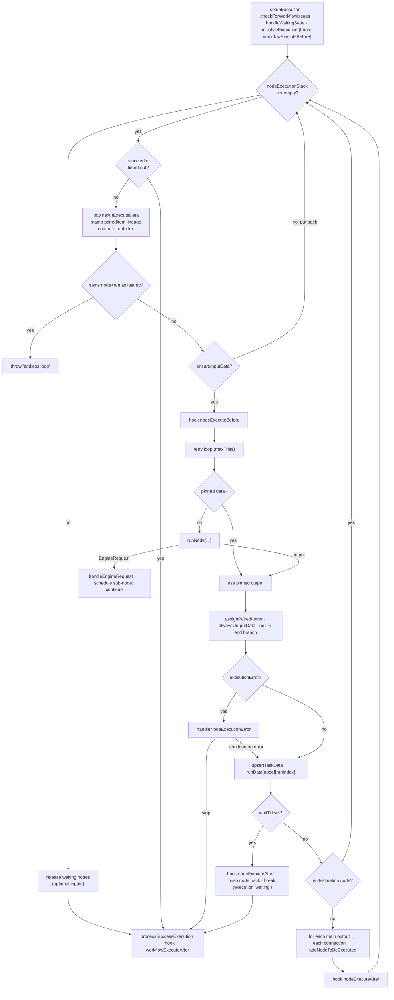

# Deep dive 6 — The Execution Engine (`WorkflowExecute`)

> **Where you are:** Stage 5, dive 6 of 11 — the heart of n8n. `packages/core/src/execution-engine/workflow-execute.ts` (3,168 lines).
> **After this file** you can predict, for any workflow, *which node runs next with which items*, how multi-input nodes wait, how errors and retries are routed, and how an execution pauses and resumes.

Abbreviations: **DAG** (Directed Acyclic Graph), **ID** (Identifier), **JSON** (JavaScript Object Notation), **DB** (Database), **UI** (User Interface), **AI** (Artificial Intelligence).

---

## Role recap

**Owns:** deciding the *order* of node runs and what data each receives; recording each run in `runData`; error routing; pause/resume; cancellation checks.
**Knows:** the entire run state, `IRunExecutionData` (see below).
**Does not do:** know what any node does (it just calls it), persist data (it fires hooks), or parse expressions.
**Appears in:** **S7 → S12** (S8 is the engine's own step; it also drives S9–S11).

## Internal design

### 1. The run state is plain, serializable data

`IRunExecutionData` v1 (`workflow/src/run-execution-data/run-execution-data.v1.ts`):

```
IRunExecutionData
├─ startData?           { startNodes, destinationNode, runNodeFilter }   ← partial/manual runs
├─ resultData
│   ├─ runData          { [nodeName]: ITaskData[] }                      ← ONE entry per run of that node
│   ├─ pinData?  lastNodeExecuted?  error?  metadata?
├─ executionData?       ← the *engine's working memory*
│   ├─ nodeExecutionStack   IExecuteData[]     ← what to run next
│   ├─ waitingExecution     { [node]: { [runIndex]: ITaskDataConnections } }  ← multi-input nodes with partial data
│   ├─ waitingExecutionSource, contextData, metadata, runtimeData
├─ waitTill?  resumeToken?  pushRef?  manualData?  parentExecution?
```

- `IExecuteData` = `{ node, data: { main: Array<items[] | null> }, source, runIndex?, metadata? }` — *a node plus the exact input it will receive*.
- `ITaskData` (`interfaces.ts` l.3591) = `{ startTime, executionTime, executionStatus, data: { main: [items[]…] }, error?, source[], … }` — *what one run of a node produced*.

Because *all* engine memory lives in this object, it can be **saved to the database and reloaded on another machine** — that is what makes queue mode, `Wait` nodes and crash forensics possible.

### 2. The loop (`processRunExecutionData`, l.2226)



*Caption: one iteration of the engine — pop, run, record, schedule children; everything else is a variation on those four verbs.*

### 3. `runNode` — dispatch by capability (l.1349)

After resume-error handling, disabled-node pass-through, and `prepareConnectionInputData`:

| Node has… | Engine calls |
|---|---|
| `execute` (or a `customOperation`) | `executeNode` → new `ExecuteContext` → `nodeType.execute.call(context)` |
| `poll` | `executePollNode` |
| `trigger` | `executeTriggerNode` (manual test of a trigger) |
| `webhook` and no declarative `requestDefaults` | **pass input through unchanged** — the webhook already ran in [Ingress](03-webhook-ingress.md); the node "executes" by forwarding the item |
| otherwise | `executeDeclarativeNodeInTest` (routing-style nodes, see [Nodes](07-nodes.md)) |

### 4. Scheduling children — `addNodeToBeExecuted` (l.444)

For each output index → each `IConnection` → the engine adds the *target node with its input data* to the stack, with these rules:

- **Only if the output has items** (`length !== 0`), or the target is a *second/optional input* in legacy order. An empty output **ends that branch** — this is how `IF` prunes.
- **Single-input target:** put `{ node, data: { main: [items] }, source: { previousNode, previousNodeOutput, previousNodeRun } }` straight on the stack.
- **Multi-input target (e.g. Merge):** park partial data in `waitingExecution[node][runIndex].main[inputIndex]`. When all inputs have arrived, it moves to the stack. If the stack drains while nodes are still waiting, the engine releases them **one by one** (respecting `requiredInputs`), passing `[]` for missing inputs.
- **Order:** `executionOrder: 'v1'` (default for new workflows) *sorts siblings top-left first* and `unshift`s them, so the stack behaves **depth-first** — finish one branch fully before the next. Legacy `v0` uses `push` (breadth-first-ish).

### 5. Items and lineage

At loop start, every input item is stamped `pairedItem: { item: <its index>, input }` (`addPairedItemLineage`). After the node runs, `assignPairedItems` fills in lineage on outputs that lack it — automatically for 1→1, same-count, and many→1 shapes. This is what lets `$('Node').item` and "paired item" expressions find "the input that produced this output" ([Expression Engine](08-expression-engine.md)).

### 6. Errors, retries, `onError`

| Setting on the node | Effect |
|---|---|
| `retryOnFail`, `maxTries`, `waitBetweenTries` | Without `retryOnFail` the node gets exactly **one** try. With it: `maxTries` is clamped to 2–5 (default 3) and `waitBetweenTries` to 0–5000 ms (default 1000) — `getRetryParams`, l.1805 |
| `onError: 'stopWorkflow'` (default) | `handleNodeExecutionError` writes `taskData.error`, pushes the node back on the stack (so it can be **restarted**), fires `nodeExecuteAfter`, and stops the run → status `error` |
| `onError: 'continueRegularOutput'` | Input items pass through to the next node as if success (`continuesOnError`) |
| `onError: 'continueErrorOutput'` | A second output receives error items (`handleNodeErrorOutput`) |
| `alwaysOutputData` | If the node returned no items, emit one empty item so the branch continues |

Cancellation and timeouts are checked at the **top of every iteration** (`shouldStopExecuting`): a timeout flips status to `canceled` and sets `timedOut`, reported as a `TimeoutExecutionCancelledError`. A node that is *mid-flight* is not interrupted (except via the abort signal passed into `runNode`).

### 7. Pause and resume (`Wait`)

If a node sets `runExecutionData.waitTill`, the engine fires `nodeExecuteAfter`, **pushes the same `IExecuteData` back onto the stack**, and exits the loop — the execution is saved as `waiting`. On resume, `handleWaitingState` clears `waitTill`, marks the pending stack entry's node **disabled** (so it passes data through instead of waiting again) and pops its last `runData` entry so the node does not appear to have run twice; then the loop continues from the same stack.

### 8. Loop protection

`currentExecutionTry === lastExecutionTry` (`nodeName:runIndex`) ⇒ `UserError('Stopped execution because it seems to be in an endless loop')`. Legitimate loops (Split In Batches / Loop Over Items) work because each re-entry gets a new `runIndex` via `computeRunIndex`.

## Interactions

| With | Contract |
|---|---|
| [Runner / JobProcessor](04-workflow-runner.md) | Constructed with `(additionalData, mode, runExecutionData)`; `processRunExecutionData(workflow): PCancelable<IRun>` |
| [Nodes](07-nodes.md) | `INodeType.execute(this: IExecuteFunctions)`; returns `INodeExecutionData[][]` (outputs × items) or an `EngineRequest` |
| [Hooks](11-lifecycle-persistence-push.md) | `workflowExecuteBefore/After`, `nodeExecuteBefore/After`, `sendResponse`, `sendChunk` |
| `Workflow` | Read-only graph: `connectionsBySourceNode`, `connectionsByDestinationNode`, `getNode`, `getParentNodes` |

## ⚓ Back to the example — S7 → S12 inside the engine

Initial state loaded from execution `1042`:

```
nodeExecutionStack: [ { node: "Order Webhook", data: { main: [[ item0 ]] }, source: null } ]
waitingExecution:   {}
runData:            {}
```

| Iter | Pop | `runNode` does | `runData` after | Stack after |
|---|---|---|---|---|
| 0 | `Order Webhook` | webhook branch: forwards `item0` unchanged | `Order Webhook: [task0]` | `[ Add VAT{main:[[item0']]} ]` |
| 1 | `Add VAT` | `executeNode` → `SetV2.execute` ([S9](08-expression-engine.md)) | `+ Add VAT` | `[ Create Invoice ]` |
| 2 | `Create Invoice` | `executeNode` → HTTP Request ([S10](09-credentials.md)) | `+ Create Invoice` | `[ Summarize ]` |
| 3 | `Summarize` | `executeNode` → Code → task runner ([S11](10-task-runner.md)) | `+ Summarize` | `[]` |

At iteration 3, `connectionsBySourceNode` has no entry for `Summarize`, so no children are added; the stack is empty and `waitingExecution` is empty, so the loop exits. `processSuccessExecution` builds the `IRun` (`getFullRunData`: `{ data: runExecutionData, mode, startedAt, stoppedAt, storedAt, status }`) and fires `workflowExecuteAfter` — where the worker's hooks persist everything.

Log lines at debug level (real format strings):

```
Start executing node "Add VAT"
Running node "Add VAT" started
Running node "Add VAT" finished successfully
```

Each node's `nodeExecuteAfter` also fires — that is where *save progress* and *push* happen (see the [hooks dive](11-lifecycle-persistence-push.md)). To see the same loop in 90 lines of code, run [`examples/mini-engine.mjs`](../examples/mini-engine.mjs).

## Failure behavior

Suppose `Create Invoice` gets an HTTP 500 from the billing API and the node has default settings:

1. `executeNode` throws `NodeApiError`; with `retryOnFail` unset the retry loop allows exactly one try.
2. `reportNodeExecutionError` wraps it; `handleNodeExecutionError` writes `taskData.error` and `executionStatus: 'error'`.
3. `onError` is `stopWorkflow` → the node is pushed back on the stack (restartable), `nodeExecuteAfter` fires, the loop `break`s.
4. `processSuccessExecution(…, executionError)` produces an `IRun` with `status: 'error'`, `resultData.error` and `lastNodeExecuted: "Create Invoice"`; `Summarize` never ran.
5. Hooks save the execution with status `error` and (for non-manual runs) dispatch the **error workflow** if configured.

If the process dies during step 1 instead, none of steps 2–5 happen; the row stays `running` until recovery marks it `crashed` (see [Scaling Queue](05-scaling-queue.md)).

**Next:** [07 — Nodes](07-nodes.md) · **Back:** [05 — Scaling Queue](05-scaling-queue.md) · [Concept map](../03-concept-map.md)
