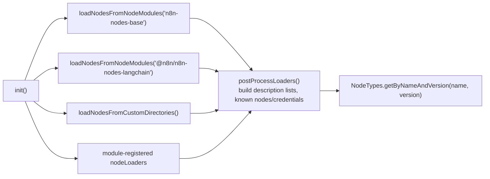

# Deep dive 7 — Nodes: types, contexts, and loading

> **Where you are:** Stage 5, dive 7 of 11 — `INodeType`, execution contexts, `NodeTypes`, `LoadNodesAndCredentials`, and three real nodes.
> **After this file** you can read any node in `nodes-base`, explain what `this` is inside `execute`, and say how a node named in JSON becomes running code.

Abbreviations: **API** (Application Programming Interface), **HTTP** (Hypertext Transfer Protocol), **JSON** (JavaScript Object Notation), **UI** (User Interface), **ID** (Identifier), **AI** (Artificial Intelligence).

---

## Role recap

**Owns:** the actual work of each step — reading parameters, calling services, shaping items.
**Knows:** its own parameters and input items, through a *context* object.
**Does not do:** choose the next node, store its own output, or talk to Redis/DB directly — everything goes through helpers on the context.
**Appears in:** **S4** (Webhook node's `webhook()`), **S8–S11** (Webhook pass-through, Set, HTTP Request, Code).

## Internal design

### 1. Two separate things: `INode` vs `INodeType`

| | `INode` (data, in the workflow JSON) | `INodeType` (code, in a package) |
|---|---|---|
| Lives in | `workflow.nodes[]` | `nodes-base/nodes/…` compiled into `dist` |
| Contains | `id, name, type, typeVersion, parameters, credentials, position, onError, retryOnFail, webhookId, …` (`interfaces.ts` l.1730) | `description` + optional `execute / poll / trigger / webhook / supplyData / methods / webhookMethods / customOperations` (l.2559) |
| Linked by | `type: "n8n-nodes-base.set"` + `typeVersion: 3.4` | resolved with `NodeTypes.getByNameAndVersion(type, version)` |

Which capability method a node implements defines what kind of node it is:

| Method | Kind | Called by |
|---|---|---|
| `execute` | Regular/action node | Engine ([`executeNode`](06-execution-engine.md)) |
| `webhook` | Webhook trigger | [Ingress](03-webhook-ingress.md) (`WebhookService.runWebhook`) |
| `trigger` | Long-lived trigger | Trigger Registry at publish, via `ActiveWorkflowTriggers` |
| `poll` | Polling trigger | Poll scheduler |
| `supplyData` | AI sub-node (model, memory, tool) | Parent node, not the engine loop |
| `methods.loadOptions` … | UI helpers (dropdown options, credential test) | Editor requests |
| `webhookMethods` | Lifecycle of *external* webhook registration | Registry (`checkExists/create/delete`) |

### 2. Versioning

`VersionedNodeType` (`workflow/src/versioned-node-type.ts`) maps `version → INodeType` and picks `defaultVersion ?? latest`. Old workflows keep their saved `typeVersion` so behaviour never changes underneath them — e.g. the Set node has `Set/v1` and `Set/v2` directories, `HttpRequest` has `V1/V2/V3`.

### 3. Programmatic vs. declarative nodes

- **Programmatic:** you write `execute()` in TypeScript (Set, Code, Webhook).
- **Declarative:** you describe requests in `description.requestDefaults` + per-property `routing` metadata and **no `execute`**; `NodeTypes.getByNameAndVersion` assigns one that runs a `RoutingNode` (`cli/src/node-types.ts` l.114–120). Many service nodes are built this way.

### 4. The context — what `this` is

Inside `execute(this: IExecuteFunctions)` the engine gives an `ExecuteContext` (`core/src/execution-engine/node-execution-context/execute-context.ts`). Its constructor receives `(workflow, node, additionalData, mode, runExecutionData, runIndex, connectionInputData, inputData, executeData, closeFunctions, abortSignal)`. Sibling contexts exist for each capability: `WebhookContext`, `TriggerContext`, `PollContext`, `SupplyDataContext`, `LoadOptionsContext`, `HookContext`, `CredentialsTestContext`.

Key members:

| Member | Meaning |
|---|---|
| `getInputData()` | The items this run received |
| `getNodeParameter(name, itemIndex, fallback?, {rawExpressions?})` | Reads `node.parameters`, **resolves expressions** through `workflow.expression.getParameterValue(…)` ([dive 8](08-expression-engine.md)) |
| `getCredentials(type)` | Decrypts the referenced credential ([dive 9](09-credentials.md)) |
| `helpers.httpRequest / requestWithAuthentication / requestOAuth2 / …` | Authenticated network I/O |
| `helpers.returnJsonArray`, `constructExecutionMetaData` | Wrap plain objects into items with `pairedItem` |
| `helpers.getBinaryDataBuffer / prepareBinaryData` | Binary attachments (stored by the binary-data service, referenced from items) |
| `continueOnFail()`, `getMode()`, `getWorkflow()`, `getNode()` | Engine settings and metadata |
| `startJob(...)` | Send work to the task runner ([dive 10](10-task-runner.md)) |

This indirection is the reason nodes are **portable**: the same node code runs in main, worker, editor test-runs, or sub-workflows because only the context differs.

### 5. Loading — from `node_modules` to `NodeTypes`

`LoadNodesAndCredentials.init()` (`cli/src/load-nodes-and-credentials.ts` l.78):



*Caption: how a node type string in a workflow becomes a callable `INodeType` at runtime.*

Loaders (`core/src/nodes-loader/`): `PackageDirectoryLoader` (reads `package.json`'s `n8n.nodes`/`n8n.credentials` lists), `CustomDirectoryLoader`, plus a lazy variant. Each loader keeps a `known` map (`nodeType → sourcePath`) and loads a node class on first use.

### 6. Three real nodes

**Webhook** (`nodes-base/nodes/Webhook/Webhook.node.ts`) — `description.webhooks = [defaultWebhookDescription]` (`isFullPath: true`, `httpMethod` from a parameter); `webhook(context)` (l.225) does auth/IP/bot checks then returns `{ workflowData: [[ {json:{headers,params,query,body}} ]] }`.

**Set / Edit Fields** (`nodes-base/nodes/Set/v2/SetV2.node.ts`, `execute` l.309):

```ts
const items = this.getInputData();
const mode = this.getNodeParameter('mode', 0) as Mode;      // 'manual' | 'raw'
for (let i = 0; i < items.length; i++) {
  const newItem = await setNode[mode].execute.call(this, items[i], i, options, rawData, node);
  returnData.push(newItem);
}
return [returnData];
```

It iterates items; inside `manual.mode.ts`, each assignment's value is fetched with `getNodeParameter(..., i)` so **the expression is re-evaluated per item**.

**HTTP Request v3** (`nodes-base/nodes/HttpRequest/V3/HttpRequestV3.node.ts`, `execute` l.110) — reads `authentication`; for `genericCredentialType` / `predefinedCredentialType` it calls `this.helpers.requestWithAuthentication.call(this, credentialType, requestOptions, …)` (l.798); for none, `this.helpers.request(...)`. Pagination and batching options wrap the same helpers.

## Interactions

| With | Contract |
|---|---|
| Engine | `execute` returns `INodeExecutionData[][]` (one array per output) or `null`; may return an `EngineRequest` to run sub-nodes (AI) |
| Expression Engine | Only via `getNodeParameter` |
| Credentials | Only via `getCredentials` / `helpers.*WithAuthentication` |
| Editor | `description.properties` (the form), `inputs/outputs`, `credentials`, `methods.loadOptions` — the *same* description drives the UI form and the runtime |

## ⚓ Back to the example

- **S4:** `Webhook.webhook(context)` — described in [dive 3](03-webhook-ingress.md).
- **S8:** the engine's `runNode` finds `nodeType.webhook` and no `requestDefaults` → forwards the item.
- **S9:** `SetV2.execute` — with input `[ {json:{body:{customer:"ACME",amount:100},…}} ]` loops once (`i = 0`); its `total` assignment is fetched with `getNodeParameter('assignments…', 0)`; the returned item is `{ json: { …input, total: 120 } }`.
- **S10:** `HttpRequestV3.execute` — with `authentication: genericCredentialType` and `genericAuthType: httpHeaderAuth` it obtains the credential type name and calls `requestWithAuthentication` — detailed in [dive 9](09-credentials.md).
- **S11:** `Code.execute` builds a `JsTaskRunnerSandbox(mode, this, …)` and calls `startJob('javascript', { code, nodeMode: 'runOnceForAllItems', … })` — [dive 10](10-task-runner.md).

## Failure behavior

| Failure | Result |
|---|---|
| Unknown `type`/`typeVersion` | `Workflow` constructor **skips** unknown node types silently (so expressions over other nodes still resolve); `checkReadyForExecution` reports `typeUnknown`; a version not in `nodeVersions` raises `NodeVersionNotFoundError` |
| `execute` throws | Wrapped as `NodeOperationError` / `NodeApiError` → engine's error routing ([dive 6](06-execution-engine.md)) |
| Missing required parameter | `getNodeParameter` throws `Could not get parameter "…"`; `checkReadyForExecution` flags parameter issues before a manual run |
| A package fails to load | Logged and reported; other packages still load |
| Node registers `closeFunctions` | Run after `execute` in `finally`; their errors surface only if the node itself succeeded |

**Next:** [08 — Expression Engine](08-expression-engine.md) · **Back:** [06 — Execution Engine](06-execution-engine.md) · [Concept map](../03-concept-map.md)
