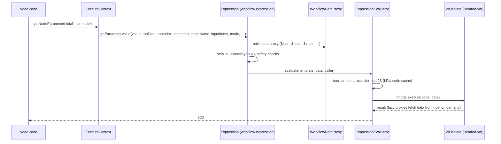

# Deep dive 8 — The Expression Engine

> **Where you are:** Stage 5, dive 8 of 11 — how `={{ $json.body.amount * 1.2 }}` becomes `120`, safely.
> **After this file** you know what an expression is at the data level, what data it can see, and how n8n stops user-written JavaScript from touching the server.

Abbreviations: **AST** (Abstract Syntax Tree), **VM** (Virtual Machine — here a sandboxed JavaScript context), **V8** (Google's JavaScript engine), **WASM** (WebAssembly), **JSON** (JavaScript Object Notation), **UI** (User Interface), **LRU** (Least Recently Used), **ID** (Identifier).

---

## Role recap

**Owns:** evaluating expression strings against the run's data, inside a sandbox.
**Knows:** a *data proxy* over `runData`/current items, an isolate pool, a code cache.
**Does not do:** network I/O, file access, reach the host process — and it never mutates run data.
**Appears in:** **S9** (`Add VAT`'s `total`), **S10** (`{{$credentials.value}}` in header auth), and — invisibly — at publish (S2) and webhook handling (S4).

## Internal design

### 1. What an expression *is*

A node parameter value is either a literal or a **string starting with `=`**. `isExpression(value)` is exactly that check (`workflow/src/expression.ts`, `resolveSimpleParameterValue` l.610): strip the `=`, then the remainder is a *template*: text with `{{ … }}` islands of JavaScript.

```
"={{ $json.body.amount * 1.2 }}"        → the number 120  (whole-value expression keeps its type)
"=Total: {{ $json.total }} EUR"         → the string "Total: 120 EUR"
```

Object results are stringified only when the caller asked (`returnObjectAsString`); a leftover function result throws "this is a function, please add ()".

### 2. Where evaluation is triggered



*Caption: `getNodeParameter` is the only door — every expression goes through the same six hops.*

`getNodeParameter` (`node-execution-context.ts` l.514–570) reads `node.parameters` with lodash `get`; if `options.rawExpressions` is set it returns the raw string (the Set node uses this to pre-scan); otherwise it calls `workflow.expression.getParameterValue(...)`, which recursively resolves nested objects/arrays.

### 3. The data an expression can see

`WorkflowDataProxy` (`workflow/src/workflow-data-proxy.ts`) builds a `Proxy` object exposing, among others: `$json` (current item's JSON), `$input`/`$items(...)`, `$node[...]` and `$('Node Name')` (other nodes' outputs, with paired-item resolution), `$parameter`, `$prevNode`, `$runIndex`, `$itemIndex`, `$mode`, `$workflow`, `$execution`, `$now`, `$today`, `DateTime`/`Duration`/`Interval` (Luxon), `$jmespath`, and — in credential contexts — `$credentials`. Data is fetched **lazily** through proxies, so a huge upstream output is not copied into the sandbox unless touched.

Paired-item lookups rely on the `pairedItem` lineage stamped by the [engine](06-execution-engine.md).

### 4. Parsing and safety: Tournament

`@n8n/tournament` parses the template into an AST and rewrites it. Hooks (`expressionSandboxHooks`) include `ThisSanitizer`, `PrototypeSanitizer`, `DollarSignValidator` — they block `this`, prototype pollution and constructor tricks. Before this, `Expression` also rejects any `.constructor` call with a regex. `extendSyntax` adds n8n's extension methods (`"abc".toUpperCase()`, `[1,2].sum()`, `.toDateTime()` …).

### 5. Where the code runs: three engines

`ExpressionEngineConfig` (`@n8n/config/src/configs/expression-engine.config.ts`):

| `N8N_EXPRESSION_ENGINE` | Sandbox | Notes |
|---|---|---|
| `vm` (**default**) | V8 isolate via `isolated-vm` (`IsolatedVmBridge`) | Timeout **5000 ms**, memory **128 MB**, pool size 1, code cache 1024 |
| `legacy` | No isolation (`new Function`-style via `evaluateExpression`) | "Less secure and soon to be deprecated" |
| `quickjs` | QuickJS compiled to WASM | Experimental; the editor can use it in the browser (`N8N_EXPRESSION_ENGINE_FRONTEND`) |

`ExpressionEvaluator` (`@n8n/expression-runtime/src/evaluator/expression-evaluator.ts`) owns: the Tournament instance (created lazily), the **code cache** (template → transformed JS; ~99.9% hit rate per the source comment), and an **isolate pool** (`IsolatePool`/`IdleScalingPool`). It exposes `acquire(caller)` / `evaluate(...)` / `release(caller)`.

### 6. Isolate lifecycle — the "acquire" pattern

An isolate must be **acquired for a workflow** before any code resolves `{{ }}`:

| Where | Call |
|---|---|
| Engine run | `WorkflowExecute.initializeExecution` → `workflow.expression.acquireIsolate()`; released in the `.finally` of `processRunExecutionData` |
| Publish / trigger registration | `ActiveWorkflowManager.add` (see [dive 2](02-trigger-registry.md)) |
| Webhook handling | `LiveWebhooks.executeWebhook` — **skipped** when `webhookPhaseNeedsIsolate` proves nothing evaluates |
| Credential resolution, polling, chat | `credentials-helper.ts`, `poll-trigger-task-handler.ts`, `chat-execution-manager.ts` |
| Generic helper | `withExpressionIsolate(workflow, fn)` (`cli/src/utils.ts`) — releases only if *this* scope acquired |

Release is **not reference-counted**, so nested scopes must only release what they acquired — the helper enforces it.

## Interactions

| With | Contract |
|---|---|
| Nodes | `getNodeParameter` (per item) — returns typed values |
| Engine | Provides `runExecutionData`, `runIndex`, `connectionInputData` used to build the proxy |
| Credentials | `authenticate` resolves `={{$credentials.x}}` with the *decrypted* data injected as `$credentials` ([dive 9](09-credentials.md)) |
| Config | Engine choice, timeout, memory, pool size via `N8N_EXPRESSION_ENGINE*` env vars |

## ⚓ Back to the example — S9

`Add VAT` runs `SetV2.execute`. For item 0, the manual mode fetches the assignment list; the `total` assignment has value `"={{ $json.body.amount * 1.2 }}"`.

1. `getNodeParameter('assignments…', 0)` → `workflow.expression.getParameterValue(value, runExecutionData, runIndex=0, itemIndex=0, 'Add VAT', connectionInputData, mode='webhook', additionalKeys, executeData)`.
2. `isExpression` → true; strip `=` → `{{ $json.body.amount * 1.2 }}`; `extendSyntax` (nothing to extend).
3. `renderExpression` → `evaluator.evaluate(template, data, caller, { timezone })`.
4. Tournament transforms the template to a JS function body (cached by string); the isolate evaluates it; `$json` resolves lazily (`nodeDataGetter(contextNodeName, …).json`) to the JSON of the *current input item* of `Add VAT` — which is the item `Order Webhook` produced — so `body.amount` = `100` → `100 * 1.2` = `120`.
5. `120` (a number, since the parameter is a single expression) returns to `SetV2`, which writes it to the output item.

Second use, **S10**: the HTTP Request node's body parameter `={{ $json.total }}` is resolved the same way → `120`, and later the credential's `={{$credentials.value}}` (dive 9).

## Failure behavior

| Failure | Result |
|---|---|
| Syntax error | `UserError('invalid syntax')` (legacy path) / mapped VM error |
| Runtime error in user JS | `ExpressionError` with `runIndex`/`itemIndex` context → node error → engine routing |
| Timeout (>5 s) or memory (>128 MB) in isolate | Isolate error mapped by `mapVmError`; the bridge is disposed/replenished by the pool |
| Isolate not acquired | `IsolateError('No bridge acquired for this context. Call acquire() first.')` |
| Pool exhausted | `PoolExhaustedError`; at activation, an `IsolateError` skips the retry back-off doubling |
| Engine selected but not initialised | `UnexpectedError("The … expression engine has not been initialized")` — the backend refuses to silently fall back to `legacy` |
| `.constructor` in template | `ExpressionError('Expression contains invalid constructor function call')` |

**Next:** [09 — Credentials](09-credentials.md) · **Back:** [07 — Nodes](07-nodes.md) · [Concept map](../03-concept-map.md)
