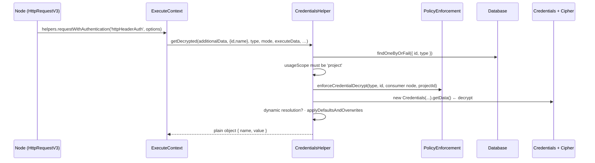
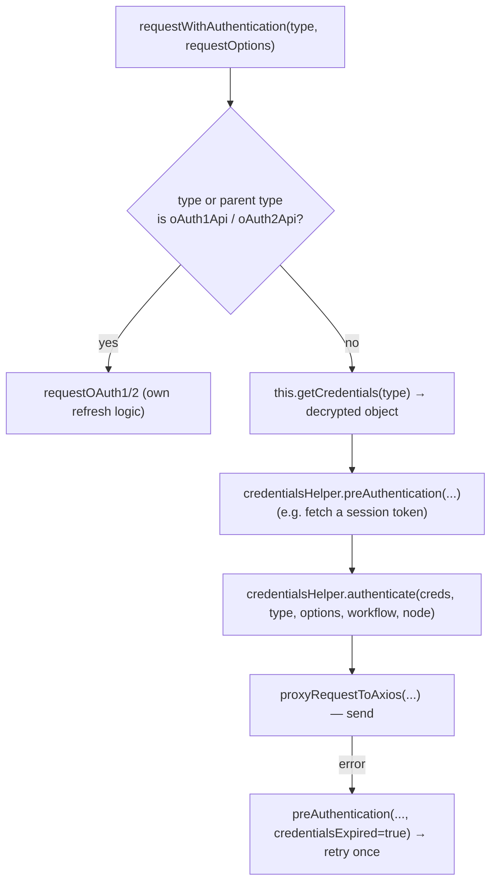

# Deep dive 9 — Credentials

> **Where you are:** Stage 5, dive 9 of 11 — `ICredentialType`, `Credentials`, `Cipher`, `CredentialsHelper`, and `requestWithAuthentication`.
> **After this file** you know where a secret lives, when it is decrypted, how it is attached to an HTTP request, and why it never appears in workflow JSON or execution data.

Abbreviations: **AES** (Advanced Encryption Standard), **CBC** (Cipher Block Chaining), **GCM** (Galois/Counter Mode), **OAuth** (Open Authorization), **HTTP** (Hypertext Transfer Protocol), **JSON** (JavaScript Object Notation), **ID** (Identifier), **DB** (Database), **API** (Application Programming Interface), **UI** (User Interface).

---

## Role recap

**Owns:** storing secrets encrypted, decrypting them at call time, and applying them to outgoing requests according to the credential *type*.
**Knows:** the encryption key (via `InstanceSettings`/key provider), credential type definitions, access policies.
**Does not do:** put secrets into workflow JSON or `runData`; expose plaintext to the editor after saving.
**Appears in:** **S1** (Ada creates "Billing API key"), **S6** (access check before the run), **S10** (decrypt + authenticate + call).

## Internal design

### 1. Three pieces, three places

| Piece | What it is | Lives in |
|---|---|---|
| **Credential type** (`ICredentialType`, `interfaces.ts` l.417) | Code: `name`, `properties` (form fields), `authenticate` (how to apply), optional `test`, `genericAuth`… | `nodes-base/credentials/*.credentials.ts` (412 files at this commit), loaded by `LoadNodesAndCredentials` |
| **Credential record** (`CredentialsEntity`) | Row: `id`, `name`, `type`, **`data` = encrypted blob**, `usageScope`, project ownership | Database |
| **Reference from a node** (`INode.credentials`) | `{ [type]: { id, name } }` — *only an id and a display name* | Workflow JSON |

### 2. Encryption

`Credentials` (`core/src/credentials.ts`) extends `ICredentials`; `setData(obj)` → `cipher.encryptV2(obj)`; `getData()` → `cipher.decryptV2` then `jsonParse`, with typed errors (`CREDENTIAL_ERRORS.NO_DATA`, `DECRYPTION_FAILED`, `INVALID_JSON`). `Cipher` (`core/src/encryption/cipher.ts`) supports `aes-256-cbc` and `aes-256-gcm` implementations, delegates key material to a key provider (`EncryptionKeyProxy`) and can operate with key rotation/wrapped keys; an explicit `customEncryptionKey` short-circuits to raw CBC. The instance's encryption key is instance-level state — **lose the key, lose every stored secret**.

### 3. Decrypt path — `CredentialsHelper.getDecrypted` (`cli/src/credentials-helper.ts` l.551)



*Caption: every decrypt passes an existence check, a scope check and a policy check before any plaintext is produced.*

Details worth knowing:

- `getCredentialsEntity` throws `CredentialMissingIdError` if the node reference has no `id`, `CredentialNotFoundError` if no row matches `(id, type)`, and `UserError('This credential cannot be used in workflows')` if `usageScope !== 'project'`.
- `enforceCredentialDecrypt` validates against the *executing project's* policy **before decryption**.
- **Dynamic credentials**: a credential can be *resolvable* (per-user), in which case the helper resolves values at runtime; manual runs deliberately fall back to static data for easier testing. This guide does not go deeper.
- `applyDefaultsAndOverwrites` merges type defaults and instance-level overwrites (`credentials-overwrites.ts`).

### 4. Applying the secret — `requestWithAuthentication`

`core/src/execution-engine/node-execution-context/utils/request-helpers/authentication.ts` l.165:



*Caption: OAuth types take their own path; everything else is decrypt → optional pre-auth → authenticate → send, with one refresh-and-retry.*

`CredentialsHelper.authenticate` (l.122) supports two styles:

- **Function**: `credentialType.authenticate(credentials, requestOptions)` — full custom control.
- **Declarative generic**: `{ type: 'generic', properties: { headers|qs|body|auth: { key: value } } }` where both keys and values may be **expressions** resolved with `$credentials` = the decrypted data (`resolveValue(..., { $credentials: credentials }, workflow, node)`). This is exactly how `HttpHeaderAuth` works:

```ts
// nodes-base/credentials/HttpHeaderAuth.credentials.ts
authenticate: IAuthenticateGeneric = {
  type: 'generic',
  properties: { headers: { '={{$credentials.name}}': '={{$credentials.value}}' } },
};
```

The secret exists in plaintext only in memory, only for the duration of the request setup — it is never written to `runData` (nodes receive the *request options*, not the credential; the recorded item is the response).

## Interactions

| With | Contract |
|---|---|
| Node | `getCredentials(type)` or `helpers.requestWithAuthentication(type, opts)` |
| [Expression Engine](08-expression-engine.md) | Resolves `={{$credentials.*}}` in `authenticate` |
| [Workflow Runner](04-workflow-runner.md) | `credentialsPermissionChecker.check(workflowId, nodes)` *before* the execution starts |
| Editor | Create/update fields; UI can run a credential's `test` request (`methods.credentialTest`) |
| Database | `CredentialsEntity` rows; shared to projects |

## ⚓ Back to the example — S1, S6, S10

**S1.** Ada picks "Header Auth", enters `Name = X-Api-Key`, `Value = sk_live_…`. The server builds `Credentials`, `setData({ name:'X-Api-Key', value:'sk_live_…' })` → `data` becomes an encrypted string; the row is `{ id:'cred42', name:'Billing API key', type:'httpHeaderAuth', data:'<ciphertext>' }`. The node stores only `credentials: { httpHeaderAuth: { id:'cred42', name:'Billing API key' } }`.

**S6.** `credentialsPermissionChecker.check('wf123', nodes)` verifies `cred42` is usable by the workflow's project.

**S10.** `HttpRequestV3.execute` → `authentication = 'genericCredentialType'`, `genericAuthType = 'httpHeaderAuth'` → `requestWithAuthentication.call(this, 'httpHeaderAuth', requestOptions, …)`:

1. `getCredentials('httpHeaderAuth')` → `getDecrypted` → `{ name: 'X-Api-Key', value: 'sk_live_…' }`.
2. `preAuthentication` → nothing to do for this type.
3. `authenticate` (generic): resolves key `={{$credentials.name}}` → `X-Api-Key`, value `={{$credentials.value}}` → `sk_live_…`; sets `requestOptions.headers['X-Api-Key']`.
4. `proxyRequestToAxios` sends `POST https://billing.example.com/invoices` with body `{ total: 120 }`.
5. Response `{ "invoiceId": "INV-1001" }` becomes the node's output item; **the header value is not in it**.

## Failure behavior

| Failure | Result |
|---|---|
| Credential row missing/wrong type | `CredentialNotFoundError` → node error |
| Node has no credential of that type set | `NodeOperationError('Node "…" does not have any credentials of type "…" set')` |
| Wrong encryption key / corrupted blob | `CredentialDataError` with `DECRYPTION_FAILED` (cause attached) |
| Policy denies decrypt | Fails **before** decryption |
| HTTP error (e.g. 401 from expired token) | `requestWithAuthentication` calls `preAuthentication(…, credentialsExpired=true)` to refresh, then retries; if it still fails → `NodeApiError` |
| Project cannot use credential | Execution created and failed at `run()` before any node executes ([dive 4](04-workflow-runner.md)) |

**Next:** [10 — Task Runner](10-task-runner.md) · **Back:** [08 — Expression Engine](08-expression-engine.md) · [Concept map](../03-concept-map.md)
