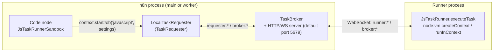
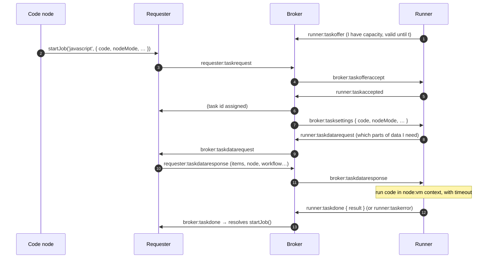

# Deep dive 10 — The Task Runner (where the Code node really runs)

> **Where you are:** Stage 5, dive 10 of 11 — `@n8n/task-runner` and the broker in `cli/src/task-runners/`.
> **After this file** you know why user JavaScript from the Code node does not execute inside the n8n server process, how a task travels requester → broker → runner and back, and what happens when a runner dies.

Abbreviations: **WS** (WebSocket), **HTTP** (Hypertext Transfer Protocol), **RPC** (Remote Procedure Call), **IPC** (Inter-Process Communication), **VM** (Virtual Machine — Node's `vm` module context), **ID** (Identifier), **JSON** (JavaScript Object Notation), **OOM** (Out Of Memory).

---

## Role recap

**Owns:** executing untrusted user code (JavaScript, and Python via a separate runner) in a separate, restartable process, with a task timeout.
**Knows:** the task's script and settings; *asks* for input data instead of owning it.
**Does not do:** own workflow state, credentials, or persistence.
**Appears in:** **S11** (`Summarize` Code node).

## Internal design

### 1. Why a separate process?

The Code node lets any user run JavaScript. In the server process that would share memory, environment and file system with credentials and other tenants' data. A separate **runner process**, driven over WebSocket, gives: a crash boundary, a hard timeout (`taskTimeout`), and a process whose lifecycle n8n can monitor and restart (OOM and restart-loop detectors).

### 2. Three roles

*Caption: requester and broker live inside n8n; only the runner is outside — it connects back over WebSocket.*

| Role | Class | Responsibility |
|---|---|---|
| **Requester** | `LocalTaskRequester extends TaskRequester` (`cli/src/task-runners/task-managers/`) | Packages the request (`TaskRequest` with `TaskData` = workflow, runExecutionData, inputData, node, …) and later answers the runner's data requests |
| **Broker** | `TaskBroker` (`task-broker/task-broker.service.ts`) + `TaskBrokerServer` / `TaskBrokerWsServer` | Matches **task requests** with **task offers** from runners; relays messages; drains on shutdown |
| **Runner** | `JsTaskRunner` (`@n8n/task-runner/src/js-task-runner/js-task-runner.ts`, `executeTask` l.200) | Connects, offers capacity (`maxConcurrency` default 10), runs the script |

Deployment: `N8N_RUNNERS_MODE` = `internal` (n8n spawns the runner as a child process — `JsTaskRunnerProcess` / `PyTaskRunnerProcess`, with restart-loop and OOM detectors) or `external` (an orchestrator launches it; requires `N8N_RUNNERS_AUTH_TOKEN`). `TaskRunnerModule.start()` wires it and cancels tasks on the `execution-cancelled` event.

### 3. The protocol (message names from `message-types.ts`)

*Caption: a runner advertises capacity first; the request is matched against an offer; the runner then pulls exactly the input data it needs.*

Key design points:

- **Offer/accept matching** (not push-to-runner) lets the broker tolerate runners coming and going; offers carry a `validUntil` and can be discarded when a runner disconnects. (The protocol also has `runner:taskrejected` / `runner:taskdeferred` messages; their exact semantics are not covered here.)
- **Data is pulled, and only what the code uses.** `JsTaskRunner.executeTask` parses the script for used built-ins (`builtInsParser.parseUsedBuiltIns(code)`); if the code never references `$('Node')` or `$input`, it doesn't ask for all data. Unknown → asks for everything.
- **Modes:** `runOnceForAllItems` (one call with all items), `runOnceForEachItem` (per item, optionally in *chunks*), and `runCode` (a locked-down context with no built-ins or RPC, used for tools).
- **RPC back to n8n:** the protocol has `runner:rpc` / `broker:rpc` / `rpcresponse` messages so a script can call selected host-side functions through the requester rather than doing I/O itself (`RpcCallObject` in `js-task-runner.ts`).
- **Timeout:** `N8N_RUNNERS_TASK_TIMEOUT` = 300 s default (`taskTimeout`). On `abort`, the runner rejects with `TimeoutError`.
- **Result validation:** the node validates shapes (`validateRunCodeAllItems`, and its per-item counterpart) and normalizes items (`helpers.normalizeItems`) — so `return {a:1}` and `return [{json:{a:1}}]` both work.

## Interactions

| With | Contract |
|---|---|
| Code node (`Code.node.ts` l.215: `new JsTaskRunnerSandbox(workflowMode, this)`) | `runCodeAllItems(code)` / `runCodeForEachItem(code, n)` → `startJob` |
| `additionalData.startRunnerTask` | The seam through which contexts reach the requester (`base-execute-context.ts` l.444) |
| [Engine](06-execution-engine.md) | Unaware — sees an ordinary `execute` that took a bit longer; cancellation propagates via `execution-cancelled` |
| Environment | `N8N_RUNNERS_*` config in `runners.config.ts` |

## ⚓ Back to the example — S11

Input to `Summarize`: one item `{ json: { invoiceId: "INV-1001", total: 120, … } }`. Code (`return [{ json: { summary: \`Invoice ${$input.first().json.invoiceId}\` } }];`).

1. `Code.execute` → `new JsTaskRunnerSandbox(mode, this)`; mode `runOnceForAllItems` → `runCodeAllItems(code)`.
2. `startJob('javascript', { code, nodeMode:'runOnceForAllItems', workflowMode:'webhook', continueOnFail:false }, 0)` → `additionalData.startRunnerTask(...)` → `LocalTaskRequester.startTask` → `requester:taskrequest`.
3. Broker matches an offer from the internal JS runner; runner receives settings.
4. The runner's parser sees `$input` in the code → requests input data (not the whole run history); requester answers.
5. `runInContext(...)` executes the script (timeout 300 s); result `[{ json: { summary: "Invoice INV-1001" } }]` → `runner:taskdone`.
6. `validateRunCodeAllItems` normalizes → returned as the node output → engine records `runData['Summarize']` (S12 continues).

## Failure behavior

| Failure | Result |
|---|---|
| Script throws | `runner:taskerror` → `throwExecutionError(...)` → node error (respecting *Continue on Fail*) |
| Script exceeds timeout | `TimeoutError` after 300 s (configurable) |
| No runner connected / offer expires | Requester waits; unmatched requests can expire (`broker:requestexpired`) and surface a task error |
| Runner process crashes / OOM | Internal mode: `TaskRunnerModule` has a disconnect analyzer and an OOM detector to explain the failure and a restart-loop detector to stop crash loops; how in-flight tasks are failed is not traced in this guide |
| Execution cancelled | `execution-cancelled` → `taskRequester.cancelTasks(executionId)` → `broker:taskcancel` |
| Shutdown | Broker *drains*: tells runners to stop offering, rejects new requests, waits for active tasks up to a timeout |

**Next:** [11 — Lifecycle, Persistence & Push](11-lifecycle-persistence-push.md) · **Back:** [09 — Credentials](09-credentials.md) · [Concept map](../03-concept-map.md)
