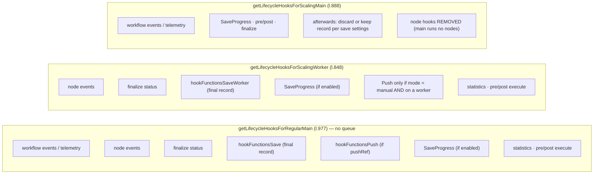

# Deep dive 11 — Lifecycle Hooks, Persistence & Push

> **Where you are:** Stage 5, dive 11 of 11 — `ExecutionLifecycleHooks`, the save hooks, the execution tables, and the push service.
> **After this file** you know how an execution becomes a durable record, why production runs don't stream to the editor, what "save progress" costs, and how the main/worker split changes which hooks run where.

Abbreviations: **DB** (Database), **ID** (Identifier), **UI** (User Interface), **WS** (WebSocket), **SSE** (Server-Sent Events), **JSON** (JavaScript Object Notation), **PII** (Personally Identifiable Information), **HTTP** (Hypertext Transfer Protocol).

---

## Role recap

**Owns:** everything that *reacts* to execution events — saving, streaming to the editor, statistics, error-workflow dispatch, HTTP response relay.
**Knows:** save settings (per workflow + global defaults), `pushRef`, the execution record.
**Does not do:** decide which node runs next or what it outputs. The engine only *fires* hooks and does not read their results. (Hooks are `await`ed one after another and `runHook` has no `try/catch`, so a handler that throws *would* propagate into the run — which is why the built-in handlers such as save-progress catch and log their own errors.)
**Appears in:** **S12** — and, less visibly, at every node boundary from S8.

## Internal design

### 1. The hook bus

`ExecutionLifecycleHooks` (`core/src/execution-engine/execution-lifecycle-hooks.ts`) is a typed list of handlers per event. `addHandler(name, fn)`, `runHook(name, params)` (handlers run sequentially with `this` = the hooks object, which carries `executionId`, `mode`, `workflowData`).

| Event | Fired by the engine | Typical handlers |
|---|---|---|
| `workflowExecuteBefore` | `initializeExecution` | telemetry event, push `executionStarted`, pre-execute |
| `nodeExecuteBefore` | before each node | push, node-event bookkeeping |
| `nodeExecuteAfter` | after each node (and on failure, unless cancelled) | **save progress**, push |
| `workflowExecuteAfter` | `processSuccessExecution` / catch | **save execution**, error workflow, statistics, push `executionFinished` |
| `sendResponse` | Respond-to-Webhook / lastNode | resolve the waiting HTTP caller |
| `sendChunk` | streaming, errors | write a chunk to the HTTP response |
| `nodeFetchedData` | nodes that pull data | workflow statistics |

### 2. The set of hooks depends on the process role

`cli/src/execution-lifecycle/execution-lifecycle-hooks.ts`:



*Caption: the same events, wired differently — in queue mode the worker writes the result; main only tidies up.*

### 3. Save settings

`toSaveSettings(workflowSettings)` (`to-save-settings.ts`) merges per-workflow overrides with global defaults from `GlobalConfig.executions`:

| Setting | Meaning |
|---|---|
| `saveDataSuccessExecution` (`all`/`none`/`DEFAULT`) | keep records of successful runs |
| `saveDataErrorExecution` | keep records of failed runs |
| `saveManualExecutions` | keep editor test runs; if off, they are **soft-deleted** and hard-deleted after a grace period (`EXECUTIONS_DATA_HARD_DELETE_BUFFER`) so the user can still fetch their binary data while building |
| `saveExecutionProgress` | write the whole run state to the DB **after every node** |

`saveExecutionProgress` (`save-execution-progress.ts`) does `updateExistingExecution(executionId, { data: executionData, status: 'running' }, { requireNotFinished: true, requireNotCanceled: true })` — so a crash mid-run leaves a *partial record* to inspect and to let a `Wait` resume; the cost is one DB write per node (the source comment notes possible "Database is locked" errors on busy SQLite).

### 4. The final save — `hookFunctionsSave` / `hookFunctionsSaveWorker`

On `workflowExecuteAfter` (l.566 / l.713):

1. Restore/duplicate binary-data ids (`restoreBinaryDataId`, sub-workflows duplicate binaries to the parent).
2. If non-manual and `newStaticData` → `saveStaticDataById`.
3. Manual + `!saveSettings.manual` → soft delete, return.
4. If the outcome is **not to be saved** (success but `!success`, or non-success but `!error`) and not `waiting` → dispatch the error workflow if applicable, then `deleteInFlightExecution`, return.
5. Otherwise `prepareExecutionDataForDbUpdate({ runData, workflowData, workflowStatusFinal, retryOf })` → `updateExistingExecution(..., { requireNotCanceled: true })` — **a finished run never overwrites a status the user already set to `canceled`**.
6. `updateExistingExecutionMetadata` (custom metadata key/values), `executeErrorWorkflow(...)` for non-success non-waiting non-manual runs (unless suppressed), `workflowStatisticsService.emit('workflowExecutionCompleted', …)`.

### 5. Persistence model

`@n8n/db` entities:

| Entity | Holds |
|---|---|
| `ExecutionEntity` (`execution-entity.ts`) | The **row you list and filter**: `id`, `workflowId`, `mode`, `status`, `finished` (deprecated), `retryOf`, `createdAt`, `startedAt` (null until processing begins), `stoppedAt`, `waitTill`, `deletedAt` (soft delete), `storedAt` (where the payload lives), `deduplicationKey` (unique; used by the Schedule Trigger), `jsonSizeBytes`, `workflowVersionId`, `usedPrivateCredentials`; indexes such as `(workflowId, id)`, `(waitTill, id)`, and a Postgres-only partial `(workflowId, status, id)` |
| `ExecutionData` (`execution-data.ts`) | The **payload**: the serialized `IRunExecutionData` and the `workflowData` snapshot, one-to-one with the entity |
| `ExecutionMetadata` | Custom key/values set from the workflow |
| `ExecutionAnnotation` (`.ee`) | Tags/ratings |

The payload can live outside the DB: `ExecutionDataStorageLocation = 'db' | 'fs' | 's3' | 'az'` (`storedAt`). `ExecutionPersistence` is the façade (`create`, `updateExistingExecution`, `findSingleExecution({ includeData, unflattenData })`, `deleteInFlightExecution`). The *workflow snapshot is stored with each execution* — so history shows the graph as it ran, even after later edits.

**Status transitions** (`ExecutionStatus`: `canceled, crashed, error, new, running, success, unknown, waiting`) — see the state diagram in [Scaling Queue](05-scaling-queue.md#failure-behavior). `hookFunctionsFinalizeExecutionStatus` runs *before other after-hooks* so that all hooks observe the same final status.

### 6. Push — the live channel to one browser tab

`hookFunctionsPush` (l.271): `if (!pushRef) return;` — **no `pushRef`, no push.** Production webhook and trigger runs have none.

With a `pushRef` it sends, via `Push.send(message, pushRef)` (`cli/src/push/`, WebSocket or SSE): `executionStarted`, `nodeExecuteBefore { executionId, nodeName, sequenceNumber, data }`, `nodeExecuteAfter { …, itemCountByConnectionType, data: taskData-without-items }`, `executionFinished { executionId, workflowId, status, source }`. Item payloads are deliberately **not** pushed with `nodeExecuteAfter` (only counts); the editor fetches full data when needed. The `sequenceNumber` is per-run, monotonic, so a suspended browser tab can order late events. The push hook also holds a redaction proxy (`ExecutionRedactionServiceProxy`) — a mechanism for stripping data from what is sent; its rules are not covered here.

In queue mode a manual run executing on a worker relays node events to main over pub/sub before they reach the browser (comment at the `sequenceNumber` counter); the *hooks* for push are installed on the worker only for `manual` mode.

## Interactions

| With | Contract |
|---|---|
| Engine | Fires events; awaits `nodeExecuteAfter` handlers so saving does not race |
| [Runner](04-workflow-runner.md) / [JobProcessor](05-scaling-queue.md) | Choose which hook set; add `sendResponse` / `sendChunk` handlers |
| Error workflow | `executeErrorWorkflow(workflowData, fullRunData, mode, executionId, retryOf)` starts another execution of the workflow named in settings |
| Editor | Push messages by `pushRef`; REST reads for the executions list |
| Statistics / telemetry / event bus | `workflow-pre-execute`, `workflow-post-execute`, `workflow-executed` events |

## ⚓ Back to the example — S12

Ada's workflow uses default save settings (success and error saved, progress off, manual saved).

- **After each node** (`nodeExecuteAfter`): worker hooks `SaveProgress` is a no-op (progress off); push hooks are absent (production run, no `pushRef`, and the worker only installs push for manual mode). Statistics/node events fire.
- **After `Summarize`** (`workflowExecuteAfter`): `hookFunctionsFinalizeExecutionStatus` fixes status `success`; `hookFunctionsSaveWorker` → `prepareExecutionDataForDbUpdate` → `updateExistingExecution` writes: `status: 'success'`, `finished: true`, `stoppedAt`, and the payload whose `resultData.runData` has four keys:

  ```
  "Order Webhook" · "Add VAT" · "Create Invoice" · "Summarize"   (each: [ { startTime, executionTime, data: { main: [[items]] }, … } ])
  ```

  No error workflow (status success). Worker sends `job-finished` (v2 with status and timestamps) → main's `ScalingService` stores the result and (via the main-side hooks) keeps the record since success is saved.
- **Ada opens Executions** → REST reads `ExecutionEntity` rows; opening `#1042` loads the payload (`findSingleExecution({ includeData: true })`), and the editor shows each node's input/output items. The credential value appears nowhere in it.

## Failure behavior

| Failure | Result |
|---|---|
| A hook handler throws | `runHook` does not catch: the error propagates. In the engine's outer `.catch`, a failure is recorded on the run and `workflowExecuteAfter` is attempted again with errors from *that* hook only logged (`console.error("There was a problem running hook \"workflowExecuteAfter\"")`). Built-in handlers avoid this by guarding themselves. If the final *save* itself fails, the row may stay `running` until recovery marks it `crashed` |
| DB write fails during SaveProgress | Reported and logged; the run continues |
| Run finishes after user canceled | `requireNotCanceled: true` keeps `canceled` |
| Save policy says "don't keep" | In-flight row deleted (`deleteInFlightExecution`) — but error-workflow dispatch still happens first for failures |
| Push connection lost | Events dropped for that tab; execution unaffected; the editor reconciles by re-fetching |
| Process dies before final save | Row left `running` → recovery → `crashed` |

**Next:** [06 — Walkthrough](../06-walkthrough.md) · **Back:** [10 — Task Runner](10-task-runner.md) · [Concept map](../03-concept-map.md)
