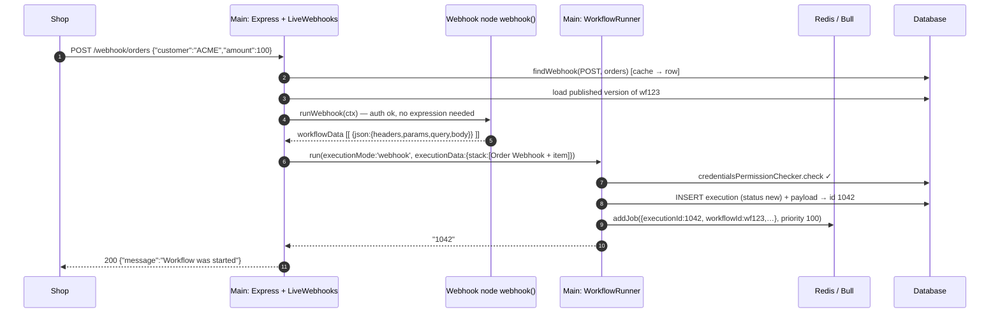
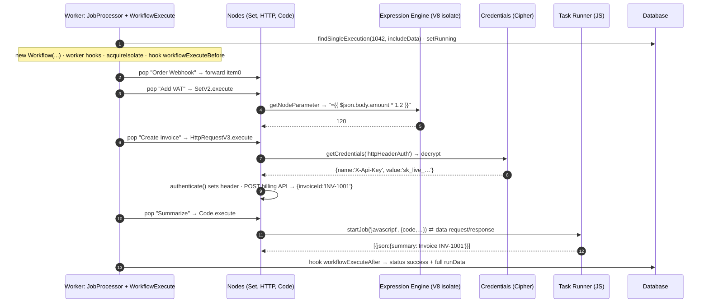
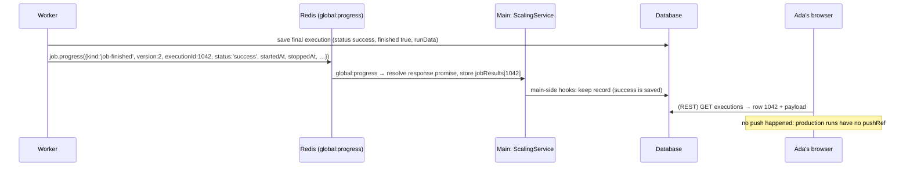
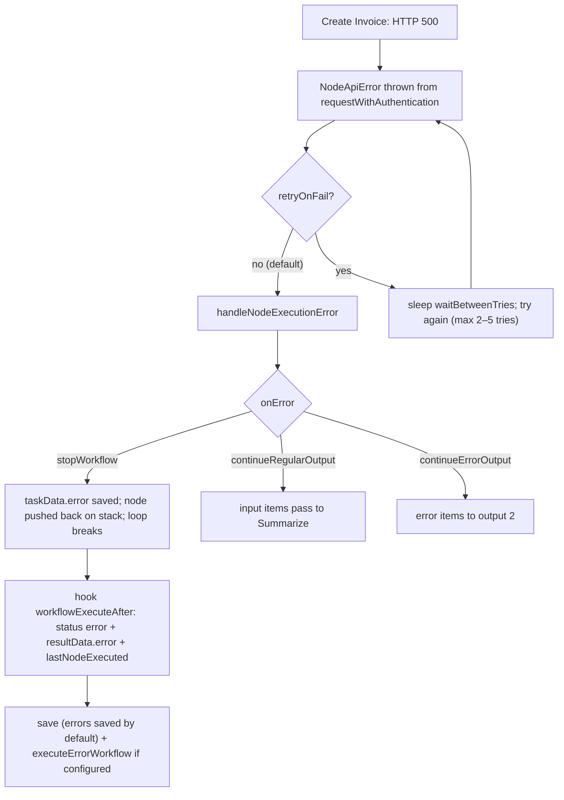

# 06 — Full Walkthrough: Ada's order, end to end

> **Where you are:** Stage 6 of 6 — the running example re-run **once, end to end, at full depth**, stitching all eleven dives.
> **After this file** every concept and every component has been *seen doing its job* in one connected story, with the real data that crosses each hop.

Abbreviations: **HTTP** (Hypertext Transfer Protocol), **JSON** (JavaScript Object Notation), **API** (Application Programming Interface), **DB** (Database), **ID** (Identifier), **UI** (User Interface), **V8** (Google's JavaScript engine), **WS** (WebSocket), **REST** (Representational State Transfer).

> **Honesty note.** Function names, field names, message kinds, log format strings and defaults below come from the source at commit `c1463d0e`. **IDs, timestamps and values** (execution `1042`, job `77`, `sk_live_…`) are illustrative. I did not run a live n8n instance for this guide; the only code I executed is the toy engine in [`examples/mini-engine.mjs`](examples/mini-engine.mjs).

---

## The cast (reminder)

Editor · Trigger Registry · Webhook Ingress · Workflow Runner · Scaling Queue · Execution Engine · Nodes · Expression Engine · Credentials · Task Runner · Hooks/Persistence/Push — see [03-concept-map](03-concept-map.md).

## Part A — Before any order: build and publish (S1–S2)

| Hop | What crosses | Inside |
|---|---|---|
| **A1** Browser → server | `PATCH /rest/workflows/wf123` with `{ nodes:[4], connections:{…} }` | Workflow stored as JSON (`WorkflowEntity`, plus a history version). No secrets. |
| **A2** Browser → server | Credential fields `{ name:"X-Api-Key", value:"sk_live_…" }` | `Credentials.setData` → `Cipher.encryptV2` → row `{ id:cred42, type:httpHeaderAuth, data:<ciphertext> }` |
| **A3** Browser → server | `POST /rest/workflows/wf123/activate` `{ versionId, expectedChecksum }` + `push-ref` header | `@ProjectScope('workflow:publish')`, write-lock check → `WorkflowService.activateWorkflow` |
| **A4** Server → registry | `ActiveWorkflowManager.add('wf123','activate')` | Load published version; `new Workflow({...active:true})`; `acquireIsolate`; `getNodeWebhooks` → `{POST,'orders'}`; `storeWebhook` inserts row `(orders, POST) → wf123 / "Order Webhook"`; `releaseIsolate`; trigger count = 1 |

State after Part A — the **only** thing live intake needs:

```
webhook_entity:  webhookPath=orders  method=POST  workflowId=wf123  node="Order Webhook"
```

## Part B — The order arrives (S3–S6)

```bash
curl -i -X POST https://n8n.example.com/webhook/orders \
  -H 'Content-Type: application/json' \
  -d '{"customer":"ACME","amount":100}'
```



*Caption: S3–S6 — the caller is answered as soon as the execution exists and the job is queued.*

Annotated data:

| Hop | Data |
|---|---|
| **B1** Shop → Ingress | Raw HTTP request; Express routes `/webhook/*path` → `createWebhookHandlerFor(liveWebhooks,'webhook')`; log `Received webhook "POST" for path "orders"` |
| **B2** Ingress → DB/cache | `findCachedStaticWebhook('POST','orders')` → key `webhook:POST-orders` |
| **B3** Ingress → Webhook node | `WebhookContext` with `req`, `res`, node parameters (`httpMethod: POST`, `path: orders`, `responseMode` default `onReceived`) |
| **B4** Webhook node → Ingress | `{ webhookResponse: undefined, workflowData: [[ { json: { headers:{…}, params:{}, query:{}, body:{customer:"ACME",amount:100} } } ]] }` |
| **B5** Ingress → Runner | `IWorkflowExecutionDataProcess { executionMode:'webhook', executionData: IRunExecutionData{ executionData.nodeExecutionStack:[{node:"Order Webhook", data:{main:[[item0]]}, source:null}] }, workflowData, projectId, … }` |
| **B6** Runner → DB | `executionPersistence.create({ mode:'webhook', status:'new', finished:false, workflowId, data, workflowData })` → `1042` |
| **B7** Runner → Redis | `JobData { workflowId:'wf123', executionId:'1042', loadStaticData:false, projectId, poolName }`; **no items** |
| **B8** Ingress → Shop | `HTTP/1.1 200` `{"message":"Workflow was started"}` — sent *after* `run()` returned the id (so `$execution.id` could have been used in a custom response) |

## Part C — The worker runs the graph (S7–S12)



*Caption: S7–S12 inside the worker — one loop, four nodes, three specialised helpers (expression isolate, cipher, task runner).*

### The engine's state, iteration by iteration

(From the [engine dive](05-deep-dives/06-execution-engine.md); `unshift`/`shift` gives depth-first order.)

```
Start   stack=[Order Webhook]                                   runData={}
Iter 0  pop Order Webhook   → out=[item0]                       runData={Order Webhook:[t0]}       stack=[Add VAT]
Iter 1  pop Add VAT         → out=[item0 + total:120]           runData+={Add VAT:[t0]}            stack=[Create Invoice]
Iter 2  pop Create Invoice  → out=[{…, invoiceId:'INV-1001'}]   runData+={Create Invoice:[t0]}     stack=[Summarize]
Iter 3  pop Summarize       → out=[{summary:'Invoice INV-1001'}] runData+={Summarize:[t0]}         stack=[]  → loop ends
```

Between iterations the engine (1) stamps `pairedItem` on inputs, (2) fires `nodeExecuteBefore/After`, (3) calls `addNodeToBeExecuted` for each connection with non-empty output.

### Data at each node

| Node | Input item (`json`) | Output item (`json`) |
|---|---|---|
| Order Webhook | `{headers,params,query,body:{customer:"ACME",amount:100}}` | same (forwarded) |
| Add VAT | same | `{…same, total: 120}` — assignment from **expression** |
| Create Invoice | `{…, total:120}` | `{invoiceId:"INV-1001", …}` — the **HTTP response body**; the header secret is *not* here |
| Summarize | `{invoiceId:"INV-1001", …}` | `{summary:"Invoice INV-1001"}` — computed in the **task runner** |

### Stored artifact (abridged `resultData.runData`)

```json
{
  "Order Webhook":  [ { "startTime": 1790000000000, "executionTime": 1, "executionStatus": "success",
                        "source": [], "data": { "main": [[ { "json": { "body": { "customer": "ACME", "amount": 100 } }, "pairedItem": { "item": 0 } } ]] } } ],
  "Add VAT":        [ { "executionStatus": "success", "source": [ { "previousNode": "Order Webhook" } ],
                        "data": { "main": [[ { "json": { "body": { "…": "…" }, "total": 120 }, "pairedItem": { "item": 0 } } ]] } } ],
  "Create Invoice": [ { "executionStatus": "success", "source": [ { "previousNode": "Add VAT" } ],
                        "data": { "main": [[ { "json": { "invoiceId": "INV-1001" }, "pairedItem": { "item": 0 } } ]] } } ],
  "Summarize":      [ { "executionStatus": "success", "source": [ { "previousNode": "Create Invoice" } ],
                        "data": { "main": [[ { "json": { "summary": "Invoice INV-1001" }, "pairedItem": { "item": 0 } } ]] } } ]
}
```

*(Shape from `ITaskData`; values illustrative.)*

### Debug-level log lines (format strings from the source)

```
[webhook process]  Received webhook "POST" for path "orders"
[webhook process]  Started execution of workflow "Order intake" from webhook with execution ID 1042
[worker]           Worker started execution 1042 (job 77)
[worker]           Start executing node "Add VAT"
[worker]           Running node "Add VAT" started
[worker]           Running node "Add VAT" finished successfully
   … (same three lines for Create Invoice, Summarize) …
[main]             Execution 1042 (job 77) finished
```

## Part D — The return path (S12)



*Caption: the worker writes the result; the job message is only a notification — main reads the database, not Redis, for data.*

## Part E — Run the shape yourself

```bash
cd n8n-guide/examples && node mini-engine.mjs
```

Output (verified):

```
ran Order Webhook   -> [{"body":{"customer":"ACME","amount":100}}]
ran Add VAT         -> [{"body":{"customer":"ACME","amount":100},"total":120}]
ran Create Invoice  -> [{"body":{…},"total":120,"invoiceId":"INV-1001","_called":"https://billing.example.com/invoices"}]
ran Summarize       -> [{"summary":"Invoice INV-1001 for 120"}]
```

The toy has the same four verbs — **pop, run, record, enqueue children** — over the same data model (`nodes`, `connections`, items, a stack, `runData`). It omits everything that makes n8n *n8n*: multi-input waiting, retries/`onError`, expressions and credentials, pairedItem lineage, hooks, persistence, cancellation and queues.

## Failure variation (edge flow, traced)

*What if the billing API returns 500?* (See the [engine dive](05-deep-dives/06-execution-engine.md#failure-behavior).)



*Caption: one failed node, three possible routings — the default stops the run but keeps everything computed so far.*

## Recap — the problem, solved

Stage 1's pain was **glue code** that gave no visibility, scattered secrets, needed a developer to change, and scaled only by hand. In this walkthrough:

- The business process was **a JSON graph** Ada drew, not code (**Workflow, Node, Connection**).
- The outside world entered through a **registered webhook row** and became the first **Item** (**Trigger, Ingress**).
- The run was a persisted **Execution** whose whole state lives in one serializable object, so a **queue** could hand it to a **worker** by ID (**Runner, Scaling Queue, Engine**).
- Values were computed by **Expressions** in a sandbox and Ada's custom logic ran in a **task runner** — never in the server's own memory.
- The **Credential** stayed encrypted, was decrypted for one request, and never entered the run record.
- Every node's input and output was **recorded**, so Ada can inspect exactly what happened (**Hooks, Persistence**).

That is the whole design: *a graph as data, one engine that walks it, one place for secrets, one record per run.*

**Next:** [07-next-steps.md](07-next-steps.md) · **Back:** [Deep dive 11](05-deep-dives/11-lifecycle-persistence-push.md) · [Overview](00-overview.md)
